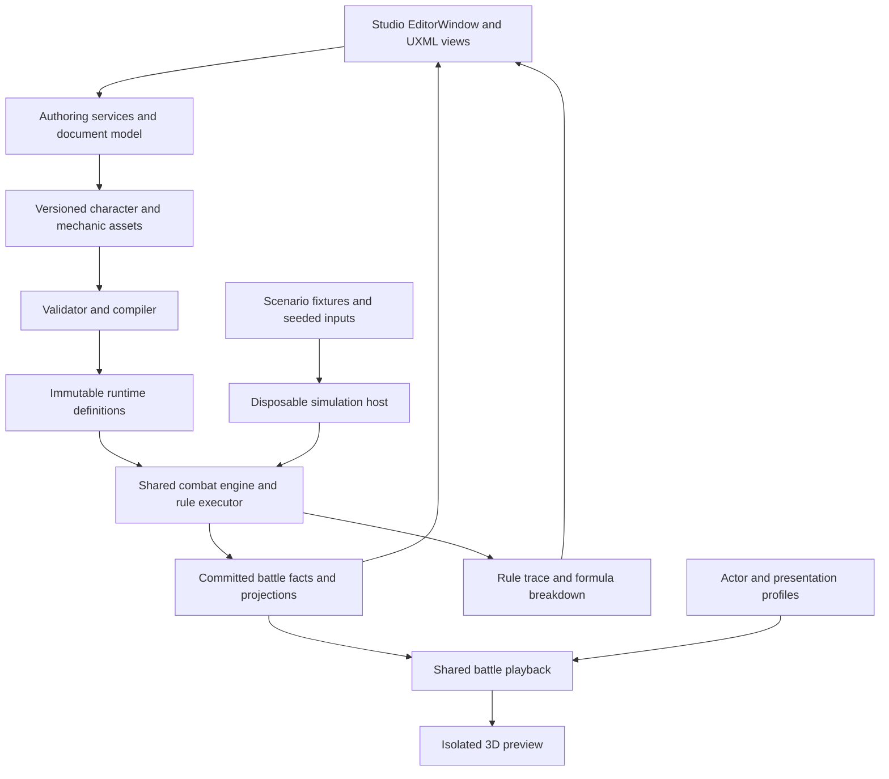

# Character Creator Studio — architecture plan

Status: proposed design, not implemented. Companion documents: [UX plan](UXDesignPlan.md), [description authoring](DescriptionAuthoringPlan.md), [implementation roadmap](ImplementationRoadmap.md), and [Mian specification](MianKitSpecification.md).

## 1. Scope and assumptions

The author needs to express new kits, reuse mechanics, understand interactions, and verify battlefield presentation without maintaining character-specific runtime branches.

**Assumption:** “standalone UXML” means a dedicated tool inside Unity, independent of the Character Hub and battle scene. Impact: an EditorWindow can use asset pickers, Undo, preview scenes, and editor binding. If a separately distributed desktop application is intended, its host, asset access, and preview renderer need a different design. Validate this interpretation before implementation, while retaining the shared schema and combat core.

**Assumption:** the existing deterministic shared core remains authoritative. Impact: simulation, forecasting, AI evaluation, and gameplay must use the same compiled character definitions. If network authority is added, the authority host executes these same definitions; the Studio is never an authority client that can mutate a live match.

The initial scope includes identity, traits, stats, progression, skills and variants, passives, resources, statuses, targeting, battle scenarios, actor bindings, damage reactions, and presentation cues. Broad economy editing, world design, and a general purpose scripting language are outside this tool's first release.

## 2. Current system: evidence and consequences

Paths below refer to the inspected working tree. `Content/…` and `Combat/…` paths are relative to `Shared/FightingAllstar.Core/`; `Assets/…` paths are relative to the project root.

| Existing system | Evidence | Studio consequence |
| --- | --- | --- |
| Real passive rules already exist | `Shared/FightingAllstar.Core/Content/PassiveRules.cs:90` defines triggers, conditions, commands, else commands, and activation limits | Extend and unify this path; do not replace it with another unrelated interpreter |
| Genshin support uses specialized capability fields | `Content/CombatSupportDefinition.cs:9`; `Content/GenshinStarterRoster.cs:12,25,43,67,91`; `Combat/BattleEngine.CombatSupport.cs` | Translate these capabilities into generic modifiers and rules in stages; the limitation is fixed capability shape, not character-name switches |
| Skill sequences are deliberately one level deep | `Content/CombatContent.cs:295–317`, especially the comment at 300 | Current sequences cannot represent arbitrary nested branches and reusable subroutines |
| Nested conditions and status reactions do not persist through normal Unity field serialization | `Content/EffectRecipes.cs:322–323,377–378` marks their backing fields NonSerialized | A nested editor over these objects would appear to work and then lose data on reload; solve storage before UI |
| Several declared passive events have no corresponding runtime emission found | `Content/PassiveRules.cs:11–12`; emitted hooks in `Combat/BattleEngine.cs` and `Combat/CharacterPassiveRuntime.cs` | StatusRemoved, Healed, action completion, and similar hooks need authoritative integration; a presentation event with a matching name is insufficient |
| Several exposed controls have no runtime reads found | `Content/PassiveRules.cs:30,104,110–112`; `Combat/CharacterPassiveRuntime.cs:465` | MaximumActivations, cooldown, reaction-origin, and defeated-owner fields cannot count as implemented; only a narrow RootActionTarget receipt distinction is currently read |
| Resource and removal operations are incomplete | `Combat/CharacterPassiveRuntime.cs:474–490`; `Combat/BattleEngine.cs:1165–1168` | Counters lack atomic spending, removal lacks partial-stack transactions, and passive RemoveStatus conversion drops recipe-specific intent |
| Target scopes are a small enum | `Content/EffectRecipes.cs:81` | Add composable selection for tagged allies, random distinct targets, adjacency, and lowest mark count |
| Character assets expose two skill slots plus an ultimate | `Assets/Project/Runtime/Content/CharacterObject.cs:131–133` | Preserve the two-slot card interface while supporting definitions and conditional variants behind each slot |
| Existing catalog conversion is a useful seam | `Assets/Project/Runtime/Content/CharacterObjectCatalogBuilder.cs:31,67` | Add a versioned Studio compilation input here, with one authoritative source per character |
| Cloneable simulation state and sessions exist | `Combat/BattleModels.cs:134`; `Combat/IBattleSession.cs:9` | Reuse state, RNG, legal plans, and projections; add manual stepping because LocalBattleSession advances opponent turns automatically |
| Damage-family behavior has important built-in semantics | `Combat/DamageResolver.cs:74,124` | Current True adds 30%, whereas Mian describes 20%; Additional and DOT bypass cap. A label alone cannot express her policy |

The runtime also already supports useful pieces: status identity and stacking policies, explicit duration clocks, stat modifiers, effect conditions, gauge changes, damage families, elemental reactions, multi-hit damage, and ordered battle events. Their presence does not imply Mian is supported end to end.

## 3. Proposed dependency structure



Logical boundaries, which can initially share existing assemblies:

| Boundary | Owns | Must not own |
| --- | --- | --- |
| Shared content/rules | Typed definitions, validation, compilation contracts | Unity objects, scene references, Animator APIs |
| Shared combat | State, commands, lifecycle, deterministic resolution, trace | UI state, frame timing, clip availability |
| Unity content adapter | Asset references → core IDs and definitions | Alternate combat formulas |
| Unity presentation | Model binding, motion, VFX, audio, UI feedback | Authoritative HP, targeting RNG, resource spending |
| Studio editor | Editing, asset transactions, scenarios, preview lifecycle | Character-specific battle exceptions |

Do not add assembly/package dependencies just to mirror this diagram. Choose physical assembly boundaries after a small dependency audit.

## 4. Authoring model and persistence

The Studio document is the editable source; compiled definitions are generated output. Preserve stable content IDs independently from display names, file paths, node positions, and list order.

| Definition | Responsibility |
| --- | --- |
| Character | Identity, series, independent trait tags, base stats, progression, skill slots, mechanic references |
| Ability | Target contract, ordered action program, combat tags, costs, variants, rank/level parameter tables |
| Rule | Trigger, event filters, query bindings, condition root, action root, frequency, priority, source lifetime |
| Modifier | Continuous eligibility condition, target query, stat/policy contribution, stacking group |
| Resource | Owner scope, initial value, optional cap, visibility, spending rules, reset clock |
| Status | Identity scope, stack model, duration/expiry clock, polarity, removal protections, modifiers, local rules |
| Target query | Candidate relation, tags, state filters, ordering, tie break, sample count, exclusions |
| Mechanic module | Reusable parameterized rules/modifiers with declared inputs, outputs, and dependencies |
| Presentation | Actor profile reference, ability cues, hit/reaction mapping, animation and effect bindings |
| Scenario | Initial teams, state overrides, input script, seed/RNG state, assertions, definition hash |
| Description document | Structured authored prose, locale variants, term/style/snippet references, bound values, mechanic links, and review state |
| Wording libraries | Versioned keyword/glossary entries, phrase templates, formatting capability profiles, semantic colors/styles, and parameterized snippets |

Recommended persistence is a **flat node table with stable node IDs and explicit child/reference IDs**, inside versioned authoring ScriptableObjects. Typed payloads are serialized fields or subassets; there are no object back-reference cycles. The author sees a nested tree, but Unity saves bounded records. This avoids relying on the currently NonSerialized recursive properties. A future managed-reference approach is an alternative only after proving reload and migration behavior; it is not required for the design.

Each node opcode has a payload schema, compiler handler, field editor, sentence formatter, validator, and execution/trace contract. Register these through an explicit catalog. Do not create another universal field bag or store arbitrary executable C# in assets. Unsupported opcodes must fail compilation with a navigable diagnostic.

Use separate identities for definition, rule, node, status instance, resource owner, event, root action, and hit. Reusing a module creates an instance with parameter bindings; it does not silently copy a mutable global mechanic.

Canonical compilation orders IDs, parameters, and query definitions deterministically and preserves explicit execution order separately. Gameplay hashes exclude editor positions, expanded panes, comments, and trace metadata. Moving a block visually without changing its semantic order must not alter combat RNG or the compiled identity.

Description compilation resolves the same typed parameters but produces separate Toolkit/TMP/plain outputs and semantic/source maps. Add versioned GameplayHash, TextHash, PresentationHash, and aggregate BundleHash through an explicit migration from the current all-content hash. Wording-only changes alter text/bundle identity without changing gameplay identity; runs pin their matching definitions and description catalog. Never parse prose to infer combat behavior, and never rerun legacy regex rewriting over Studio-compiled descriptions. The full text contract is in [DescriptionAuthoringPlan.md](DescriptionAuthoringPlan.md).

Allow nested `All`, `Any`, `Not`, `If/Else`, ordered `Sequence`, deterministic `For each target`, and `Call module`. Forbid unrestricted loops and recursive module calls. Sharing one immutable definition is legal; recursive execution and cyclic ownership are not. Numeric execution/node limits are configurable safety limits to establish through stress tests, not character balance values.

## 5. Trigger → query → condition → action

An author-facing rule has the following explicit contract:

```text
WHEN       Damage resolved
OBSERVE    Actor: ally with Series KOF AND Trait Woman
SCOPE      Once per root action (or another explicitly selected scope)
IF         Actual health damage > 0 AND owner is an eligible provider
DO         Add resource Face Mask by 1, capped at 6
EXPLAIN    Actor, health damage, eligibility, old/new resource, limit key
```

The rule executor binds typed context, not ambiguous global “source” variables:

`Owner`, `EventActor`, `EventTarget`, `SelectedTarget`, `CurrentLoopTarget`, `StatusSource`, and named captured values. A node may only use values available at its trigger and enclosing scopes. The editor must reject “actual damage” before damage resolution or “removed layers” outside a removal context.

An event carries immutable before/after facts: root action and hit IDs, origin, ability tags, outcome, critical/block flags, calculated damage, shield damage, actual health damage, resource deltas, and relevant status instance IDs. Removal events additionally carry old layers, source identity, removal reason, and optional authored detonation context. Name the exact value being used; never offer an unqualified “damage” token.

Expressions use a small typed AST: integer/scalar, percent, stat reference, resource/layer count, arithmetic, clamp, comparison, and level parameter. Values display as percentages in the editor and compile to the core's integer/basis-point conventions. Define rounding and evaluation snapshot explicitly. No arbitrary code, dynamic evaluation, or locale-dependent numeric parsing.

**Continuous modifiers are separate.** A condition such as Mask Switch ≥ 5 contributes damage or gauge protection while true. Cleanse and rank upgrade run on a transition into that state, with a declared rearm policy. Recomputing stats must never trigger actions or consume RNG.

## 6. Authoritative timing and execution

Distinguish a proposed operation, an interception window, and a committed fact. `BeforeDamage` is an interception context; `DamageResolved` is an immutable observation. Studio edit commands, external turn-plan commands, and internal combat actions are separate concepts even if each is called a command in code.

Proposed damage/action lifecycle:

1. Validate the action, resolve its variant, pay authorized costs, and capture an action context.
2. Commit action start; resolve target queries at their authored timing and emit target-selection facts.
3. Run before-action rules and pre-damage modifiers; choose documented snapshot/live reads.
4. Resolve a hit's offensive formula, mitigation, caps, and shield routing.
5. If the proposed HP result is lethal, run **BeforeDefeat** interceptors while the target is still a valid participant. A successful interception replaces the proposed HP outcome; the lethal packet is not applied again after recovery.
6. Commit health/shield and any successful interception outcome. Emit hit, critical, cap, and damage facts.
7. Resolve ordered post-hit reactions and follow-ups. Finalize defeat only when no valid interception preserves the fighter.
8. Complete remaining hits according to retarget/cancel policy, then emit ability outcome and action-completed facts. Drain post-action rules at this checkpoint. Reflection, retaliation, counters, and lifesteal use named checkpoints with an explicit precedence table, covered by legacy parity scenarios; do not leave their relative position implicit or change it during UI work.

An interceptor cannot be simulated by waiting for FighterDefeated and trying to heal a dead target. Mian's fatal save requires atomic Spend(3 Mask Switch) → prevent defeat → cleanse → restore HP → apply modifiers. If spending fails, the interception does not partially execute. Define recovery-block interactions explicitly.

Dispatch ordering is stable: phase, declared priority, owner battle order, rule ID, then deterministic target/hit order. Priority is a conflict tool, not a substitute for phases. Record it in traces. Queue resulting events instead of recursively invoking arbitrary listeners. Reevaluate condition-dependent eligibility at documented checkpoints.

Every rule declares a frequency key: per event, per hit, per root action, per root action/target, per owner turn, or per battle. Explicit origin policies distinguish primary card damage, splash, DOT, reflection, counters, and triggered effects. Root/parent IDs and a recursion guard prevent splash from feeding itself indefinitely. Enforce budgets across the entire root resolution, not a fresh budget for every nested dispatch. On budget failure, reject the uncommitted command resolution in both production and simulation, preserve the last valid battle state, and retain the causal trace; never publish a partially resolved action or silently truncate gameplay.

Atomic groups are narrow, such as resource payment plus protection. An entire long skill should not be blindly rolled back after it has committed damage. Per-operation outputs record Applied, Blocked, NoTarget, InsufficientResource, or Invalid, and branches may inspect documented outcomes. Success/failure of the ability must have its own explicit definition.

## 7. Statuses, resources, auras, and memory

Mian's Face Mask and Mask Switch should be resource definitions with optional status-style display. Facial Impressions is an enemy status instance with layers. Do not force all three to use the same stack container.

Author all stack semantics: cap, merge key, per-source/shared identity, refresh/independent durations, partial consumption, cleanse eligibility, protected/gray removal behavior, death cleanup, and source death/reserve behavior. Color is presentation, not removal permission. “Permanent” means an explicit lifetime such as battle lifetime, not campaign persistence.

Removal is an operation with a reason (`Cleanse`, `Absorb`, `Detonate`, `Expire`, `Replace`, `DeathCleanup`, or authored reason). Capture old values, remove the exact instance/layers once, commit one fact per affected instance/removal operation, and run matching removal reactions once for that fact. Include removedLayers and remainingLayers; author whether partial consumption qualifies for a removal burst. Ultimate-enhanced detonation uses operation context and a formula override; it must not temporarily mutate a shared status recipe.

Aura contributions are derived from authoritative state and removed when eligibility ends. Threshold entry/exit is tracked as state transition, with persistence in snapshots. A “no card used during the previous own turn” condition uses a turn-scoped ledger populated by committed card-use facts, not a visual flag or inference from the current hand.

## 8. Damage and targeting policies

Keep attack classification orthogonal: ability slot, ultimate flag, single/area attack shape, damage family, DOT origin, element, reflection behavior, and cap policy. A single-target skill with splash still needs to qualify as a single-target skill for the relevant rules.

Damage policy profiles expose supported engine stages: crit chance adjustment (multiply versus percentage points), reflect check/immunity, defense/shield/reduction bypass, outgoing bonus, family-specific mitigation, cap application scope, and fatal-protection bypass. Authors select a validated profile and contextual modifiers; they do not reorder the engine arbitrarily.

Mian's true detonation needs a profile reflecting the supplied +20% and bypasses. Preserve the legacy True profile's +30% for existing content until a deliberate migration. Her 49% incoming cap must specify whether it applies per hit or root action, to HP or pre-shield damage, and to which families. Current family-wide Additional/DOT cap bypass must be surfaced as a conflict rather than inherited silently.

Queries compose candidate sets, `All/Any/Not` tags, living/reserve filters, exclusions, sort keys, and sample rules. Define adjacency through battlefield slot topology, not model world distance. Ties use stable battle order or recorded seeded selection. Random distinct targets exclude the primary unless explicitly requested, and empty-set behavior is authored.

Gauge transfer is an atomic drain-and-credit operation with actual delta output. “Absorb 5” must not create 5 points when the target had 1 unless the author deliberately selects a fixed award operation. Overflow and protection are explicit.

## 9. Simulator and actor presentation

The simulator uses compiled draft definitions and the actual BattleEngine, with isolated state and no progression rewards. Provide a manually controlled simulation session; unchanged LocalBattleSession is unsuitable for manual per-command control of either side because it automatically advances enemy turns. Its recorded events can still be inspected individually.

Use two execution views of the same engine: fast headless scenario runs and 3D event playback. “Step rule” is initially a trace cursor over a resolved transaction, not a promise that the existing synchronous resolver can pause safely between mutations. Live breakpoints require a later resumable execution design. Rewind restores a snapshot and replays inputs/RNG; it does not reverse scene animations to reconstruct combat state.

Capture scenario seed, current RNG state/draw position, rules/content hash, engine version, initial state, and input script. A scrubbed frame shows the projection for that event, not the final battle snapshot. Edits invalidate the old run and produce a fresh draft compilation. Keep frozen run results available for comparison.

Presentation consumes semantic cues from committed events: action start, hit result, shield hit/break, dodge, block, heal, status applied/removed, cap reached, fatal save, defeat. Animation/VFX callbacks may release a presentation barrier or place a visual impact; they cannot decide combat damage or reroll a target.

An ActorProfile defines prefab/model fallback, visual yaw/scale, rig/Animator bindings, anchors, clips, sockets, movement/root-motion policy, and reaction mappings. An AbilityPresentationProfile binds phases and stable contact-definition IDs/hit ordinals to motion, VFX, audio, floating text, camera and return-to-rest cues. Per-execution hit/event IDs correlate those bindings during playback and tracing. Missing cues fall back deterministically and report a diagnostic. A reaction arbiter resolves overlapping flinch, stun, death, and defeat-prevented presentation; death overrides flinch only after a committed defeat.

Existing reusable presentation pieces are BattleFighterView, CoreFighterTarget, ActorCardPresentation, BattleStagePresenter, and the playback reducer; no dedicated BattlefieldActor or general TargetSimulation class was found. Extract a small playback driver instead of instantiating the full scene controller. ActorVisualEffectPreview already demonstrates an isolated preview fixture, but its reflection into private stage fields should be replaced with injected camera, anchors, audio, FX, and stage context. Named GameObject.Find anchors must not leak into the preview dependency contract.

Preview objects live in an isolated editor preview scene, with explicit cleanup on document close, reload, cancellation, and window disposal. Use a rendered texture in the UXML viewport. Production controller setup must not be invoked if it changes the open scene or initializes gameplay services.

Scenario formations initially follow the game's existing active-slot and reserve rules. The current presenter uses three active slot anchors; a larger formation is an engine/presentation capability change, not a viewport-only option. Likewise, respect the current logical hit-count limit until the core, forecasts, playback, and validators are deliberately expanded together.

## 10. Reliability and source ownership

Save Draft persists authored data, including incomplete work. Validate reports structural, semantic, compatibility, and presentation issues. Apply to Game compiles a complete bundle, checks all dependencies, presents the exact changed assets/IDs, and activates the bundle as one logical transaction. Failed application preserves the last working bundle and reports recovery details; AssetDatabase writes alone are not an atomic database transaction.

One source of truth per character is mandatory. In Studio mode, legacy CharacterObject/card/passive data are generated compatibility output. In legacy mode, they remain the source and Studio offers an import preview. Never silently round-trip both ways. Existing asset generators must detect Studio ownership before overwriting content.

Validation includes dangling IDs, duplicate IDs, call cycles, incompatible trigger/value scopes, unsupported events/operations, invalid units, conflicting variants, unbounded feedback, source lifetime, level coverage, required cues, and production/preview capability differences. Diagnostics map compiler node IDs back to editable nodes. Changing a shared module shows all affected characters and reruns their saved scenarios.

Domain reload, close/reopen, clone, compile, export/import, and save/reimport must preserve nested nodes and IDs. A versioned migration preserves old data and emits a reviewable diff. Undo restores the document and rebuilds derived views; preview state and pane selection are not serialized into gameplay definitions.

## 11. Delivery sequence and acceptance gates

The [implementation roadmap](ImplementationRoadmap.md) is the current ordering reference. It brings description authoring and minimal actor playback into the first complete slice; full workspaces then develop in parallel after their shared contracts stabilize.

| Milestone | Work | Gate before proceeding |
| --- | --- | --- |
| M0–M1 Foundation | Capability/renderer audit, schemas, flat persistence, compiler, text references, node IDs, Undo and minimal UXML shell | Rules and descriptions round-trip; compilation and diagnostics are reproducible |
| M2 First complete slice | One Genshin passive, bound description/keyword/snippet, actual text previews, scenario trace and basic actor playback | Legacy parity; designer can change, save/reopen, describe and explain the mechanic without C# |
| M3–M6 Parallel workspaces | Complete rules/lifecycle, Description Studio, battlefield debugger and actor presentation lab | Mechanics pass independently; required text renderers verified; playback projection matches the core |
| M7 Mian and migration | Full Mian kit/text and all five existing Genshin kits | No identity-keyed character branch; full scenarios and roster regressions pass |
| M8 Production readiness | Activation/recovery, source ownership, library impact, author trials, performance and cleanup | Reproducible release evidence; previous good bundle is recoverable; designers complete representative tasks |

Use the smallest vertical slice before building the entire catalog UI. Existing neutral/elemental/character-specific tests become regression inputs. Add semantic tests for new runtime behavior and persistence tests for the compiler; avoid tests that merely mirror UI field layout.

Design playtests: a new author builds a simple triggered heal without C#; an experienced author reproduces layered absorption and explains each layer reward; an observer identifies the reason a rule skipped from its trace. Stress scenarios cover multi-hit AOE, multiple providers, death during follow-ups, source removal, repeated threshold crossing, empty random target sets, and reaction loops. Tune wording, event granularity, and defaults before visual polish or balance changes.

## 12. Unity feasibility references

The proposed host follows Unity's documented [EditorWindow/UI Toolkit workflow](https://docs.unity3d.com/6000.3/Documentation/Manual/UIE-HowTo-CreateEditorWindow.html), with UXML loading and registration in CreateGUI. Authoring fields can use [SerializedObject binding](https://docs.unity3d.com/6000.3/Documentation/Manual/UIE-Binding.html). Isolated model inspection can use [editor preview scenes](https://docs.unity3d.com/6000.3/Documentation/ScriptReference/SceneManagement.EditorSceneManager.NewPreviewScene.html), which require explicit closure. Exact preview rendering and animation APIs should be verified against 6000.3.4f1 during the first vertical slice.
