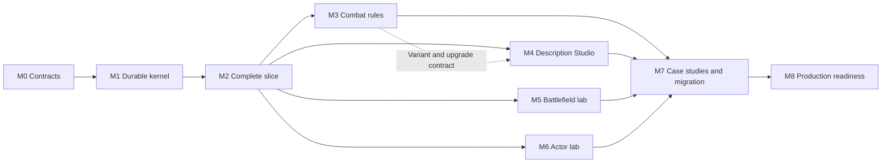

# Character Creator Studio — implementation roadmap

20 October 2026 · M0–M5 delivered for their bounded scope; M6 paused/incomplete; M7–M8 remain planned. Full character creation is not release-ready; see the [production creation audit](ProductionReadinessAudit.md) for the missing source-asset workflow and required closure order.

The subsequent [native bridge fix](BridgeImplementationReport.md) delivers generic import, canonical SO persistence, reviewed five-asset publication, normal runtime loading, full validation, selected wording installation and local rollback. Next closure work is blank creation and complete canonical base-kit authoring, followed by dynamic description routing and durable release recovery. M6 remains paused.

The following [native kit authoring change](NativeKitAuthoringReport.md) replaces required draft assets with direct native editing, adds the missing kit navigator and base skill/ultimate/passive/stat pages, and verifies Joe96 through that workflow. The remaining creation work is blank initialization/component creation, art replacement, complex-editor refinement, dynamic wording routing and durable rollout recovery.

See the [M0–M2 implementation report](ImplementationReport.md) for the delivered subset, verification evidence and remaining boundaries. The milestone definitions below remain the acceptance and ordering reference for subsequent work.

The [M3 implementation report](M3ImplementationReport.md) records the reusable rule runtime and authoring expansion. Mian is a reference case study; no playable Mian kit or roster entry is required by this Editor roadmap.

The [M3 A–F audit](M3Audit.md) identifies the original validation and designer-facing gaps. The subsequent [closure report](M3ClosureReport.md) records their fixes, the revised rule workspace and UI-driven acceptance evidence. The broader product boundaries remain explicit.

This roadmap is the implementation ordering reference for the [architecture](ArchitecturePlan.md), [UX](UXDesignPlan.md), and [description-authoring](DescriptionAuthoringPlan.md) plans. It replaces the earlier coarse delivery sequence. Milestones are acceptance gates, not fixed calendar estimates. Staffing and integration cost are not established; estimate delivery dates after the first complete slice, using measured work and remaining capability gaps.

## 1. Outcome and first release

A designer can create a character, author nested mechanics, write its description with supported rich text and shared vocabulary, preview relevant ranks/levels/variants, run a reproducible battlefield scenario, explain each trigger, and inspect the resulting 3D presentation. The same compiled gameplay runs in Studio and the game.

The first release uses representative case-study mechanics as synthetic acceptance fixtures and migrates the five existing Genshin kits. It includes an editable keyword database, semantic colors, supported-tag reference, linked/versioned snippets, bound description values, Thai/English authoring structure, and real preview adapters for required game surfaces. It does not depend on inventing a general purpose script language or a full document-processing/WYSIWYG engine.

The first useful delivery is smaller: **one mechanic, one parameter-bound description, one explainable simulation, and one visible actor result, all surviving save/reload**. This is the integration proof for the rest of the roadmap.

## 2. Delivery map

| Milestone | Result visible to the designer | Depends on | Completion evidence |
| --- | --- | --- | --- |
| M0 Contract baseline | A capability inventory and agreed document/runtime/text boundaries | Existing source audit | Supported, missing, and proposed features identified; baseline fixtures captured |
| M1 Durable Studio kernel | Independent UXML shell; reliable draft save, Undo, references, and diagnostics | M0 | Rules and descriptions round-trip; stable compilation; recovery demonstrated |
| M2 First complete slice | One existing Genshin passive editable, described, simulated, traced, and presented | M1 | End-to-end author trial and legacy behavioral parity |
| M3 Reusable combat rules | Nested rules, resources, lifecycle events, selectors, thresholds, variants, and damage policies | M2 | Independent mechanics and ordering scenarios pass |
| M4 Description Studio | Writer, live target previews, keyword/tag/color/snippet library, bindings and localization workflow | Starts after M2; advanced variant/upgrade integration needs M3-F | Description acceptance suite and author trial pass |
| M5 Quick Battle Lab | Disposable Real Battle / Training Battle, actor/target setup, live inspector, feedback and seeded restart | M2; integrates M3 capabilities | Production-engine checks and actual 3D Play Mode acceptance pass; no scenario file required |
| M6 Actor/presentation lab | Model profiles, sockets, cue timeline, reactions, isolated 3D viewport | M2 cue contract; integrates M3/M5 | Playback projection matches core; preview cleanup and fallback tests pass |
| M7 Case-study acceptance and roster migration | Representative complex mechanics/text plus five migrated Genshin kits | M3, M4, M5, M6 | Synthetic scenario matrix and existing roster regression pass |
| M8 Production readiness | Safe activation, migration recovery, author usability, versioned bundles and performance | M7 | Rollout checklist satisfied with reproducible evidence |

M3–M6 are parallel workstreams after M2 stabilizes shared IDs, events, parameters, render contracts, and cue bindings. M5/M6 can build their UI with the proven M2 subset; support for advanced outcomes is complete only after integration with M3. Maintain one contract owner and small integration increments to avoid independently changing shared schemas.

## 3. M0 — contract baseline

Work packages:

- **M0-A Runtime capability matrix:** identify which events, conditions, actions, limits, damage policies, selectors, and lifetime options actually execute. Declared-but-unused fields remain unavailable in Studio.
- **M0-B Text/render audit:** inventory description fields and consumers; UI Toolkit versus TMP; font/text settings; tag pass-through/stripping; glossary, formatting, and status badge paths. Record engine-documented, project-verified, and Studio-enabled support separately.
- **M0-C Schema contracts:** stable IDs, versioning, flat node storage, typed parameter units, dependency references, source ownership, immutable event context, description structure, term/tag/style/snippet schemas.
- **M0-D Baseline fixtures:** save representative existing character definitions, input/RNG fixtures, events/results, description source/output, and screenshots from required consumers. Preserve existing local edits; baseline the actual intended revision before behavioral comparisons.
- **M0-E Semantic decisions:** record Mian's unresolved timing/ownership/duration choices. They need not delay a simple first slice, but must be resolved before approving the affected Mian mechanics.

Exit gate: every planned picker option has an explicit implementation status; the required description surfaces and smallest portable formatting set are named; the first passive and its parity fixture are selected. Choose the slice after the audit—do not assume one support field can already be expressed through current generic actions.

## 4. M1 — durable authoring kernel

Build the EditorWindow/root UXML, document selection, outline, context inspector, and Problems dock. Keep views separate from edit/application services. Add document IDs, schema versions, flat rule-node tables, typed references, dependency indexing, clone/remap, explicit save, grouped Undo/Redo, and recovery after assembly reload.

Introduce description contracts now: paragraph/section identity, text spans, term references, value bindings, semantic style references, locale variants, snippet instances, and plain source preservation. The source editor and structured controls must edit one canonical description representation through a lossless parser/serializer for its supported syntax. Invalid drafts remain saveable; valid compilation is required for activation.

Include a minimal tested All/Any/Not condition subset and the operations needed for M2. M3 expands this proven subset into the complete rule language; it is not the first appearance of nested conditions.

Implement minimal compilers and diagnostics with source spans/node IDs. Separate proposed gameplay/text/presentation hashes and retain an aggregate versioned bundle identity. The current catalog hash covers the whole serialized catalog, so adopt this separation through an explicit compatibility migration and consumer audit.

Exit gate:

- Nested rules, text with Thai combining characters, parameter references, and snippet instances survive save/reimport/reopen/domain reload.
- Undo/Redo restores references and ordering; duplication remaps local IDs without breaking external library references.
- Compile order is deterministic; editor-only changes do not affect semantic output.
- A broken reference or malformed text can be located and repaired without losing the original draft.
- Schema migration failure preserves the source and last working compiled bundle.

## 5. M2 — first complete usable slice

Select one existing Genshin passive, import its legacy definition into a draft, and express it using generic rule/modifier primitives. If that needs a new primitive, implement the primitive in the shared engine and register its capability and text contract; do not special-case the character.

The slice includes:

1. Edit a nested eligibility condition and a real mechanic parameter.
2. Write a player description using that bound parameter, one keyword entry, one reusable snippet, and approved color/emphasis.
3. Show literal source and live UI Toolkit preview; render the same document through a real TMP game preview where required.
4. Save/reopen, compile, run a fixed scenario through BattleEngine, and inspect fired/skipped rule explanations.
5. Play one existing actor action/reaction using committed battle events in a disposable preview fixture.
6. Inspect a concrete activation diff on test content, preserving the ability to return to its prior source mode.

Exit gate: a designer changes the mechanic and description without C#, sees matching values in both render targets, reproduces the scenario after reopening, and explains its result from the trace. Legacy/new behavior matches the selected baseline. Text edits do not change gameplay results or consume RNG. Basic preview cleanup and missing-clip behavior pass.

Do not expand the node/keyword catalog until this gate passes. This milestone is the first point to measure integration cost and create a calendar estimate for the remaining work.

## 6. M3 — reusable combat rules

Implement these groups incrementally, each with capability registration, editor fields, text bindings/summary support, trace output, and semantic regression fixtures:

| Package | Capabilities | Acceptance mechanic |
| --- | --- | --- |
| M3-A Composition | Expand the M1/M2 condition subset with full sequences/branches, bounded target loops, typed context/bindings, reusable modules | Nested team filter and ordered cleanse/heal |
| M3-B Execution controls | Complete event emission, stable phase/priority order, activation receipts, cooldowns, origin policies, root-wide budget | Multi-hit/AOE proc scope and feedback-chain termination |
| M3-C Resources/status lifecycle | Atomic spend/transfer, partial-layer consumption, removal snapshots/reasons, ownership, lifetime | Face Mask protection and Impression removal burst |
| M3-D Queries/history/transitions | Filter/sort/sample/exclude/reuse target sets, slot adjacency, turn ledger, threshold entry/exit | Random-other splash, lowest-layer overflow, Mask Switch transition |
| M3-E Interception/policies | BeforeDefeat, cap policy/interception, gauge guard, explicit true profile and bypass precedence | Fatal save and incoming cap scenarios |
| M3-F Ability variants/upgrades | EX availability/relock/card handling, independent rank/level axes, parameter overrides | Skill 1 Base/EX selection and maximum-level branches |

Ordering: establish execution context and origin/frequency control before enabling rich chains; resources and removal facts before layer rewards; history/transition tracking before threshold effects; variants after parameter and card-identity contracts are stable. Define relative ordering of reflect, retaliation, lifesteal, and post-action rules with parity fixtures.

Exit gate: Face protection, absorption, threshold entry, and fatal save pass independently with readable traces. No exposed field counts as supported until its end-to-end contract is tested. A failed root resolution never activates partial authoritative results.

## 7. M4 — Description Studio and wording database

Implemented as a first-class workspace extending the M2 subset. See the [M4 implementation and verification report](M4ImplementationReport.md) for delivered behavior, native authoring evidence and per-font locale limits. The [Description Authoring Plan](DescriptionAuthoringPlan.md) retains the longer-term vocabulary and adapter design.

| Package | Designer capability | Gate |
| --- | --- | --- |
| M4-A Writer | Structured paragraphs/sections, source editor, insertion toolbar, selection formatting, Undo and source diagnostics | Edits preserve Thai/English prose, token identity, and supported nested formatting |
| M4-B Renderer profiles | Actual Toolkit and TMP previews, compact/expanded surfaces, width/font/rank/variant/locale selection, plain output | Output is verified in each required consumer; unsupported features are visible |
| M4-C Vocabulary | Editable keyword database with IDs, localized labels, aliases, tooltip docs, gameplay links, categories and consumers | Rename preserves identity; ambiguous aliases and dangling links are caught |
| M4-D Formatting reference | Searchable tag catalog with syntax, example, support state, asset prerequisites and insert/wrap actions; semantic color/style palette | An author can discover and insert approved formatting without memorizing markup |
| M4-E Snippets | Typed placeholders, versioned linked instances, explicit detach/copy, update diff, usage search | No silent propagation or unbound snippet variables; call cycles rejected |
| M4-F Description integrity | Bound values and units, level/variant text branches, localized reorderable sentences, rule coverage links and review state | Parameter changes update rendered values; free prose remains explicitly reviewable |

Exit gate: a designer writes Mian's resource and layered-mark descriptions, reuses a protection snippet, previews Base/EX and level variants, opens referenced keywords, and repairs a deliberately broken tag/binding. Advanced configuration preview completes after M3-F integration; earlier M4 work uses the M2 configuration subset. Numeric bindings match the selected compiled configuration. All required locale/surface combinations are verified; missing translation fallback is visible.

Full in-place rich editing is not a dependency: Unity TextField does not render rich tags. The initial writer uses source/plain editing with approved insertion tools and separate render previews. A later custom styled editor is justified only after reliable source/selection/IME round-tripping is demonstrated.

## 8. M5 — Quick 3D Battle Lab (revised scope)

Implemented per the user's simplified request: a disposable 3D runtime session with **Real Battle** and **Training Battle**, without a required scenario-save or file workflow. See the [M5 implementation report](M5ImplementationReport.md) for usage, contracts and native verification.

Select actors/targets and optional starting state in the Studio. Real Battle retains the production engine's HP, deck, resources, RNG, enemy AI and status/DOT clocks. Training uses the existing 1v1 no-defeat practice deck with an idle target. Both reuse actual runtime actor creation, animation/contact playback, FCT, VFX/SFX fallbacks and character inspection. Model/rig prefab overrides are local to the lab.

The live inspector exposes authoritative and presented state, contact indices/origins, passive decisions and RNG draw counts. Restart freezes/reuses the setup and seed; stop restores the previous editor scene and clears the volatile handoff. Account/run persistence is bypassed. General saved scenarios, file replay, formula debugging and rewind are deferred from this revised milestone.

Exit gate: real Play Mode authoring trial verifies both modes, AI, DOT, logical contacts, presentation feedback, inspector access, deterministic restart and source/scene/account isolation. Headless tests retain M0–M4 behavior and exercise the new setup/session contracts. Mian remains a case study.

## 9. M6 — actor, damage animation, and presentation

The [M6 implementation report](M6ImplementationReport.md) records partial profile/playback work and scoped checks. Work was interrupted and then stopped at the user's request; M6 is not closed. The production creation audit takes priority over further presentation expansion.

Extract a small battle playback driver from the existing scene controller. Inject camera, formation anchors, actor registry, VFX, and audio rather than depending on a named game scene or reflection into private fields. Reuse existing actor creation and motion support.

Implement ActorProfile editing for model/prefab, rig/Animator mappings, orientation/scale, sockets, bounds, movement/root motion, and reaction capabilities. Ability profiles bind stable logical contact IDs to authored/procedural animation, cosmetic impact cues, target reactions, FX/audio, camera, and recovery. Provide an isolated timeline and viewport with deterministic fallback and cancellation/cleanup.

Exit gate: animation edits cannot alter hit count, target selection, damage, resource use, or passive frequency. Headless and visual playback agree; the final presentation projection matches the engine snapshot. Missing clips/markers, simultaneous reactions, fatal saves, viewport disposal, and domain reload do not hang or leak preview resources.

## 10. M7 — complex case-study acceptance and roster migration

Exercise representative modules in synthetic authoring fixtures: team synergy and resource generation; protection and marks; layered consumption; threshold/history transitions; crit growth/recovery; lethal interception; skill variants; overflow and enhanced detonation. The supplied [Mian kit](MianKitSpecification.md) provides examples and unresolved semantic questions. These fixtures validate the Editor and shared capabilities without installing Mian as a game character.

Author structured player descriptions and glossary entries alongside each module. Preserve source Thai text and designer notes. Trace sentence/parameter links into relevant mechanics; do not treat automatic linting as proof that arbitrary free prose fully describes the kit.

Import the remaining Genshin characters, convert specialized support features to shared primitives, migrate description sources, and retain compare/revert data. Produce verified staged bundles and ownership-mode diffs; production activation waits for M8's recovery/activation gate. A character has one active source mode. Update existing generators to respect Studio ownership before any production switch.

Exit gate: the selected complex-mechanic scenario matrix passes without character-ID runtime branches; level/variant descriptions show correct bound values and approved wording; all five migrated Genshin kits pass their frozen regression fixtures. Applied-status badges derive from compiled mechanics/status application references; glossary entries derive from explicit term references and intentional mechanic-backed supplements. Mere word matches grant neither gameplay effects nor applied-status badges.

## 11. M8 — production readiness and rollout

Complete bundle staging/activation/recovery, runtime compatibility diagnostics, migration backups, shared-module/term/snippet impact analysis, revision pinning, source conflict handling, cached compilation, and preview lifecycle cleanup. Avoid relying on AssetDatabase writes as an atomic transaction.

Conduct author trials with simple and complex kits, including an author unfamiliar with the implementation. Validate dense Thai text, long tooltips, missing glyphs, keyboard/IME editing, nested formatting, missing references, adverse battle chains, and repeated open/close/reload. Measure actual document size, compile time, rerun latency, allocation, and trace volume before establishing performance targets.

Release gate: no unresolved blocking capability, persistence, activation, locale, or required-renderer issue; required regression evidence is attached to the exact bundle; designers can complete representative tasks and explain a failed trigger unaided. Only after activation/recovery verification should the staged M7 migration change production source ownership. Runtime/CI/dependency changes and production publishing follow the project's applicable approval rules when those actions are actually proposed.

## 12. Cross-cutting ownership and tracking

| Stream | Owns | Integration contract |
| --- | --- | --- |
| Authoring foundation | Documents, stable IDs, editing services, compile/apply, Undo, dependency index | All feature editors use the same transaction and diagnostic model |
| Rules/runtime | Events, conditions, operations, ordering, policies, trace | Capability registry and immutable gameplay definition contract |
| Description/content | Text AST, keyword/tag/style/snippet database, locales, renderer adapters | Shared parameter IDs and semantic references; no gameplay interpretation of prose |
| Simulation | Fixtures, control policies, assertions, replay/state inspection | Production engine and version-pinned snapshots |
| Presentation | Actor/ability profiles, cues, reactions, viewport lifecycle | Committed facts → visual cues, independent from combat authority |

Track each work package as Proposed → Contracted → Implemented → Verified → Integrated. Store its dependencies, schema/capability IDs, acceptance fixtures, required render targets/locales, migration impact, and evidence. A merged implementation is not automatically an integrated designer capability.

## 13. Immediate implementation backlog

M0–M5, including the [M3 audit closure](M3ClosureReport.md), [M4 Description Studio](M4ImplementationReport.md) and revised [M5 Quick Battle Lab](M5ImplementationReport.md), have bounded delivery evidence. M6 remains partial. The [production creation audit](ProductionReadinessAudit.md) identifies the prerequisite full-creator closure; preserve existing evidence while addressing those gaps before resuming presentation expansion.

1. **M4 — delivered wording workflow.** Preserve its authoring and renderer evidence. Runtime font/profile release limits and later registered tag/asset adapters remain explicit; production rollout belongs to M8.
2. **M5 — Quick Battle Lab delivered.** Preserve its native Real Battle / Training Battle and nonmutation evidence. Saved scenarios, rewind and a formula debugger are deferred under the revised request.
3. **M6 — paused/incomplete.** Preserve partial work and scoped evidence, including the known clip-event editing error. Resume only after the actual creation/persistence/runtime loop is closed; scoped playback checks do not establish production readiness.
4. **M7–M8 — acceptance, migration and rollout.** Use synthetic complex-mechanic fixtures and designer trials to validate the completed workflow, then stage the remaining roster/description migrations with compare/revert data. Complete versioned activation, recovery, dependency impact and compatibility gates before any production source switch. Mian remains a case study; these steps do not require adding her as a playable character.

