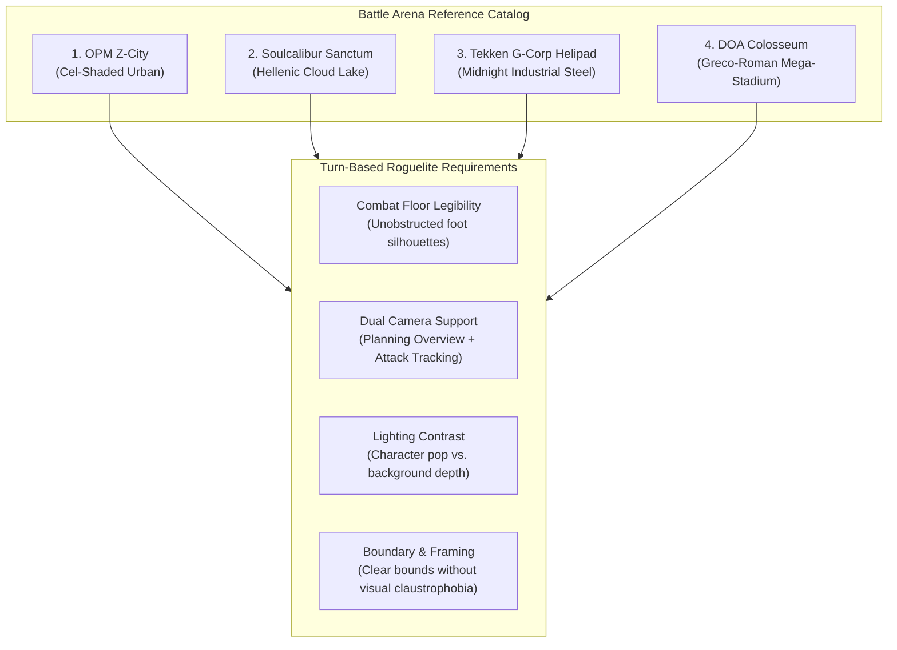
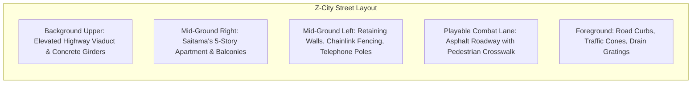
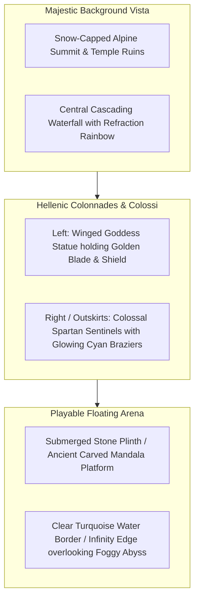
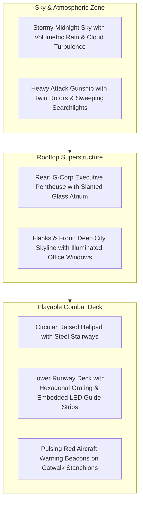
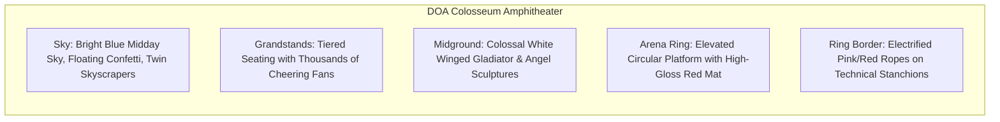

# Battle Arena Art Direction & Level Design Reference Document

**Document Version:** 1.0.0  
**Project:** Roguelite Turn-Based RPG  
**Target Engine:** Unity (URP / Linear Color Space)  
**Target Platform:** Windows PC  
**Authoring Context:** Stage Concept & Level Design Production Standards  

---

## 1. Executive Summary & Design Overview

This reference manual documents the Art Direction, Architectural Styling, Lighting Schemes, and Level Design specifications for four distinctive battle arena archetypes inspired by competitive fighting and action game classics:

1. **One-Punch Man (OPM): Z-City Saitama Apartment** — *Stylized / Cel-Shaded Urban District under Overpass*
2. **Soulcalibur: Ethereal Sanctum** — *Hybrid of Floating Lake Plinth & Shrine of Eurydice (Cloud Sanctuary / Foggy Abyss)*
3. **Tekken: G Corp Helipad (Midnight Rain)** — *Industrial Steel Rooftop, Wet Specular Brutalism, Red Hazard Lights*
4. **Dead or Alive (DOA): Tournament Colosseum** — *Greco-Roman Modern Stadium, Electrified Ring, High-Spectacle Crowd*

Each arena is analyzed through the lens of a **turn-based tactical combat system** (e.g., 3-character allied row vs. enemy row, dynamic attack cameras, turn planning overviews, and crystal-clear combatant grounding).

---

## 2. Comparative Specification Matrix

| Parameter | OPM: Saitama Apartment | Soulcalibur: Ethereal Sanctum | Tekken: G Corp Helipad | DOA: Tournament Colosseum |
| :--- | :--- | :--- | :--- | :--- |
| **Aesthetic Theme** | Mundane anime urban dystopia | Neoclassical Hellenic myth & floating lake | Cyberpunk corporate industrialism | High-spectacle sports entertainment |
| **Rendering Style** | Toon / Cel-shaded (Anime NPR) | Semi-realistic PBR / Fantasy High-End | Gritty Hard-Surface PBR | High-Gloss Clean PBR / Arcade Polish |
| **Color Palette** | Beige, asphalt grey, muted teal, safety orange | White marble, turquoise water, alpine snow, gold | Gunmetal slate, midnight navy, emergency red, neon cyan | Terracotta red, chalk white, azure blue, gold brass |
| **Lighting Environment** | Flat midday/overcast anime skylight | Warm high-altitude alpine sun + cool mist | Stormy midnight downpour + localized searchlights | Blazing midday sun + stadium floodlight beams |
| **Floor Material** | Clean asphalt road with painted road markings | Carved stone mandala / white flagstone mosaic | Wet anti-slip steel plating & hexagonal mesh grating | High-gloss red composite combat canvas |
| **Boundary Design** | Guard rails, road cones, overpass pillars | Open water current edges / sheer cloud drop | Steel pipe catwalk railings & perimeter drops | Electrified glowing ring ropes on tech stanchions |
| **Dynamic VFX** | Drifting dust motes, windblown paper, exhaust | Cascading water foam, cloud sea drift, blue flame | Torrential rain, surface splashes, searchlight sweep | Confetti flutter, stadium strobe flashes, lens flares |

---

## 3. Detailed Arena Specifications

---

### Stage 1: One-Punch Man (OPM) — Z-City Saitama Apartment

> **Theme:** Abandoned residential street directly underneath a massive concrete highway viaduct in the Ghost Town district of City Z.
> **Key Art References:** Located in [`ArtDirection/Level Design/OPM-Saitama-Z-City/`](./OPM-Saitama-Z-City/)

#### 3.1.1 Visual Language & Art Direction
* **Shading Model:** Non-Photorealistic Rendering (NPR) / Anime Cel-Shading.
  * 2-tone stepped light-and-shadow ramp (Cel ramp step threshold ~0.45, smoothness ~0.02).
  * Inverted-hull mesh outline extrusion or post-process edge-detection shader with uniform dark ink lines.
  * Minimalist surface noise; texture details focus on clean hand-drawn panel lines, concrete seam joints, and subtle weathering.
* **Palette & Tone:**
  * Sun-bleached beige/tan tile facade of the apartment complex.
  * Cool-neutral dark grey asphalt.
  * Muted teal/sage green underside of the highway viaduct steel box girders.
  * Accents of high-visibility safety orange/white (traffic cones, parking barriers, Japanese traffic signs).
* **Atmospheric Mood:**
  * Quiet, eerie abandonment. Despite being a modern metropolis, no cars or normal pedestrians exist (deserted monster territory).
  * Bright, clean daytime lighting juxtaposed with crumbling mundane infrastructure.

#### 3.1.2 Level Design & Spatial Anatomy
* **Playable Floor Zone:**
  * Dimensions: ~18m wide × 8m deep combat corridor across the two-lane street.
  * Zero clutter on the main combat runway: feet remain clearly visible against the dark tarmac surface and faded white road striping.
  * Ground slope: 0° flat horizontal plane to avoid character rigging or camera perspective distortion.
* **Staging & Framing (Turn-Based Camera):**
  * **Planning Camera:** Positioned slightly elevated (~12m back, ~8m up) looking down the street avenue. The left side is framed by the massive brutalist highway pier; the right side is framed by the apartment building's entryway and parking sign.
  * **Attack Camera:** Dynamic lateral cuts track combatants against the vertical rhythm of the apartment balconies and utility poles.
* **Key Environmental Props:**
  * *Saitama's Apartment Building:* 5–6 story modular concrete building with repeating exterior balconies, AC condenser units mounted on railings, side drain pipes, and aluminum sliding doors.
  * *Highway Viaduct:* Towering elevated roadway structure overhead on the left, casting a soft ambient occlusion shadow zone across the rear street.
  * *Street Furniture:* Automated coin parking meter box (yellow/green "Mitsui Repark" style), cylindrical concrete road barriers, orange traffic cones, overhead power lines crisscrossing against the blue sky.

#### 3.1.3 Reference Image Index
* [`Capture.JPG`](./OPM-Saitama-Z-City/Capture.JPG) — Mobile turn-based lane battle in Z-City showing Saitama charging forward; clear road floor, highway overpass on left, apartment backdrop on right, clean UI framing.
* [`images.png`](./OPM-Saitama-Z-City/images.png) — Real-world architectural reference photo of the iconic building facade (Setagaya, Tokyo); exterior tile grid, balcony rhythm, parking lot sign.
* [`images2.png`](./OPM-Saitama-Z-City/images2.png) — Full street perspective matching the anime layout: overpass viaduct flanking the left, roadway center, sidewalk and apartment on right.

---

### Stage 2: Soulcalibur — Ethereal Sanctum (Floating Lake & Eurydice Cloud Sanctuary)

> **Theme:** A monumental floating ancient plinth hovering upon an alpine lake at the edge of a colossal cloud abyss, framed by the Shrine of Eurydice's classical Hellenic colonnades, cascading waterfalls, and colossal guardian sentinels.
> **Key Art References:** Located in [`ArtDirection/Level Design/SoulCalibur-Shrine-of-eurydice/`](./SoulCalibur-Shrine-of-eurydice/)

#### 3.2.1 Visual Language & Art Direction
* **Shading Model:** High-End Stylized Fantasy PBR (Soulcalibur VI standard).
  * High-frequency marble displacement, micro-scratches, and gold inlay accents.
  * Subsurface scattering on marble statues and columns for a soft, lifelike stone glow.
  * Flowing directional water shaders with depth-tinted turquoise absorption, edge contact foam, and planar reflections of the sky and temple columns.
* **Palette & Tone:**
  * Luminous ivory and pristine white statuary marble.
  * Weathered mossy stone and terracotta accents on the submerged plinth foundation.
  * Deep turquoise to crystalline cyan water.
  * Ethereal golden hour or midday alpine sky (pale blues, creamy cumulus clouds, and warm sunlight).
  * High-contrast cyan/spectral blue flames held by the sentinel statues.
* **Atmospheric Mood:**
  * Divine tranquility, heroic mythos, and dizzying high-altitude scale. The sense that this sanctuary exists between earth and Mount Olympus.

#### 3.2.2 Level Design & Spatial Anatomy
* **Playable Floor Zone:**
  * A broad square or octagonal stone platform (approx. 16m × 16m) floating directly on the surface of the sacred mountain lake.
  * The center features an intricate geometric mandala or Hellenic meander relief that is low-profile and untextured with noisy clutter, ensuring character models stand out starkly.
  * *Infinity Edge Boundary:* Water laps gently at the edge of the carved stones. Beyond the perimeter, water plunges downward in stepped waterfalls into a bottomless foggy cloud canyon.
* **Staging & Framing (Turn-Based Camera):**
  * **Planning Camera (Back View):** Framed looking forward toward the grand temple facade and central tiered waterfall. The winged Goddess Eurydice statue crowns the midground staircase.
  * **Lateral Attack Cameras:** When swinging sideways, cameras frame against the vast, open mountain vista and the two colossal Spartan statues gazing into the infinite cloud sea.
* **Key Environmental Props & Architecture:**
  * *Central Goddess Statue (Eurydice/Nike):* Elegant winged female deity carved from translucent white marble, right hand holding a raised golden broadsword, left arm bearing a round aegis shield.
  * *Twin Spartan Sentinels:* Enormous statues seated or emerging from the abyss, holding tall upright bronze spears and bronze braziers lit with mystical perpetual blue flames.
  * *Cascading Water System:* Multi-tiered marble staircases with water flowing down every step, feeding into the lake reservoir from high alpine glacier melts.
  * *Perimeter Pillars:* Corinthian/Ionic marble columns draped in light mountain vines and ivy, some standing intact, others poetically broken.

#### 3.2.3 Reference Image Index
* [`sddefault.png`](./SoulCalibur-Shrine-of-eurydice/sddefault.png) — Floating stone raft/plinth submerged in rushing lake water with elephant plinth foundation, water ripples, distant mountain waterfalls.
* [`Soul_Calibur_VI_Screenshot_2023.10.12_-_20.23.36.90.png`](./SoulCalibur-Shrine-of-eurydice/Soul_Calibur_VI_Screenshot_2023.10.12_-_20.23.36.90.png) — Majestic temple backdrop: central winged goddess statue, stepped waterfall stairs, marble colonnade, snow-capped alpine peaks.
* [`Soul_Calibur_VI_Screenshot_2023.10.12_-_20.27.22.25.png`](./SoulCalibur-Shrine-of-eurydice/Soul_Calibur_VI_Screenshot_2023.10.12_-_20.27.22.25.png) — Vista overlooking the cloud sanctuary: twin colossal Spartan hoplites with spears and blue flame braziers guarding the foggy abyss.
* [`Soul_Calibur_VI_Screenshot_2023.10.12_-_20.40.48.54.png`](./SoulCalibur-Shrine-of-eurydice/Soul_Calibur_VI_Screenshot_2023.10.12_-_20.40.48.54.png) — Golden sunset lighting variant of the colossal sentinels and distant mountain temples.
* [`tumblr_piyvll8mjs1sh4myko2_540.png`](./SoulCalibur-Shrine-of-eurydice/tumblr_piyvll8mjs1sh4myko2_540.png) — Heroic vertical shot of Eurydice statue framed with rainbow refraction across the glacier waterfall.
* [`UI_VS_Stage_Bg_001_V.png`](./SoulCalibur-Shrine-of-eurydice/UI_VS_Stage_Bg_001_V.png) — Concept illustration of stage perspective, flagstone flooring, spartan statue and ruined temple portico.
* [`Sc6_st_001.png`](./SoulCalibur-Shrine-of-eurydice/Sc6_st_001.png) — Official concept art sheets for the Winged Goddess statue.
* [`Sc6_st_002.png`](./SoulCalibur-Shrine-of-eurydice/Sc6_st_002.png) — Official concept art sheets for the Spartan warrior sentinels with spear and torch.
* [`images.png`](./SoulCalibur-Shrine-of-eurydice/images.png) — In-game cutscene angle of the shrine steps and colonnade.

---

### Stage 3: Tekken — G Corporation Helipad (Midnight Rain & Steel)

> **Theme:** High-altitude skyscraper helipad atop G Corporation headquarters during a violent midnight tempest. Dark wet steel, flashing red hazard lamps, and a heavy attack gunship hovering overhead.
> **Key Art References:** Located in [`ArtDirection/Level Design/Tekken-G-Corp-Heilpad/`](./Tekken-G-Corp-Heilpad/)

#### 3.3.1 Visual Language & Art Direction
* **Shading Model:** Physically-Based Rendering (PBR) with heavy emphasis on wet surface response.
  * Roughness modulated by dynamic puddle masks (smooth, mirror-like standing water in recessed channels; matte textured steel on raised treads).
  * High normal map detail on diamond steel plating, hex mesh grates, rivet lines, and drainage seams.
  * Anisotropic highlights on brushed metallic structural beams.
* **Palette & Tone:**
  * Dominant: Deep carbon black, gunmetal gray, midnight navy blue, dark wet tarmac.
  * Secondary: Cold fluorescent city lights and pale cyan LED runway guide strips.
  * Emissive Accent: Pulsing crimson red warning lights and amber navigation beacons.
* **Atmospheric Mood:**
  * Heavy corporate espionage, menacing tension, and raw industrial power.
  * Constant, intense rain streaks, spray mist from the helicopter rotors, and wet optical reflections.

#### 3.3.2 Level Design & Spatial Anatomy
* **Playable Floor Zone:**
  * Multi-tiered industrial deck: An octagonal or circular raised helipad in the background connected by 3-step steel industrial stairs to a wide foreground runway platform (~16m × 10m).
  * Embossed G Corporation hexagonal logo centered on the deck.
  * Embedded runway LED light strips define combat lanes without cluttering the floor with physical barriers.
* **Staging & Framing (Turn-Based Camera):**
  * **Planning Camera:** Positioned looking out toward the edge of the helipad. The background reveals the massive illuminated corporate skyscrapers and the hovering gunship whose spotlights create a natural rim-light on characters.
  * **Attack Camera:** Low-angle hero shots capture rain streaks rushing through the spotlight cones with city silhouettes in the background.
* **Key Environmental Props:**
  * *Attack Helicopter (Gunship):* Stationed in persistent low hover just beyond the helipad railing; rotors generate downdraft wind effects on character clothing/hair and water spray particles.
  * *Penthouse Atrium Facade:* Multi-story glass and steel architectural envelope with glowing gold corporate trims and revolving entrance doors.
  * *Industrial Catwalks & Safety Rails:* Heavy steel pipes, safety kickplates, and warning beacon posts that define the outer perimeter.

#### 3.3.3 Reference Image Index
* [`tekken_g_corps_helipad_by_crosslantis_dm6stwd-fullview.png`](./Tekken-G-Corp-Heilpad/tekken_g_corps_helipad_by_crosslantis_dm6stwd-fullview.png) — Definitive establishing shot: hovering helicopter, heavy midnight rain, wet steel decking, red hazard beacons, corporate skyscraper skyline.
* [`GCorpHelipadNight.PNG.png`](./Tekken-G-Corp-Heilpad/GCorpHelipadNight.PNG.png) — In-game fight arena floor view: G Corp emblem, wet floor puddle reflections, cyan LED guide strips, glass penthouse on left.
* [`SS_ST_RND_12a.png`](./Tekken-G-Corp-Heilpad/SS_ST_RND_12a.png) — Symmetrical arena overview highlighting the raised circular helipad, access stairs, and rain atmosphere.
* [`615228.png`](./Tekken-G-Corp-Heilpad/615228.png) — High-angle architectural view showing the connection to the G-Corp skyscraper facade, glass atrium, and floor plates.
* [`devil-kazuya-tekken-7-kazuya-mishima-wallpaper-preview.png`](./Tekken-G-Corp-Heilpad/devil-kazuya-tekken-7-kazuya-mishima-wallpaper-preview.png) — Narrative reference: storm sky, damaged skyscrapers, high-stakes cinematic atmosphere.

---

### Stage 4: Dead or Alive (DOA) — Tournament Colosseum

> **Theme:** A state-of-the-art hybrid tournament amphitheater blending classical Roman Colosseum stonework with modern sports stadium technology, illuminated LED banners, roaring crowds, and electrified boundary ropes.
> **Key Art References:** Located in [`ArtDirection/Level Design/DOA-Colosseum/`](./DOA-Colosseum/)

#### 3.4.1 Visual Language & Art Direction
* **Shading Model:** High-Gloss Clean Arcade PBR (DOA6 signature style).
  * Smooth reflective vinyl/composite combat mat with clear concentric circles and target indicators.
  * Highly polished white stone and brushed silver stadium truss framework.
  * Vivid emissive shaders for electrified ring ropes, stadium ticker screens, and floodlights.
* **Palette & Tone:**
  * Dominant: Vibrant scarlet red on the center mat, chalk-white limestone, brushed silver-grey steel.
  * Secondary: Azure blue sky, lush green decorative palm foliage tucked into the arches.
  * Emissive Accent: Fluorescent magenta/pink neon glow on the electrified ropes, warm white stadium floodlights.
* **Atmospheric Mood:**
  * Grand tournament championship hype, explosive spectator energy, and high-stakes athletic spectacle.
  * Golden sunlight, airborne confetti fluttering through the air, and occasional camera flashes from the grandstands.

#### 3.4.2 Level Design & Spatial Anatomy
* **Playable Floor Zone:**
  * A circular elevated tournament ring (approx. 14m diameter) resting on a cantilevered triangular platform base.
  * Combat Mat: Smooth red surface with crisp white boundary concentric circles. Absolutely clear of physical clutter to provide immediate tactical feedback for unit positioning, AOE circles, and turn indicators.
  * *Danger Zone Boundary:* Surrounded by technical corner posts strung with glowing electrified pink ropes. In a turn-based RPG, this provides an ideal visual perimeter for knockback impact VFX or ring-out boundary logic.
* **Staging & Framing (Turn-Based Camera):**
  * **Planning Camera:** Centered behind the player's team looking across the ring. The upper frame captures the massive curved stadium arches, "DOA COLOSSEUM" marquee, and twin towering corporate glass skyscrapers beyond.
  * **Attack Camera:** Dynamic orbital cameras capture dramatic upward angles where character actions are framed against the massive winged angel statues and cheering stadium crowds.
* **Key Environmental Props:**
  * *Winged Guardian Statues:* Monumental white marble statues of winged gladiators and goddesses emerging from the arena balustrades with arms outstretched toward the center stage.
  * *Stadium Architecture:* Roman-style multi-tiered round arches, VIP viewing booths, orange sunshades, and giant electronic ribbon displays ("DEAD OR ALIVE 6").
  * *Arena Infrastructure:* Heavy truss lighting gantries, suspended stadium loudspeakers, and floor-mounted stage lights.

#### 3.4.3 Reference Image Index
* [`colosseum001.png`](./DOA-Colosseum/colosseum001.png) — Grand spectator perspective showing the central ring, crowd bleachers, "DOA COLOSSEUM" sign, winged statues, and open-air trusses.
* [`dead_or_alive_doa_colosseum_by_crosslantis_dm6sey0-fullview.png`](./DOA-Colosseum/dead_or_alive_doa_colosseum_by_crosslantis_dm6sey0-fullview.png) — Eye-level combat mat view: high-gloss red circular ring, pink electrified ropes, VIP glass lounges, and twin skyscrapers in background.
* [`images.png`](./DOA-Colosseum/images.png) — Elevated perspective revealing the triangular cantilevered platform supporting the ring above the lower arena floor.
* [`sddefault.png`](./DOA-Colosseum/sddefault.png) — Heroic camera angle featuring the white winged ram-horned guardian statue overlooking the stadium arches.

---

## 4. Unity Production & Implementation Guidelines

### 4.1 Turn-Based Battle Camera Setup
For each arena, calibrate the standard game battle camera rig:
* **Battle Planning Camera (Static / Soft Drift):**
  * Distance: ~16.0m – 17.5m back from arena center.
  * Height: ~12.0m – 13.5m above ground plane.
  * Pitch: -28° to -32° downward angle.
  * Field of View: 42° – 48° (vertical).
* **Attack Action Camera (Dynamic Tracking):**
  * Distance: ~5.0m – 7.5m from primary target.
  * Height: ~1.5m – 2.5m (eye level / slight low-angle heroic pitch).
  * Pitch: -5° to +10° upward angle to capture dramatic arena silhouettes (overpass, statues, gunship, or colosseum crowd).

### 4.2 Lighting & Post-Processing Stack (URP)

| Arena | Sun / Key Light | Ambient / Sky | Key Post-Processing Effects |
| :--- | :--- | :--- | :--- |
| **OPM Z-City** | Directional Light (Color: `FFF7E6`, Intensity: 1.2, Soft Shadows) | Flat Gradient (Sky: `B4D6EE`, Equator: `D0D0D0`, Ground: `8A8A8A`) | ACES Tonemapping, Light Bloom (Threshold 1.1), Cel-Shading Ramp, Outline Pass |
| **Soulcalibur Sanctum** | Warm Directional (Color: `FFE8C2`, Intensity: 1.5, Soft Shadows) | Atmospheric Gradient (Sky: `7EA8DF`, Ground: `5A7E74`) | Depth of Field, Bloom (Threshold 0.9 for waterfalls/godrays), Volumetric Fog |
| **Tekken G Corp** | Cool Fill Sun (Color: `334466`, Intensity: 0.3) + Spotlights (`FFFFFF`, Int: 4.0) | Dark Midnight (Sky: `0A0E1A`, Ground: `05070D`) | Screen Space Reflections, Motion Blur, Lens Flare on red beacons, Rain Drops |
| **DOA Colosseum** | Bright Sun (Color: `FFFBF0`, Intensity: 1.6, Hard/Soft Hybrid) | Warm Stadium Ambient (Sky: `6EA0E0`, Ground: `D4A373`) | Tonemapping (Vibrant Punch), Restrained Bloom, Ticker Tape Particles, Lens Flare |

---

## 5. Verification Checklist for Level Artists & Technical Designers

- [ ] **Floor Readability:** Does the combat floor remain 100% readable when character targeting rings, path arrows, and skill AOE markers are projected onto it?
- [ ] **Leg Silhouette Test:** From both planning and attack camera angles, are characters' feet and lower legs clearly visible against the ground without being occluded by high grass or debris?
- [ ] **Boundary Clarity:** Can the player immediately perceive the playable battle perimeter without requiring invisible walls or artificial glowing grid borders?
- [ ] **VFX Subordination:** Do stage environmental effects (rain, waterfall spray, falling confetti, dust) enhance the mood without drowning out combat hit flashes, status icons, or damage numbers?
- [ ] **Performance Budget:** Ensure draw calls, overdraw (especially with rain/waterfall/confetti particle systems), and shadow cascades comply with target PC frame-time budgets (<16.6ms for 60 FPS).
