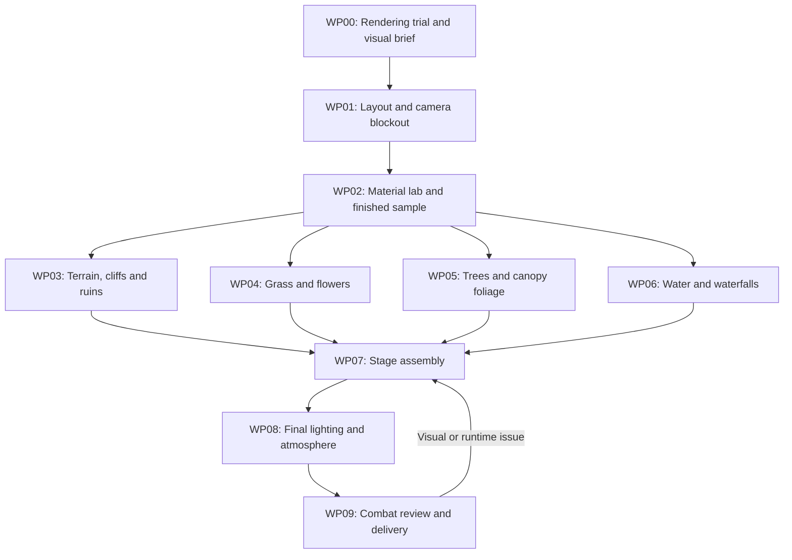

# Teyvat Grassland Battle Map — Production Pipeline

Prepared 2026-10-18. Status: production workflow only; map assets, shaders and scenes have not been implemented by this document.

## Intended result

Create a bounded, fully 3D grassland battle stage that follows the supplied concepts: luminous green clearing, flower-rich borders, rounded tree canopies, sculpted gray cliffs, turquoise water and waterfalls, mossy ruins, and distant blue hills. Judge the result in Unity through the actual combat cameras. Blender renders are intermediate evidence.

The priority is visual cohesion and combat readability. More polygons, more grass, or more effects are useful only when they improve the captured gameplay image.

Use [the modeling overview](01-environment-overview.png) for environment composition, [the planning shot](02-battle-planning-camera.png) for team framing, and [the attack shot](03-attack-camera.png) for close-range detail. These generated images are art-direction references. They are not perfectly consistent geometric blueprints: resolve discrepancies in the approved 3D blockout, then use that blockout as spatial truth.

Supporting documents:

- [Asset and integration contract](ASSET_CONTRACT.md): interfaces shared by all work packages.
- [Separate work-package briefs](WORK_PACKAGES.md): bounded assignments suitable for separate work sessions.
- [Visual and runtime review](REVIEW_CHECKLIST.md): evidence needed to accept each milestone.

## Current project and assumptions

Verified from local files on 2026-10-18:

| Item | Observed state | Consequence |
| --- | --- | --- |
| Unity | 6000.3.4f1 | Match tools and package versions to this editor. |
| |
| Color space | Gamma | Evaluate Linear in the rendering trial; compare existing character and effect appearance. |
| Combat planning camera | Centered behind the acting team; reverses for the other side | Both ends of the stage need complete, convincing backgrounds. |
| Combat attack camera | Rear/shoulder composition, adaptive framing | Test vegetation and geometry across the full motion path. |
| Existing stage | Osaka stage builder and environment assets | Give the new stage its own assets and integration path. |

Evidence: `Packages/manifest.json`, `ProjectSettings/ProjectVersion.txt`, `ProjectSettings/GraphicsSettings.asset`, `ProjectSettings/QualitySettings.asset`, `ProjectSettings/ProjectSettings.asset`, and `Assets/Project/Runtime/Presentation/Combat/BattleStagePresenter*.cs`.

ASSUMPTION: This is a contained turn-based battle environment with existing actor anchors and moving combat cameras, rather than an explorable open world.

IMPACT: Concentrate detail around the camera-visible combat volume and use simplified distant geometry.

IF WRONG: Exploration, free camera movement, or traversable water would require expanded collision, navigation, background and streaming work.

VALIDATE: Inspect current gameplay and record the camera sweep during layout work.

UPDATE during WP00: the user confirmed Windows PC as the target platform. The minimum hardware class, output resolution and frame-rate target are not yet specified. The current authoring machine is the initial comparison baseline.

IMPACT: No polygon, texture-memory, vegetation-density or frame-time allowance in this workflow is a final production budget.

IF WRONG: Desktop-only quality choices may be unaffordable on the intended mobile device.

VALIDATE: Record a named representative device and intended display mode in WP00 before committing to mass vegetation or reflection techniques. CPU and GPU measurements may begin earlier, but final performance acceptance remains pending that decision.

## Tool responsibilities

| Tool or discipline | Owns | Main deliverable |
| --- | --- | --- |
| Blender modeling and sculpting | Terrain silhouette, cliffs, rocks, ruins, trunks, canopy structure, foliage meshes, waterfall ribbons | Editable sources plus explicit exported assets |
| Blender scripts / Geometry Nodes | Controlled variations, reusable generators, source validation, export preparation | Reproducible tools with saved parameters and seeds |
| Texture authoring | Clean albedo, foliage opacity, normal maps where helpful, material masks | Documented source textures and export maps |
| Optional Tripo / Meshy | Candidate starting meshes for a difficult decorative prop | Reviewed and cleaned mesh that meets the same asset contract |
| Unity shaders and materials | Final grass, leaves, ground, rock, water and waterfall appearance | Named shader families, material instances and sample scenes |
| Unity scene assembly | Placement, instancing, collision, lighting, effects, combat integration and captures | Stage prefab, review scene and runtime evidence |

AI generation is optional. Do not make core terrain, grass or water production depend on an untested external service. MCP or a script is an automation mechanism; it does not replace visual review or asset preparation.

## Execution order and dependencies

WP03–WP06 are independent production lanes after the shared material interfaces and sample are accepted. They can run sequentially in separate sessions or concurrently in isolated scopes. This workflow does not itself start agents or create chats.

Profiling and import validation happen at every lane handoff, not only at WP09. WP07 integrates accepted increments while work continues; it should not be the first time the assets meet Unity.

## WP00 — Rendering trial and visual foundation

**Purpose:** choose a reproducible rendering foundation before investing in shaders and textures.

Capture the current project and representative characters, effects and Osaka scene as a baseline. Evaluate URP and Linear color space in a separate full project copy or equivalently isolated test project. A new scene in this project does not isolate project-wide rendering settings. Preserve needed uncommitted files in the test setup.

My preferred candidate is URP with Linear color space, but acceptance depends on the sample and compatibility evidence. Unity documents that installing URP can require manually recreating shaders and post-processing; do not assume automatic conversion of custom Osaka or character shaders. [Unity: install URP into an existing project](https://docs.unity3d.com/6000.3/Documentation/Manual/urp/InstallURPIntoAProject.html).

Record editor and pipeline package versions, renderer, color space, anti-aliasing choice, texture support, scene-depth/opaque-texture policy, shadows, camera setup and target hardware. Fix a neutral preview light and a target afternoon light for repeatable asset reviews. Retain a Built-in implementation route if the rendering trial does not justify migration; finalize shader interfaces against the selected renderer.

**Deliverable:** rendering decision record, visual brief, baseline captures, compatibility list and initial runtime measurements.

**Exit:** the team can open the same sample and see consistent materials and characters. Record remaining migration work explicitly before full scene production.

## WP01 — Layout and combat-camera blockout

**Purpose:** establish the scene geometry that every other package can trust.

Use simple meshes for the clearing, stream basin, cliffs, left tree, right arch, distant tower and skyline. Derive arena origin and orientation from the current combat anchors rather than imposing arbitrary world positions. Keep the combat floor compatible with existing character ground height.

Capture the actual player and enemy planning cameras, attack approaches, close portraits, multi-target actions and ultimate shots. Include camera transitions and the volumes swept by fighters and effects. Build the reverse-side landscape as well as the waterfall-facing view. Use full 3D background coverage for visible camera rotations; reserve cards or billboards for distant elements whose parallax is acceptable.

Save a shared layout scene, camera records, an environment bounds plan and vegetation exclusion masks. Lock the primary silhouettes: clearing shape, cliff skyline, waterfall positions, left tree mass and right ruin.

**Exit:** no fighter or camera intersects the blockout; both acting sides have a complete frame. Changes to the agreed layout require a revised shared layout version.

## WP02 — Material lab and a finished sample

**Purpose:** prove the reference look at small scale before expanding the asset count.

Use representative prototype pieces: a ground patch with grass transition, a cliff face, a rock, a tree canopy, flowers, shallow water and a waterfall segment. These should be genuine candidates for the eventual kit, not unrelated showcase assets.

Create and test the material families: Ground, Rock, Trunk, Grass, Leaf, Flower, River and Waterfall. Establish shared ground/grass color sampling, foliage vertex masks, wind coordinates and material parameters. Give the foliage artist a working shader sample and the shader artist a working mesh sample.

Prove the following under the same lighting and cameras:

- Ground and grass share a coherent hue at their meeting point.
- Leaf clumps read as soft canopy volumes rather than disconnected flat cards.
- Rocks have broad designed planes rather than fine random surface noise.
- Turquoise water has readable shallows and restrained highlights.
- Waterfall motion has direction and does not resemble opaque white sheets.
- Characters remain readable in both warm light and cool shade.

**Exit:** the sample works in Unity at battle distance and close attack distance, with useful runtime measurements. Fix material interfaces here before batch-authoring assets.

## WP03 — Terrain, cliffs, rocks and ruins

**Purpose:** author the large forms that make this stage recognizable.

Use an authored terrain mesh for the bounded combat terrace and cliff silhouettes. Native Unity Terrain is an alternative for extensive rolling background land; make that choice during blockout. Use meshes for vertical cliffs and overhangs either way.

Create reusable cliff modules with broad angled planes, ledges and grassy caps. Author riverbanks and a basin below the water surface so depth-dependent water has actual underlying geometry. Build silhouette-specific hero pieces around waterfall openings. Create the mossy arch, broken masonry, distant tower and bridge as separate reusable assets.

Use Blender scripts for controlled shape variation and export; review the silhouette of each accepted result. Author UVs and masks that work with the shared ground/rock materials. Keep material colors free of baked directional sunlight.

**Exit:** imported assets match the accepted blockout, have intentional normals and simple collision where needed, and look cohesive in the material lab. A single merged world mesh is not the default deliverable.

## WP04 — Grass, flowers and meadow distribution

**Purpose:** recreate the rich meadow border without hiding combat or overwhelming rendering cost.

Author actual low-complexity grass-blade clumps, sparse accent blades, flower clusters and ground-cover accents in Blender. Use flower or leaf cards when they give the desired silhouette efficiently; inspect opacity and mip behavior. Keep roots fixed through wind masks and test whether the imported vertex channels survive the chosen export route.

In Unity, use an instancing path compatible with the selected shader, pipeline and lighting needs. GPU instancing has pipeline and shader constraints; choose and measure the actual path rather than assuming that identical-looking materials will batch. [Unity: GPU instancing](https://docs.unity3d.com/6000.3/Documentation/Manual/GPUInstancing.html).

Scatter from explicit density, species, color and exclusion masks. Use stable seeds and incremental regeneration. Keep the middle clearing short and visually quiet; build richer grass toward the perimeter. Design near, middle and distant appearance together so a density reduction blends into the ground rather than exposing a sudden bare strip.

Use a shared world-space color field to prevent grass/ground seams. Match wind direction across grass and trees, with asset-specific bend response. Verify animated bounds and consistent deformation in visible and shadow passes. Optional actor bending can follow after the base look passes; it must not block the first map.

**Exit:** convincing meadow depth in planning and attack views; no root floating, major shimmer, abrupt density rings or character occlusion. Record overdraw/shadow cost and compare wind-on versus wind-off captures.

## WP05 — Trees and canopy foliage

**Purpose:** create the large soft leafy masses seen in the reference.

Model the left hero trunk and large branches with a readable silhouette. Build canopy as overlapping designed leaf clumps, not a uniformly noisy sphere of leaves. Give branches and canopy masses enough variation that repeated trees do not become obvious.

Test custom or transferred canopy normals in the Unity import pipeline. Use them only when they improve the lighting shape. The final leaf material should support controlled wrap/backlighting, base-to-tip or canopy tint, received shadows, alpha clipping if cards are used, and branch/leaf wind masks. Ensure backface lighting is intentional.

Separate the hero tree from simpler midground and distant variants. Review lower-cost distance versions against the same silhouettes. Avoid declaring wind-deformed foliage static for lighting merely to obtain a bake: select and test an appropriate lighting/shadow strategy.

**Exit:** full soft canopies in both light and shade; no severe card edges, black leaf backs or camera obstruction during attacks. Handoff includes the working leaf shader sample and imported normals evidence.

## WP06 — River, waterfall materials and effects

**Purpose:** build water as a complete feature: basin geometry, surface shader, waterfall mesh, foam and mist.

Author the river surface and waterfall ribbons separately. Keep the visible surface simple enough to edit, with controllable UV flow. Pair waterfall ribbons with breakup layers, contact foam and restrained mist; the current project has the built-in particle system, so an additional effects framework is not a default prerequisite.

For the selected renderer, implement shallow/deep color, scrolling normal detail, Fresnel response, controlled specular glints, shoreline/intersection foam and directional flow. Use authored masks as a fallback where screen-space depth cannot represent the intended water behavior.

If URP is selected, enable depth textures only where required by the implementation and opaque textures when refraction needs the already-rendered opaque scene. These are explicit URP asset features. Opaque texture sampling does not provide a reflection or a complete image of other transparent surfaces. [Unity: URP asset reference](https://docs.unity3d.com/6000.3/Documentation/Manual/urp/universalrp-asset.html).

Depth foam must compare compatible linearized depths and be tested from shallow and elevated angles. Check transparent ordering between river, ribbons, mist and combat effects. Start reflection look development with a sky/probe solution; add a planar reflection camera only if its visual improvement justifies the measured extra rendering cost. Do not promise automatic URP screen-space water reflections.

**Exit:** believable water color, motion and bank contact from both teams' views and attack shots; acceptable sorting and runtime cost with combat particles present.

## WP07 — Stage assembly and dressing

**Purpose:** combine accepted modules without losing the composition or asset boundaries.

Only the integrator edits the master scene and final stage prefab. Bring in completed modules incrementally. Replace blockout pieces, preserve fighter anchors and ground height, and place flowers and stones to support the agreed silhouettes. Reuse the layout's mask data for scattering.

Organize scene roots by function: Ground, Cliffs, Ruins, Trees, Meadow, Water, Waterfalls, Background and Atmosphere. Final environment modules should not contain accidental preview cameras, duplicate suns or test-scene lighting. Existing characters and gameplay controllers remain outside the reusable environment prefab.

Use complete 3D forms where reverse shots or camera motion reveal them. Distant tower, bridge and mountains can be simplified according to captured visibility. Inspect the full camera movement rather than hiding errors outside one attractive screenshot.

**Exit:** a complete scene that matches the reference's shape hierarchy from all registered views and plays through current combat camera transitions.

## WP08 — Lighting, sky and atmosphere

**Purpose:** unify the accepted assets under the reference's luminous afternoon mood.

Refine the baseline sun, sky and ambient fill already established in WP00/WP02. Keep broad warm light, cool readable shadow masses, gentle distant haze and restrained bloom. Preserve the reference's green/yellow meadow foreground and turquoise/blue depth layers without turning shadowed leaves black or washing the frame yellow.

Evaluate exposure and tone mapping alongside the actual character shaders. Use ambient/probe lighting for moving actors as supported by the selected pipeline; bake only suitable static geometry and test animated foliage separately. Choose reflection probes and any baked lighting with documented bake settings. Disable depth of field for baseline comparison captures, then evaluate it separately in cinematic shots.

Do not use strong bloom, fog or grading to hide incorrect foliage normals or mismatched grass colors. Review a neutral-light version to diagnose material issues before adjusting the final mood.

**Exit:** matching light direction, clear subject separation, stable exposure across camera changes, and convincing depth without sacrificing combat readability.

## WP09 — Combat validation, profiling and final package

**Purpose:** confirm the beautiful static scene remains usable in motion.

Run the registered camera sequence with representative actual characters and actions. Review dense effects, knockbacks, close portraits, multiple targets, both acting sides and stage entry/exit. Capture clean frames with UI hidden; also test gameplay overlays in the real battle scene without adding UI to the environment assets.

Profile a player build on the recorded target hardware. Track CPU and GPU time, frame-time spikes, texture/mesh memory, visible geometry, draw activity, shadow cost, transparent overdraw and extra-camera rendering. Frame Debugger is useful for explaining passes, not a substitute for player-build timing. Tune the measured bottleneck: foliage coverage, shadow distance, material samples, water transparency, reflection passes or texture residency.

Any numeric density, mesh count, texture size, LOD distance, particle count or rendering budget selected during production must be recorded as a starting value with its device, test, pass condition and adjustment direction. Do not label it an industry standard.

Deliver editable Blender sources, texture sources, exports, Unity prefabs/materials/shaders, scenes, procedural settings and seeds, package versions, visual review captures, runtime measurements and known limitations. Verify regeneration or reimport on a clean asset copy and review dependencies before calling the stage complete.

## Review and iteration policy

Every package hands off the source, Unity-ready output, sample scene, neutral and target-light captures, dependencies, regeneration instructions, measurements and unresolved issues. Use the exact shared camera records and exposure for comparisons. A Blender beauty render alone does not close a package.

Correct issues in this order: layout and scale; major silhouettes; ground/grass and canopy material behavior; lighting; water motion and depth; small dressing details. If runtime profiling exposes a bottleneck, address it immediately and recapture the affected views.

If a shared interface changes, the integrator versions the contract and lists the affected packages. Workers do not independently rename shader properties, reinterpret mask channels or move the arena origin. Prefer updating a representative sample before regenerating the entire kit.

## Definition of success

The map is accepted when the registered gameplay views convey the supplied concepts' meadow, cliff, canopy, water and afternoon-light relationships; fighters and action targets remain clear; all modules import and regenerate consistently; and the player build meets the recorded target-device budget. Visual similarity is assessed through comparative captures, not a promised percentage match.
