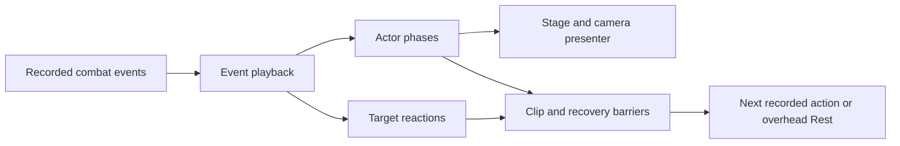

# Fighting Allstar — Game Design Document

Design draft • 2026-10-01 • First prototype and full-game direction

Actor/camera state contract updated • 2026-10-09 • Owner-confirmed presentation rules

Elemental reaction direction updated • 2026-10-15 • Owner-approved adaptation; runtime implementation remains planned

## Purpose and decision status

**Screen/economy revision:** see [banners and route design](../3_Outputs/Specs/fighting-allstar-economy-route-design.md), [battle screen states](../3_Outputs/Specs/fighting-allstar-battle-screen-states.md) and [Unity implementation phase plan](../3_Outputs/Specs/fighting-allstar-unity-implementation-plan.md). Owner-confirmed rates/costs, forward route choices, persistent HP, Rest and entry difficulty supersede earlier defaults.300-pull selector semantics remain proposed pending clarification.

**Actual-source revision (2026-10-01):** incorporates the supplied guide, 29 WIP characters and effect catalogs. Character tables are external. Conflict decisions and generated values remain reviewable proposals; no runtime kits are implemented by this document.

**Actor/camera revision (2026-10-09):** [Actor and camera state architecture](#actor-and-camera-state-architecture), `@tag:actor-camera`, records the owner's confirmed execution sequence and latest framing/support/ultimate corrections. It is the canonical contract for future presentation work, superseding older generic camera descriptions and historical reference notes. It does not change combat formulas or approve unrelated proposed GDD sections.

**Elemental reaction revision (2026-10-15):** [Genshin-inspired elemental reactions](#genshin-inspired-elemental-reactions), `@tag:elemental-reactions`, records the owner's confirmed full-team restriction, all-stack consumption, Swirl/Crystallize preservation exceptions, and terminal Overload damage. It owns this new feature's behavior; the linked [implementation plan](../3_Outputs/Specs/genshin-element-system-arch-plan.md) separates observed foundations from proposed extensions. Remaining detailed rules and tuning are explicitly labeled Proposed/Starting value. This revision does not change existing combat formulas, character assets, or runtime code.

**Genshin roster revision (2026-10-15):** the owner approved the documented elemental plan, then supplied five kits and authorized generating their missing stats. [Genshin starter roster](#genshin-starter-roster), `@tag:genshin-roster`, adds those design entries and the confirmed delayed/retaliation contact exceptions. Generated stats/ranks and unresolved kit interpretations remain labeled; no runtime fighter or summon-pool migration is implied.

**Elemental A–C implementation (2026-10-15):** the owner authorized slices A–C. Shared-core content validation, frozen roster eligibility, explicit elemental contacts, directional amplification and terminal Overload are implemented and headlessly verified. See [implementation evidence](../../../Artifacts/GenshinElementSystem/ImplementationAC.md). Swirl, forecasting/presentation, remaining reactions and complete character kits retain their later-slice status.

**Elemental D–F follow-up (2026-10-15):** the owner subsequently authorized D–F, Genshin-style floating combat text using the local `zh-cn` font, colored contact→reaction feedback, and a global DOT correction. This revision supersedes the historical A–C-only scope above. Swirl, remaining outputs, public conditional forecasts and five authored starter kits are implemented. See [D–F evidence](../../../Artifacts/GenshinElementSystem/ImplementationDF.md) and [task card](../3_Outputs/Specs/genshin-element-system-df-task-card.md).

**Elemental G–H follow-up:** the owner authorized G–H. Combo-aware enemy planning, automated Windows/editor integration and the Practice launch repair are implemented. [G–H evidence](../../../Artifacts/GenshinElementSystem/ImplementationGH.md) records expected-value planning, privacy, replay/export, Practice and audio/cleanup checks. The owner explicitly requested Android runtime testing remain pending; human balance/readability/feel acceptance is also open.

Fighting Allstar is a 3D card battle RPG about assembling a team whose fighters create opportunities for one another, then adapting that team to a dungeon and its opponents. Its signature is several overlapping counterplay relationships: a strong team has weaknesses, and the player can answer those weaknesses through roster selection, card sequencing, and run boon choices.

**Confirmed** means stated by the owner in the 2026-10-01 request or an explicitly dated owner clarification below. **Observed** means inspected in this repository; it does not mean verified in a running build. **Proposed** means a concrete recommendation prepared for review. All mechanics, content, scope quantities, timing, economy, and tuning below are **Proposed** unless explicitly marked Confirmed or Observed. They are not claims about the exact rules of Grand Cross. This draft preserves its card battle inspiration while specifying Fighting Allstar's own rules.

The completed documents are review inputs. Runtime implementation, dependency changes, scene/build changes, and deployment are later work. This GDD is the design reference; [the architecture plan](../3_Outputs/Specs/fighting-allstar-prototype-arch-plan.md) describes the implementation boundary and [the test plan](../3_Outputs/TestPlans/fighting-allstar-prototype-test-plan.md) defines verification. There is no claim that the new design is already implemented.

**Current owner clarification:** constellation starts at **C0/5** and advances through five upgrades to **C5/5**. Dungeons have **linear stages with randomized opposing character teams drawn from the same shared character catalog**. Opponents use ordinary character skills, passives, progression snapshots, and combat rules. Account sign-in uses **Firebase Authentication with third-party providers**. The specific providers and platform integration remain implementation choices for review.

<!-- @tag:identity -->
## Project identity

| Field | Direction and status |
| --- | --- |
| Title | **Fighting Allstar** — Confirmed |
| Genre | **3D tactical card turn based game / roguelite dungeon / character and team driven RPG** — Confirmed |
| Formation | **3 active fighters + 1 reserve against 3 active fighters + 1 reserve** — Confirmed |
| Platforms | **Mobile and PC**, with PC build and Android APK — Confirmed |
| Play model | **Server authoritative online**, with a switchable local AI test backend — Confirmed |
| Core fantasy | Build a fighting team, read its opponent, and win through coordinated card decisions — Proposed expression of the user's priorities |
| Player promise | A larger roster opens more plans and dungeon options; a practiced player can turn an awkward hand into a good turn |
| Camera / play plane | Fixed 3D formations in an arena; camera presents card actions; movement through space is not a combat input |
| Tone | Energetic tournament spectacle, clear tactical information, rivals with readable strengths |
| Story intent | A tournament expedition brings fighters through themed challenge gates; detailed narrative is later content |

### Experience pillars

1. **The team is the build.** A fighter supplies damage, protection, setup, or recovery that another fighter can use. No single fighter should simultaneously provide the best damage, defense, cleanse, and gauge economy.
2. **Several ways to gain an advantage.** Strategy, effect counters, and attributes create separate soft counter relationships. Mixed teams trade peak payoff for wider answers.
3. **Every card action has a cost.** Playing, saving, moving, and merging compete for the same turn budget. A powerful hand still requires a good sequence.
4. **Readable intelligence.** Enemy choices express a plan the player can infer from visible buffs, gauges, roles, and past actions. Difficulty comes from better decisions and authored encounters.
5. **A failed run still belongs to the player.** Defeat ends the attempt, while owned fighters and permanent inventory remain. Restrictions invite preparation rather than destroy investments.

### Design assumptions and consequences

| Assumption | Impact | If wrong | Quick validation |
| --- | --- | --- | --- |
| Mobile touch is the primary interaction model; Windows mirrors it | Cards and targets must work without hover or precision dragging | PC-first expectations may demand different density and shortcuts | Review the same turn on a phone and desktop mockup |
| Each linear stage loads an authored 3D arena and a validated randomized character team | A complete generated run can reuse arena assets while varying tactical matchups | Variety may feel insufficient if team changes do not change decisions | Compare repeated runs with different team seeds and record changed player plans |
| Permanent duplicates fund the six confirmed constellation upgrades | Collection remains persistent and upgrade costs are easy to explain | Too many required duplicate pulls can delay meaningful progression | Test C0 utility and acquisition pacing before final economy tuning |
| Counterplay matters more than collection rarity | Normalized tests and useful starter roles remain necessary | A rarity-first power fantasy may conflict with fair team variety | Playtest starter teams against new combinations at equal progression |

<!-- @tag:visual-audio -->
## Visual, mood, and audio direction

Use stylized 3D fighters with distinct silhouettes and readable stance changes. Prototype art can be capsules, available placeholder models, and simple particles. Gameplay signs must remain legible before visual polish: target outline, health, shield, PG, taunt, Ignite, and harmful status icons. Attributes use a symbol and written name as well as color.

The planning camera shows both formations and the action queue. Card playback follows the owner-confirmed [actor/camera state contract](#actor-and-camera-state-architecture): type/rank-specific framing, direct chaining between queued actors, and an overhead return when the queue ends. The ultimate Rest lead-in is an explicit exception to direct chaining. A camera cut never hides a target-selection change, reserve entry, or counter. A reduced-motion setting disables shake, aggressive zoom, and flashes. Ultimate cinematics are skippable presentation; simulation is unaffected by skip, playback speed, or low frame rate.

Sound carries information: a card snap confirms a selection, a distinct chime confirms a merge, a deeper cue announces an ultimate, and contrasting impact sounds distinguish ordinary, critical, blocked, and absorbed damage. Music shifts between preparation, battle pressure, and result screens. Captions and visual cues carry any meaning conveyed by sound. Haptics are optional.

### Combat interaction and feedback specification

| Trigger | What the player sees | What the player hears | Timing rule |
| --- | --- | --- | --- |
| Select a card | Card lifts, eligible targets highlight, action cost previews | Short card click | Immediate local draft feedback; timing budget T-UI |
| Move / merge | Slot destination appears; merge animation shows rank and PG preview | Slide / ascending chime | Draft remains reversible until confirm |
| Reset | Original authoritative hand and resources return | Soft undo cue | No reward, RNG, or PG mutation |
| Final Action slot filled | Queue locks and automatically submits | Clear transition into playback | Only server acceptance starts authoritative playback |
| Hit | Target flashes; damage label includes crit/block; health updates at cue | Matching impact | Cues read already resolved events; T-PACE |
| Heal / lifesteal | Green heal number and source-to-owner trace; caps clearly | Recovery cue | At the recorded heal event, never a second client calculation |
| Guard / counter | Shield or stance icon activates; counter source is framed | Guard ring / response hit | Counter label precedes the response animation |
| Death / reserve entry | Portrait grays out, cards disappear, reserve enters its slot | Defeat accent / entry cue | On corresponding event boundaries |
| Win / loss | Result names decisive effects and persistent rewards | Victory / defeat stinger | Claim status distinguished from visual celebration |

**Owner-confirmed combat feedback rule (2026-10-06):** Floating combat text for both damage and healing always shows the full resolved event amount, even when that amount exceeds the target's remaining HP or missing HP. Do not clamp or suppress the displayed number because HP reaches zero or MaxHP. Clamp only the authoritative HP state: damage cannot take HP below zero, and healing cannot raise HP above MaxHP. Show all feedback events, including zero-effective recovery at full HP and recovery blocked by Infect; a blocked recovery displays **“Can't Recovery”** instead of a heal number. Critical, block, Endurance, shield, lifesteal, Rejuvenation, and other effect feedback remain visible whenever their corresponding events resolve.

Juice starts with restrained hit flash, impact audio, and short card movement. Screen shake and haptics default off in the earliest functional slice until the player can read an entire turn. Their amplitude and duration require device playtesting; no unvalidated camera value is a dependency of battle logic. Jump timing, coyote time, world movement buffering, and collision response are not applicable to this combat model.

<!-- @tag:actor-camera -->
## Actor and camera state architecture

**Confirmed by the owner, 2026-10-09.** These are required behavioral rules, not optional animation style suggestions. Latest explicit owner corrections take precedence over old clips, historical test notes, and generic camera prose. Future specs must reference `@tag:actor-camera`; update this section and its regression checks together when the owner changes a rule. Detailed fixture notes are [actor execution](../../../Tests/CombatPresentation/ActorDrivenExecution.md), [multi-hit attacks](../../../Tests/CombatPresentation/MultiHit.md), and [target reactions](../../../Tests/CombatPresentation/HitReactions.md).

### Responsibility and authority

The player should recognize who is preparing, what action is happening, and when everyone is ready for the next card. Preparation retains charge/skill cues; each impact retains its recorded visual and audio feedback. Wider portraits improve readability without removing ranked spectacle. None of these presentation states adds a combat cost, status, RNG roll, or player action.

| Layer | Owns | Must not do |
| --- | --- | --- |
| Combat authority | Accepted actions, damage/healing, per-hit outcomes, status/stance facts, deaths and event order | Depend on camera, Animator, Transform, tween completion, or frame rate |
| Event playback | Consume recorded events in order; coordinate hit, reaction, clip and action-completion barriers | Recalculate damage, reroll crit/block, change recipients, or grant extra actions |
| Actor phase controller | `Rest`, `WindUp`, `Action`, `Recovery`; authored clip selection/completion and fallback feedback | Decide combat outcomes or turn ownership |
| Stage/camera presenter | Observe actor phases; choose shots; follow offensive caster; restore saved poses | Follow displaced victims or invent an unrelated recovery/ultimate camera state |
| Target reaction controller | Temporary displacement/poses, sustained-hit holds, ready barrier and restoration | Change formation slots, targeting, damage immunity, or combat stun state |

**Observed implementation mapping:** `ActorCardPresentation` owns actor phases; `BattleStagePresenter` owns choreography/camera and reaction readiness; `CoreBattleSceneController` coordinates recorded event playback. This describes the current presentation boundary, not a claim that all online architecture in this GDD is complete.

### Actor phases and exit barriers

Normal offensive sequence: `Rest → WindUp → Action → Recovery → Rest`. Buff/Heal Rank 1: `Rest → Action → Recovery → Rest`; Rank 2/3 retain WindUp. Actor Rest means the fighter is ready; it does **not** force an overhead camera while another card is queued.

| Phase | Entry and visible behavior | Exit condition |
| --- | --- | --- |
| Rest | Formation/home pose and idle; a recorded valid card/counter creates the next execution context | Enter WindUp, or skip directly to Action for ordinary Rank 1 Buff/Heal |
| WindUp | Preparation/anticipation before Attack, AttackDebuff, Debuff or Stance; support uses the rank rules below | Preparation feedback and any authored WindUp clip finish; ultimate reveal also finishes before Action |
| Action | Perform close/ranged attack, debuff, stance, buff or heal; execute all authored hit/effect beats | Strike motion, recorded hit/effect windows, authored Action clip and pending target reactions finish or release at the no-more-hits boundary |
| Recovery | Return the caster to saved position, rotation and scale; stationary casts still settle visibly | Home pose and any authored Recovery clip finish, then actor becomes Rest/ready |

Missing phase clips/Animator states must use procedural anticipation, strike/cast, and recovery feedback; do not silently omit a required phase. Animator markers synchronize authored impacts, while generated multi-hit templates own their impact timing. Broken/looping clips use a bounded watchdog rather than blocking playback forever. This is a playback safeguard, not permission to resolve combat from animation callbacks.

### Camera states, compositions and rank matrix

There are exactly three camera states: **Rest** (saved overhead drafting view), **WindUp** (caster preparation framing), and **Action** (execution framing). Rear caster, face, and full-team views are compositions within those states. Recovery returns to the saved rear WindUp composition or holds the support Action shot; it is not a fourth camera state.

All face shots show approximately the **upper two-thirds of the body**, not an extreme face/head close-up. Rank 3/ultimate may use stronger angle/roll, but cannot tighten the body crop. Fit the actual fighter geometry and viewport, leaving readable HUD space. Use the same rules for player/opponent and portrait/landscape.

| Card family / target | Rank | WindUp camera | Action camera | Recovery camera |
| --- | --- | --- | --- | --- |
| Attack, AttackDebuff, Debuff, Stance | 1 | Fast visible move behind caster; offensive actor and selected opponents face one another | Rear execution view follows attacking caster, looking toward captured target position(s) | Follow caster home to saved rear WindUp pose/angle/FOV |
| Same offensive families | 2/3 | Jump cut to two-thirds-body front portrait | Jump cut back behind caster at Action entry, then same caster-follow sequence; ranked flair must preserve framing rules | Return to saved rear WindUp, settling any ranked Action roll |
| Buff/Heal, self | 1 | Skip actor WindUp; cut behind caster, framing full opposing formation like offensive AoE | Hold this rear shot throughout Action | Hold rear; proceed to next queue entry |
| Buff/Heal, self | 2 | Jump cut to two-thirds-body portrait | At Action entry, jump cut to **exactly the Rank 1 self-cast camera**; hold it | Hold rear; no late Action camera change |
| Buff/Heal, self | 3 | Jump cut to two-thirds-body portrait | Hold face shot until the entire Action ends | Only then cut to saved rear WindUp; proceed to queue |
| Buff/Heal, selected ally or whole team | 1 | Skip actor WindUp; cut to rear view of full allied formation | Hold full allied team view, even for one selected ally | Hold team view until next queue entry/Rest |
| Buff/Heal, selected ally or whole team | 2 | Jump cut to caster's two-thirds-body portrait | At Action entry, jump cut to **exactly the Rank 1 full-team camera**; hold it | Hold team view; no late caster-rear reset |
| Buff/Heal, selected ally or whole team | 3 | Cut to full allied rear-team view; no face introduction | Hold full allied team view | Hold team view until next queue entry/Rest |

**Self-target Stance is offensive presentation, not Buff/Heal.** It performs its stance action without an enemy lunge and returns behind the caster. Support/self scope comes from authored targeting, not merely which unit survives. An ordinary selected-ally heal is not a self-cast or single-body shot.

**Cuts versus movement:** Buff/Heal camera changes are immediate cuts with no interpolation. Offensive travel is fast and visible, and follows only the caster during Action/home return; ranked face/rear resets are deliberate cuts. After support, the next queued card entry cuts rather than interpolating away from the support shot. Ultimate lead-in overrides this queue-cut rule with the explicit movement below.

### Captured target focus and formation

- Capture focus positions, target bounds, source direction, actor geometry and rear WindUp shot when the execution context is created. Reserve the action's reaction envelope before impacts, including knockup apex/landing where recorded.
- During offensive Action, camera may follow the **caster root**, while looking toward captured world focus. It must not lock to a victim Transform, refocus from recoil/death, or chase a knocked/flying target. Impact/crit adds no camera shake.
- AoE camera and animation always retain the **whole opposing formation**, including vacant/defeated slots with one enemy left. Do not convert AoE presentation into single-target framing; actual recipients still follow recorded combat events.
- Non-self support Action always frames the full allied formation. Reserves join the formation framing registry on entry; temporary visual displacement never moves a formation slot.
- Derive opposing facing from formation positions, not stale anchor yaw. Keep imported model-yaw correction above the Animator root so a clip cannot reverse logical facing or camera front/rear.

### Multi-hit and enemy reaction coordination

The 1–10-hit, Close/Long, Single/AoE template settings apply only to **Damage-kind** effects, regardless of card category. Preserve the four hit-count families (heavy single, two-hit slash, three-hit combo, editable barrage) in all four range/scope combinations. The card's authored damage is the **whole attack**, split across hits by combat authority; each hit has its own eligible crit/block outcome. Playback consumes those results and never multiplies the card total by hit count or shares one outcome across all hits.

`BeforeAction` is once per action; `Damaging` is once at the first hit before its damage; `AfterDamage` is once after the last actual hit; `AfterAction` remains once per action. Intermediate hits remain inside one Action. Barrage beat duration decreases as count increases so more hits do not linearly lengthen execution. Approach and attacker recovery occur once, not once per hit.

| Reaction | Required presentation |
| --- | --- |
| Hit / None | Light recoil / no motion; recorded damage, numbers and audio still display |
| KnockBack | Displace away from attacker, hold a grounded recoil posture, stand, then run to saved home |
| KnockDown | Trip face down at the same horizontal place, then get up |
| KnockUp | Launch upward **and away**, mostly upright in flight; readable apex, descending drop, touchdown, back fall, get-up at landing point, return home |

Use the visible foot/ground anchor, not an assumed feet-pivot: centre/hip-pivot models must not lie flat while rising, orbit their origin, hover or clip the floor on landing. These movements are visual displacement, not extra damage, a stun effect, collision combat, or a new targeting position.

- Active stance tolerates **all** hit motion; this is not damage immunity. A successful cancellation of an existing stance forces one KnockBack, overriding that recipient's authored reaction for the remainder of the action. Cancellation with no active stance forces nothing. A utility stance-removal event can cause this override without becoming a Damage template.
- First/Last/EveryHit reaction timing is editable. An early strong reaction launches/displaces once and holds its apex/prone/recoil pose through the remaining hits. Do not restart the full sequence or snap home on each hit; later light/None hits cannot cut it short.
- The final hit releases the hold and lets fall/get-up/return finish. If there are no more hits (including an evaded/skipped final packet), the action barrier releases remaining holds. **Attacker Recovery and the next card wait until every affected target is ready.** Each AoE recipient applies its own stance/reaction facts independently.
- New ultimate SO tiers default to **KnockUp / LastHit** for Damage. Defaults remain editable and must not overwrite existing authored assets. Normal ultimate hits do not need separate forced-knockup runtime logic.
- Preserve recorded original-recipient and overkill feedback through the card's last hit; HP remains clamped and actual HP-loss rules unchanged. Defer defeat/reserve presentation to the recorded action boundary so a reserve cannot inherit unfinished strikes.

### Ultimate, queue and cleanup transitions

Ultimate presentation sequence: `previous action/reactions recover → visible move to owner's overhead Rest → brief Rest pause → portrait/title overlay (Rest camera held) → actor WindUp/energy reveal → rear Action reset and execution → Recovery → queued actor or Rest`. This reuses the three camera states; it does not add hero/detail shots or live target tracking. The pullback must remain visible **even after Buff/Heal** and finish before the overlay appears.

Normal cards chain directly to the next owner's WindUp/Rank 1 support entry without an overhead detour. Recovery holds its final rear/team composition while a current-turn card/counter is queued. An empty queue returns to overhead drafting; turn/status/battle boundaries close that queue rather than mistaking a later turn's card for a same-queue continuation. Ultimate is the documented Rest detour exception.

Skip, Restore, disable or scene teardown cancels camera travel/follow, actor motion, reaction holds and callbacks; restores saved active poses/scales/facing and drafting camera/FOV; and clears portrait/energy/HUD execution state. No stale coroutine may move the restored camera later. Missing actors must not strand playback. Skip changes presentation only: authoritative damage, costs, RNG, deaths and rewards stay unchanged.

### Starting tuning values and consistency tests

These are **starting values observed in the current presentation**, not immutable design constants or measured reference-game values. Retune durations with final art; do not retune away the state order, support cuts, target snapshots or readiness barriers.

| Timing | Starting value | Quick test and adjustment |
| --- | --- | --- |
| Ordinary offensive camera entry: WindUp / Action / Rest | 140 / 120 / 160 ms | Alternating owners must show rapid travel without lag; increase by 20 ms if unintentionally cut, decrease by 20 ms if dragging |
| Actor WindUp: Rank 1 / 2 / 3 / ultimate | 180 / 650 / 850 / 800 ms, plus authored completion where needed | Observer identifies preparation before impact; shorten if queue drags, lengthen if missed; never trim a valid authored clip early |
| Actor/camera home recovery | 320 ms, plus authored Recovery completion | Return reads as one coherent movement and ends before next actor; shorten/lengthen only after readiness and pose restoration pass |
| Ultimate Rest travel, then overhead pause | 450 ms + 350 ms | Attack→ultimate and team-heal→ultimate show continuous pullback before overlay; adjust travel/pause in 50 ms steps if missed or slow |
| Barrage strike-beat budget | 720 ms shared across 4–10 hits; related projectile beats also scale with count | Compare 4/10 hits at same range/scope: execution must not grow linearly with count; tune the shared budget, never add repeated approach/recovery |
| Malformed animation/motion watchdog | 8 s | Broken/looping clip cannot deadlock queue; log/inspect the asset rather than treat timeout as a normal phase transition |

Required regression/acceptance cases:

1. **Readability/new player:** identify preparing actor, affected team and each impact without explanation; all portraits show upper two-thirds body with HUD clear.
2. **Rank/target matrix:** both sides and viewport orientations; Rank 2 Buff/Heal self, selected ally and team must face-cut into the exact Rank 1 Action shot. Rank 3 self holds face until Action ends; Rank 3 team holds team view.
3. **Caster/target separation:** close/ranged offensive caster follows correctly; move/launch only the victim and confirm focus/angle/FOV do not chase it. Recovery restores the saved rear WindUp, including ranked roll.
4. **Stress/skill:** queue different owners and mixed categories; ten-hit AoE with shields, crit/block, stance tolerance/cancellation, an early launch and one survivor. Count per-hit feedback; first/last effect windows occur once; no next card while anyone is unready.
5. **Ultimate/abuse:** enter from offensive and support shots; overlay waits for Rest arrival. Skip during travel, face, projectiles, held reaction, overlay, reveal and return; confirm cleanup stays restored and authoritative results are identical.
6. **Asset edge cases:** absent Animator/phase clips, looping clips, animated model yaw, centre-pivot launch/landing, death during combo and reserve entry. Final-art feel requires owner playtesting; a fixture pass is not art approval.

Observed regression entry points: [actor/camera runner](../../../Tests/CombatPresentation/RunActorExecutionVisual.ps1) (`-Focused`, `-Moves`, `-Polish`, `-Facing`), [multi-hit runner](../../../Tests/CombatPresentation/RunMultiHitVisual.ps1), [reaction runner](../../../Tests/CombatPresentation/RunHitReactionVisual.ps1), and [ultimate/HUD runner](../../../Tests/CombatPresentation/RunCinematicHudVisual.ps1). These use isolated fixture projects; distinguish their evidence from a live-scene/art review.

<!-- @tag:platform-input -->
## Platform and input philosophy

**Proposed: mobile landscape touch is the primary input model.** PC uses the same decision verbs and rules. Neither device grants more decision time or more combat information.

| Intent | Mobile | PC |
| --- | --- | --- |
| Inspect fighter or card | Tap inspect icon / long press card | Right click or inspect button; hover may show the same information |
| Queue a play | Tap a card to queue it against the preferred living target; tap an opponent model to change that target | Click a card to queue it; click an opponent model to change the preferred target |
| Move a card | Enter Move mode, tap source, tap destination; drag is optional | Move mode or drag |
| Choose enemy | Tap the opponent model | Click the opponent model |
| Reset draft | Visible Reset button | Same button; Escape may cancel current selection |
| Commit turn | Filling the Action field commits automatically | Filling the Action field commits automatically |
| Review stages | Tap the current or upcoming stage in the linear progress list | Click a stage entry |

The battle surface keeps only immediate decisions visible: card art/rank, ordered Action slots, Reset, and the authored UnitUI above fighters. Holding a card opens its compact skill tooltip; a quick tap queues it. Validation, playback, and diagnostic messages use the Unity log during the prototype. Filling every Action slot commits and begins playback automatically.

Touch cancellation and Reset affect only the unsubmitted draft. Input during playback can open inspection but cannot insert combat actions. Double taps, stale UI bindings, and duplicated network replies must not duplicate commands. Modal dialogs stop underlying touch propagation. Safe-area layouts and text scaling are validated on selected Android devices before calling the mobile interface complete.

<!-- @tag:core-loop -->
## Core game loop

**Confirmed loop:** receive starter **Kyo94**, enter linear dungeons, face randomly generated character teams, win Diamonds, use Diamonds for character gacha, expand the roster, and use eligible fighters in restricted dungeons. Defeat preserves owned characters and permanent inventory. Ultimate/constellation progression advances from **C0/5 through C5/5**.

**Proposed complete session:**

1. Sign in through a configured third-party Firebase provider, then inspect an eligible dungeon's restrictions, enemy tendencies, stage count, and victory reward.
2. Assemble three active fighters and a reserve; inspect enabled passives and missing role coverage.
3. Advance through the dungeon's forward map rows, choosing a reachable encounter and bypassing its alternatives; inspect the generated opposing team before committing.
4. Win battles by managing cards, PG, target priorities, and reserve timing; choose a temporary team boon at the scheduled reward checkpoints.
5. Defeat the final opposing team; the server settles the run and credits Diamonds exactly once.
6. Return to MainMenu, summon or improve a fighter, revise the team, and enter a new eligible dungeon.

### Onboarding and roster access

The first tutorial starts with Kyo94 alone and explicitly uses reduced active-team rules. It teaches targeting and a regular card, then movement/merging and PG. The tutorial is not a full 3+1 battle. Guaranteed tutorial grants then add **Chin94, Kensou94, and King94**, creating a complete starter team without depending on gacha luck. A subsequent practice encounter teaches reserve entry with a protected, scripted lesson; ordinary matches never script the result.

Every account always has an unrestricted foundation dungeon that the starter roster can enter. Restricted dungeons are optional selections until the account owns enough eligible fighters. Eligibility is checked against all selected slots, including reserve. An unavailable dungeon explains which owned fighters qualify and a guaranteed acquisition path for any needed role. **The first Open Circuit completion grants an unowned-fighter selector. Choosing Mai94 or Athena94 opens Women Exhibition alongside King94.** Choosing another fighter is allowed; guaranteed onboarding and the first-clear selector preserve an accessible progression route; ordinary gacha is not an unowned-character guarantee. A player must never need to win a locked dungeon to acquire its first eligible team.

An eligibility rule is an authored predicate over attributes, traits, or named exclusions. The generator cannot invent new account restrictions. The prototype proves both an immediately eligible profile and a stricter profile unlocked by acquiring another role in @tag:dungeons. Difficulty, roster restrictions, and rewards are shown separately; rarity is not a hidden eligibility gate.

### What survives a run

| State | Win | Loss / surrender |
| --- | --- | --- |
| Owned fighters, permanent inventory, constellation progression, preexisting Diamonds | Preserved | Preserved |
| Dungeon victory Diamonds | Credited once after validated victory | Not awarded |
| Run boons, current stage, run HP | Discarded when run closes | Discarded when run closes |
| Discovery/tutorial completion already committed | Preserved | Preserved |
| Unclaimed victory receipt | Claim can be retried idempotently | Cannot be converted from a loss |

Leaving the app suspends presentation and reconnects to the existing server run. It does not reroll a hand, opponent, map, summon, or reward. A committed battle turn resumes from a snapshot/event cursor. A disconnected player follows the timeout rule. A server fault returns a recoverable error and is not recorded as a player defeat.

### Session pacing

The desired arc is **prepare → fight → breathe → adapt → next character team → final test → grow roster**. Battle and session duration targets are starting values in @tag:tuning. The stage list shows the run's length, recovery rule, boon checkpoints, and final elite character-team battle before entry. The final team changes tactical pressure through coordinated kits and permitted progression, using the same character rules as the player. The result screen names key triggers and lets the player inspect a concise battle log to understand a loss.

<!-- @tag:items -->
## Canonical gameplay content — items and progression

| Item / resource | Role | Prototype rule |
| --- | --- | --- |
| Diamonds | Permanent character acquisition currency — Confirmed | Awarded on dungeon completion; server owns wallet and spend ledger |
| Duplicate crest | Character-specific upgrade material — Proposed | A duplicate adds a crest to that character; it does not create an independently fieldable copy |
| First-clear fighter selector | Guaranteed roster-breadth milestone — Proposed | First Open Circuit clear grants one unowned pool member of the player's choice; Mai94 or Athena94 opens Women Exhibition |
| Training credit | Overflow material — Proposed | Duplicates of a completed character convert to generic Collection Token; use is collection catch-up later, not an undefined paid sink |
| Run boon | Temporary team modifier — Proposed | Chosen during the run; cleared on completion/failure; never modifies permanent content assets |
| Stage recovery | Automatic recovery after a stage victory — Proposed | Restores a defined portion of run HP and returns fallen fighters for the next battle; cannot revive midbattle |
| Character entry | Permanent collection ownership | Stable identity, acquired timestamp, constellation, and progression; no fighters removed by defeat |

### Gacha and progression starting model

Banners are separated by series using explicit seriesId and matching series trait (KOF, Tekken, DOA, Street Fighter, etc.). Confirmed ordinary rates:4% aggregate featuredSSR,36%SR,60%R. One pull costs160 Diamonds; ten costs1600, no discount. Each featuredSSR receives its share of the4% bucket. No five-pull unowned guarantee or ten-pullSR guarantee applies.

Confirmed featured guarantee threshold300 pulls. Proposed review policy: every300 paid pulls earns a featured selector; earlySSR does not reset progress, and progress stays in the same series guarantee group. This reset/selector policy is not yet owner-confirmed. Rates, individual weights, carryover and duplicate outcomes are disclosed before spending. The first-clear roster selector is separate from this guarantee. Published banner pools contain only implemented character definitions.

Server atomically debits/grants and stores an immutable summon receipt; retries use the same requestID and return the same results. Reveals/skips cannot spend or grant again. Six character-specific crests upgrade C0 throughC6; proposed capped duplicates become Collection Tokens with no prototype exchange. Full states, receipt recovery and economy starting values are in the linked economy design.

**Confirmed constellation model:** ownership is **C0/5**, followed by **C1/5, C2/5, C3/5, C4/5, C5/5**. This is five upgrades and six displayed states. A constellation changes ultimate parameters and a visible ultimate-related synergy; it does not unlock a fighter's essential role. The initial eight-fighter balance test runs all fighters at C0/5. Mandatory cleanse, guard, or anti-stall answers cannot require duplicates.

The separate roster provides explicit C0–C5 drafts. Default generated ultimate ATK potency grows non-compoundingly by5% of baseline per upgrade; source Kyo Ignite and Robert critical-chance riders keep their stated per-level steps. Relics and equipment are deferred.

<!-- @tag:enemies -->
## Canonical gameplay content — opposing character teams

Every dungeon encounter uses the same versioned character catalog, skills and battle rules as the player. Generator selects legal 3+1 character teams, not separate NPC monsters. Enemy roster/attributes/CC and difficulty are visible before entry; private hand and future RNG remain private.

Proposed encounter plans include Kyo/Chin Ignite setup, Kensou/Athena recovery, and Shingo/King PG denial. Preserve supporting traits and active/reserve passive scope when generating. Elite final teams improve synergy/decision quality with disclosed progression snapshots. Do not silently inflate stats or activate PvP-only passives in PvE. Initial four-character fixtures may mirror both sides; eight-kit generation expands variety.

<!-- @tag:mechanics -->
## System mechanics

The detailed [actual-source combat contract](../3_Outputs/Specs/fighting-allstar-combat-source-contract.md) is part of this design revision. It owns formulas, keyword timing, status clocks, packet bypass flags and source conflicts. Earlier invented combat rules are replaced by the following.

The planned [elemental reaction feature](#genshin-inspired-elemental-reactions), `@tag:elemental-reactions`, adds explicit element/application metadata and reaction policy to these rules. It does not reclassify ordinary DOTs or replace attribute advantages.

### Team build and initiative

Three active fighters and one reserve; no duplicate definition IDs within a team. Different variants are allowed for the prototype; family restrictions are future rules. Validate ownership, dungeon eligibility and C0–C5; freeze the versioned loadout. Proposed initiative sums authored Class_Combat across the selected roster, including reserve, before transient passives; a server-recorded coin flip breaks ties. CC is an estimate, not the AI evaluation. Existing source CC is retained; there is no invented HP+ATK formula overriding it.

### Cards, planning and PG

- Two skills per fighter, R1/R2/R3. The ordered Deck-field capacity is `min(7, total formation size + 3)`: a three-fighter roster holds six cards; three active fighters plus one SUB hold seven. At battle initialization, deal two R1 skill cards per active fighter from Position 1 toward Position 3. With three fighters and no random capacity this yields Position 1 at indices 0–1, Position 2 at 2–3, and Position 3 at 4–5. Random opening cards enter from the left and shift that known block right; a full 3+1 roster therefore has its random seventh card at index 0. SUB raises capacity but does not enter the card-owner pool while reserved.
- A quick card tap moves it from the ordered Deck field into the next Action slot against the preferred living target; holding the card displays its tooltip without queuing it. Reset restores the pre-plan Deck field exactly, including card identities, ranks, and indices. Filling every Action slot automatically commits and consumes the queued cards; unplayed Deck-field cards retain their order and compact from index 0. At each later owner TurnStart, add ready ultimates as space allows, then insert randomly drawn R1 skills from living active fighters at the left side until formation-based capacity is reached. The opening positional deal is not repeated after Turn 1. Do not draw during planning.
- Adjacent identical fighter/skill/rank cards merge left-to-right up to R3. Settle after a draw batch; no repeated draw/merge refill loop. Move and play each cost one action; automatic merge costs none.
- The action field has three ordered slots when three active fighters are alive and two slots when one or two active fighters are alive. The first queued action always occupies the leftmost slot. Freeze this budget at turn start; a reserve does not add a slot during the current turn.
- PG cap5; play/move/merge gain1 each, including merges caused by opening and TurnStart draws. No-op moves, pass, reset, rejected plans and ultimate use award no normal PG. At next owner TurnStart, generate one ready ultimate per active fighter in slot order as space permits; then regular refill. Full hand retains readiness. Ultimates cannot move/merge. Drain below5 removes a pending ultimate; valid ultimate spends all PG.
- Client planning is disposable. Reset restores card IDs/order/ranks, PG and action budget from the authoritative snapshot. Drafts do not advance live RNG or reveal random future draws. Filling the final Action slot submits one versioned ordered plan, validated atomically; accepted plans cannot be undone.
- On execution, revalidate actor and target. Dead/disabled actors fizzle. Invalid enemy target retargets lowest valid enemy slot, respecting taunt; invalid ally target fizzles. No free substitute card after an unexpected merge. Passing is always available. Timeout commits passes; reconnect does not reset deadline.

### Attributes and interacting meta relationships

Source cycle **Red→Green→Yellow→Purple→Blue→Red**: advantage +20%, disadvantage −20% Normal damage. Non-adjacent attribute pairs and identical attributes are neutral (1.0x).

Standalone attributes outside the cycle:
- **Darkness**: Standalone attribute, outside the cycle and always neutral against all attributes. Team passive aura: grants **+10% dealt damage** to the living team if existing within the roster (does not stack per Darkness attribute).
- **Light**: Standalone attribute, outside the cycle and always neutral against all attributes. Team passive aura: grants **−10% received damage** to the living team if existing within the roster (does not stack per Light attribute).

Traits use actual catalog tags (Women, Japan, Fire Elements, Psycho Soldier, etc.), independently of roles/attributes.

Proposed strategy triangles: **setup burst→recovery sustain→PG denial→setup burst**; **buffed offense→raw damage/defense→dispel/Rupture→buffed offense**. These are matchup hypotheses based on actual card costs, not hidden bonuses or guaranteed outcomes. Attribute is a five-way cycle (**Red→Green→Yellow→Purple→Blue→Red**). Paired-side tests must establish whether these soft counters actually emerge.

### Damage and status rules

Normal base uses `(scalingStat × cardCoefficient) × (1 + Pierce − Resistance) − DEF`, clamped nonnegative before keyword/outgoing/incoming/outcome factors. Normal, DOT, Additional, True-enchanted Normal, Destructive and Additional DOT have separate mitigation contracts. Critical and block are exclusive proposed outcomes; CritDamage is a total multiplier. Never subtract damage from reduction or reduce all packet families together.

Ignite raises damage received, with no periodic HP tick. Poison/Bleed/Shock snapshot damage dealt and tick at their authored owner window. Regeneration heals at TurnStart; Recovery is a total healing multiplier (112%=1.12). Status healing uses `Behavior: Heal` plus an authored `PeriodicHealing` recipe and turn timing. Rejuvenation scales that heal from the resolved turn-start Recovery amount per stack; the engine does not special-case its buff ID. Infect blocks recovery. Source stats, missing-value proposals and full rank tables live outside the GDD.

All passives register; On-Field runs only while active, SUB is proposed to remain eligible active or reserve. Mode restrictions are separate: Goro94 and Joe94 PvP effects do not apply in dungeons. Status color determines cleanse eligibility: Normal (formerly Blue) statuses can be cleansed; Grey statuses cannot. Debuff immunity and expiry remain independent status properties. Stun/Paralyze/Seal and category-specific disables use explicit legality checks. Death disables ordinary passives; authored OnDeath triggers are exceptions.

### Resolution state machine

Validate teams → BattleStart/passives/opening cards → TurnStart/triggers/heal/deaths/reserve/budget/draw → Planning → PreAction → Hit batches → Additional/reflect/deaths → PostAction/counters/follow-ups/reserve → next queued action → TurnEnd/DOT/end triggers/expiry → opposing TurnStart. Terminal result is checked at defined batch boundaries; a remaining living reserve enters before a team is declared defeated. Both rosters eliminated together is a draw.

Batch damage is simultaneous for its target set. Lifesteal uses actual HP removed, excluding shield/overkill; zero-HP fighters cannot heal. Reactions use stable priority/side/slot/source order and lineage guards; no recursive reflect. Destructive death records a separate −1% display sentinel with actual HP clamped0. Animation plays recorded results and never controls state. Turn cap40 is a starting value; reaching it is a draw, not a fabricated winner.

This authoritative resolution timeline is distinct from the [actor/camera presentation state machine](#actor-and-camera-state-architecture), `@tag:actor-camera`. Presentation waits at recorded hit/clip/reaction barriers but cannot use those callbacks to decide combat outcomes.

<!-- @tag:elemental-reactions -->
## Genshin-inspired elemental reactions

**Latest owner revision:** remove player-facing reaction prediction and the dedicated Genshin Practice shortcut. Practice selects Genshin through its existing Series dropdown. Actual resolved reaction feedback remains. Genshin FCT is exclusive to the source fighter's Genshin trait, including mixed teams; other sources retain their original font, colors, motion and critical cue. Genshin captions fade in while shrinking, slide upward with decreasing speed, then fade away; criticals use a stronger starting scale with no CRITICAL/CRITCAL text, while BLOCK remains explicit. Dungeon validation uses the complete standard elemental catalog. [Revision and verification](../../../Artifacts/GenshinElementSystem/PresentationRevision.md) supersedes older prediction/universal-font/shortcut instructions below.

**Owner screenshot refinement:** use the bundled HYWenHei-85W family (correct the importer family name to prevent fallback glyphs), ungrouped damage numbers, subtle darker elemental outlines, compact hit clusters, and smaller reaction captions above the impact. Only Genshin sources receive this style; BLOCK remains explicit and other series keep their existing styling. Display Overload as “Overloaded.”

Starting FCT values after screenshot review: normal 36 px, critical 64 px, healing 28 px, reaction 24 px; 50 ms fade-in, 180 ms shrink; starting scales normal 1.18, critical 1.7, reaction 1.08; 48 px upward travel with exponential deceleration and at most 6 px lateral drift. Numeric lifetime 1.15 s, reaction 1.2 s, fade over the final 30%; existing multi-hit duration reductions still apply. These are prototype feel values inferred from the requested motion, not measured timings from still screenshots. Test entrance/settle/fade with mixed sources and dense simultaneous hits: pass when sizes distinguish criticals, each packet remains legible, reaction captions stay smaller than damage, BLOCK remains visible, and other series retain their style. If crowded, reduce fan overlap or critical scale before changing lifetime; if the entrance is hard to see, lengthen fade/shrink slightly. Human and Android acceptance remain open.

### Decision status, player goal, and scope

**Confirmed by the owner, 2026-10-15:** adapt Genshin's reaction-driven feel to turn-based card combat; require every selected fighter, including SUB, to have the Genshin Impact trait; consuming reactions remove **all matching debuff stacks**. The owner subsequently accepted preserving source debuffs for **Swirl and Crystallize**, and making **Overload explosion damage terminal**, so it cannot trigger Melt or another reaction.

The player prepares elemental debuffs, chooses a trigger through card order and targeting, and trades remaining debuff value for immediate damage or control. The original debuffs themselves are the setup resource; a separate consumable aura that leaves those debuffs untouched is not the selected model. More stacks do not automatically increase reaction payout.

The rest of this section specifies the implementation baseline with approval/implementation updates below; it does not certify final tuning or unimplemented later slices. The [design spec](../3_Outputs/Specs/genshin-element-system-design-spec.md), [implementation plan](../3_Outputs/Specs/genshin-element-system-arch-plan.md), and [acceptance tests](../3_Outputs/TestPlans/genshin-element-system-test-plan.md) derive from this section. If they conflict, update the GDD first. The original [audit](../../../Artifacts/GenshinElementSystem/DesignAudit.md) remains historical rationale.

**Approval update, 2026-10-15:** the owner subsequently accepted the documented plan with “LGTM.” This approves its architecture direction and proposed baseline for planning/implementation handoff, while decisions explicitly left unanswered below and final balance/feel remain unresolved. Later supplied kits introduce the confirmed exceptions documented under [Genshin starter roster](#genshin-starter-roster).

Initial scope is Pyro, Hydro, Electro, Cryo, Dendro, Anemo, and Geo with the directional reactions below. Dendro initially supports Burning only. Bloom, Quicken, their follow-ups, real-time gauge decay, elemental resonance, environment reactions, and player movement/switching are outside this feature. Prototype test fighters are fixtures, not permission to publish incomplete kits into acquisition pools.

### Team activation and elemental setup

Proposed: evaluate the Genshin trait requirement from the starting roster, including SUB, once per side at encounter initialization. Death and reserve entry cannot unlock or disable it. Use a canonical trait ID; do not compare display names or confuse a fighter's attribute/color with their element. Repeated Gnosis descriptions enable the rule once rather than producing duplicate reactions. Whether an additional unlocked Gnosis passive is required remains decision **E-01** below; no such extra requirement is implied by the confirmed full-team restriction.

Only an eligible source may trigger a reaction. A mapped target debuff may be used regardless of its original applier; the incoming source owns the reaction and its children. Opponents obey the same rules.

**Confirmed/implemented for A–C:** no additional Gnosis provider is required. Eligibility uses the frozen starting roster, including SUB; older snapshots without an elemental schema/rule set stay neutral. The production default fuel registry includes existing Ignite and Shock only. Unknown aliases, Wet, Nature and Frost Bite require validated authored recipes/mappings before production use; isolated Cryo/Hydro fixtures verify amplification without inventing those missing kits.

| Eligible recipe family | Element | Meaning |
| --- | --- | --- |
| Ignite / Internal Flame | Pyro | Explicit eligible recipes only; Ignite remains vulnerability rather than a periodic tick. |
| Wet | Hydro | Proposed Avoidance reduction affects debuff application, not attack evasion. |
| Shock / Lightning | Electro | Periodic damage and duration remain authored on each recipe. |
| Frost Bite | Cryo | Requires a validated authored recipe; does not imply every control status is Cryo. |
| Nature | Dendro | Proposed Control reduction weakens the afflicted unit's outgoing debuff applications. |
| Anemo / Geo | Trigger only | No ordinary persistent setup debuff. |

This mapping is an allowlist, not a check for the generic DOT tag. Poison, Bleed, Conductive, and unrelated debuffs are not reaction fuel. Confirm alternate names against source content before export. A reaction consumes every eligible instance mapped to its participating elements on the reacting target, including different source owners/recipe aliases, and leaves unrelated statuses intact. Grey/immune-to-removal candidates require an explicit eligibility policy before they can enter this registry; elemental consumption must not accidentally use a generic cleanse operation.

### Contact, order, and consumption contract

Elemental **damage**, elemental **application**, and damage **family** are separate fields. An elemental damage-only hit may trigger against existing setup without leaving a debuff. A normal damaging attack may deliver an eligible elemental debuff as its trigger. A direct elemental hit plus its matching debuff rider is one application opportunity, not two.

Proposed contact rules:

- Trigger only within a damaging action's eligible contact. Merely owning two debuffs, pure non-damaging application, and end-turn DOT ticks do not trigger reactions. Pure application can prepare setup for a later contact.
- **Confirmed roster extension:** Baron Bunny's natural-expiry Pyro attack and Glacial Waltz's Cryo retaliation are explicit authored triggered attacks and have their own eligible damage contacts, including outside ordinary card playback. This does not make ordinary turn-end DOT or generic reflected damage reaction-capable. The shared queue/origin rules must bound these exceptions and prevent retaliation loops.
- Evasion prevents contact and consumption. Shield absorption counts as contact. A damage-only elemental trigger does not depend on its optional debuff rider succeeding; a normal hit relying on Shock application cannot use a rejected Shock.
- Choose the reaction from existing setup plus the incoming element; do not scan all coexisting debuffs for unrelated automatic reactions. Check the authored application point and action budget before any consumption.
- Determine amplification during that contact's calculation, before final damage cap/shield allocation; commit hit facts, consumed instance IDs, and reaction outcomes at the contact boundary. This is inside action resolution, not a before-action or after-action trigger.
- Current-contact stats use the pre-consumption view consistently; consumed vulnerability stops affecting later contacts. An incoming status used as fuel is marked consumed and is not reapplied by the same contact's ordinary deferred status rider. A separately authored later application is a new opportunity only if the action's budget permits it.
- Original DOT snapshots keep their established damage basis if they survive. Never copy their full stack count, remaining duration, or snapshotted damage through Swirl.

Freeze/status rejection, debuff immunity, and damage immunity have separate outcomes. CC immunity/recovery can reject Frozen without erasing the damage hit. Implementation policy: a valid direct contact still consumes participating setup and emits the reaction; rejected Frozen produces an explicit immune outcome, does not grant recovery, and does not reroll the original hit.

### Directional reaction table

Read every row as **existing target setup + incoming trigger**. Reverse-order pairs are listed explicitly where the result differs. Both directions of a symmetric reaction use the same consumption rules.

| Existing setup | Incoming trigger | Result | Consumption / output |
| --- | --- | --- | --- |
| Cryo | Pyro | Melt | Consume all Cryo/Pyro fuel; amplify the eligible incoming hit. |
| Pyro | Cryo | Reverse Melt | Same consumption; lower reference amplification. |
| Pyro | Hydro | Vaporize | Consume all Pyro/Hydro fuel; amplify the eligible incoming hit. |
| Hydro | Pyro | Reverse Vaporize | Same consumption; lower reference amplification. |
| Pyro / Electro | Electro / Pyro respectively | Overload | Consume both fuel elements; Pyro explosion hits the reacting enemy and adjacent active enemies. Explosion does not apply elements or trigger reactions. |
| Cryo / Electro | Electro / Cryo respectively | Superconduct | Consume both; terminal Cryo reaction damage to active enemies, then +40% physical Normal damage received for one target turn. |
| Hydro / Electro | Electro / Hydro respectively | Electro-Charged | Consume both; owned Charged ticks at target-turn end for two turns, using 100% snapshotted trigger ATK per tick. Refresh stronger, one instance. |
| Hydro / Cryo | Cryo / Hydro respectively | Freeze | Consume both; apply Frozen under the defined control/immunity/expiry policy. |
| Pyro / Dendro | Dendro / Pyro respectively | Burning | Consume both; apply a Pyro reaction DOT. Its ticks do not supply Pyro setup or trigger further reactions. |
| Pyro, Hydro, Electro, or Cryo | Anemo | Swirl | Preserve source setup; deal reaction damage and deliver that element to adjacent active targets, where it may react. |
| Pyro, Hydro, Electro, or Cryo | Geo | Crystallize | Preserve source setup; grant an owned barrier to the Geo actor. |
| Same element, Anemo/Geo combinations, or any unlisted pair | Any | No reaction | Apply the ordinary authored damage/status result without consuming setup. |

When a target has several eligible elements, choose **one** reaction for the incoming application using an authored deterministic priority, not list insertion order. Default order is Melt, Vaporize, Reverse Melt, Reverse Vaporize, Overload, Superconduct, Charged, Freeze, Burning, Swirl, Crystallize. Within a multi-aura Anemo/Geo contact, the authored aura order is Pyro, Hydro, Electro, Cryo. This baseline excludes simultaneous dual reactions.

**Confirmed/implemented A–C priority:** Melt, Vaporize, Reverse Melt, Reverse Vaporize, then Overload. Both Overload directions share its priority. The versioned rule set stores explicit priorities and rejects duplicate pairs/unsupported reaction definitions. A status-dependent incoming application must be accepted, including proc/critical conditions and strength/immunity policy; a direct elemental hit may react even when its optional status rider fails.

### Damage identity and tuning

Proposed: ordinary elemental hits use the existing Normal formula, preserving its crit, block, attribute, cap, and shield policies. Elemental resistance is distinct from generic Resistance/Pierce. Add a documented element-resistance factor; do not rewrite the base formula during this feature.

Amplification modifies the same hit rather than adding a duplicate hit. Separate reaction damage uses a dedicated explicit policy: no ordinary crit/block, normal card keywords, lifesteal, reflect, or on-normal-attack retriggers unless a future authored rule explicitly opts in. It still has explicit shield, cap, modifier, and elemental resistance behavior. Periodic reaction results use status clocks and attribution but cannot recursively react. Swirl-delivered damage can be amplified by a destination reaction without becoming a fresh Normal skill calculation.

For the supplied Normal-plus-DOT-bonus concept, proposed bridge: an ordinary elemental hit receives the source's DOT-family damage-dealt modifier once in a named modifier stage. It remains Normal and does not inherit DOT bypass flags or receive a second damage calculation. DOT-family damage-received modifiers do not also apply by default. Reaction bonuses, ordinary damage bonuses, and the bridge need a category matrix so Lumine's bonuses cannot enter twice. This modifier choice remains E-03.

| Parameter | Status and validation requirement |
| --- | --- |
| Melt / Vaporize direction | Reference multipliers: incoming Pyro on Cryo and incoming Hydro on Pyro use 2x; reverse directions use 1.5x. Source: [KQM Amplifying Reactions](https://library.keqingmains.com/combat-mechanics/elemental-effects/amplifying-reactions). Treat these as **Starting values** here; compare reversed-order equal-investment combos. If one ordering dominates every role, adjust consumption/application access before changing the multiplier. |
| Application/reaction limits | **Starting value:** one authored root application per target per card action; one Swirl emission per source target per action; one occurrence of each reaction type per target per root action. Compare equivalent single-hit/multi-hit/AOE cards; if visual hit count alone grants extra reactions, tighten application points. If intended combos cannot operate, author specific additional opportunities rather than removing all bounds. |
| Overlapping Overload | **Starting value:** at most one Overload damage receipt per victim per root action. Each valid local reaction still consumes its fuel; overlapping damage suppression does not cancel consumption. Test adjacent triggers against isolated triggers; adjust spatial coverage or the receipt policy if position alone causes unexplained losses. |
| DOT database correction | **Owner-confirmed:** Shock and Poison deal 45% of triggering actual HP damage per tick; Bleed deals 70%. `StandardDotRules` owns the coefficients across existing characters, inline recipes and saved statuses. Frost Bite retains its supplied 64% basis. |
| Remaining reaction tuning | **Starting values:** Swirl spread and Superconduct each use 100% trigger ATK; Burning uses 100% snapshotted ATK for two target-end ticks, up to three independent stacks. Compare equivalent action/rank investment; reduce coefficients/cap if splash or DOT removes the value of deliberate ordering. |
| Freeze and barrier budgets | **Owner accepted:** Freeze through the next target turn, then one full recovery turn; no break on damage. Crystallize lasts two actor turns and accumulates 30% of actual Geo HP-plus-shield damage, excluding overkill. **Owner correction:** capacity cap is 100% of the Geo actor's effective Max HP. Test repeated denial/accumulation; tighten duration or frequency before increasing damage if counterplay disappears. |

### Formation, propagation, and hit batches

**Confirmed:** Swirl may cause a destination reaction; Overload cannot chain onward. Proposed extension: other ordinary reaction damage and periodic ticks are terminal too. Generated reaction events keep the same root action and explicit parent/source IDs; they spend no additional card action.

**Confirmed kit exception:** an authored Bunny expiry attack or Waltz retaliation may enter reaction evaluation. They are distinct attack origins, not ordinary reaction damage/reflect. Their resulting Overload remains terminal. Amber's team modifier doubles Bunny, Overload, and explicitly Explosion-tagged packets once each; it does not double every elemental reaction. Natural expiry triggers Bunny; cleanse safely cancels it. These origin/category/removal-reason contracts are required before those kits are enabled.

Adjacency means occupied neighboring **formation slots**, not temporary Transform positions or a compacted list after death. Reserves are excluded. Proposed taunt rule: redirect the selected root hit according to existing taunt; center splash on the actual target; do not let taunt redirect each splash recipient or cancel spreading.

Preserve the existing simultaneous root-hit target set and hit-major multi-hit sequence. At each root hit's start, capture potential Swirl source instance IDs/elements. Resolve root target-local damage/reactions as a batch, then emit surviving Swirl sources and drain child events in stable source-slot/recipient-slot order before the next root hit. Recheck the captured instance before emission: a consumed source cannot spread later; newly spread statuses cannot join that same root source snapshot. Formula inputs for simultaneous root recipients use the same pre-batch view; do not let earlier splash alter a root hit already in that batch.

Example: Pos1 has Ignite, Pos2 has Shock, Pos3 has Frost Bite. Single-target Anemo on Pos1 preserves Ignite and spreads Pyro to Pos2. Overload consumes every matching Pyro/Electro fuel stack on Pos2 and damages Pos1/Pos2/Pos3 according to adjacency. It does not Melt Pos3; Frost Bite remains. An AOE Anemo card first resolves its root batch, then checks sources in order; Pos2 cannot later spread the Shock already consumed by Pos1's chain.

Do not generate new reactions/setup on targets already at zero HP, even when their visual hit sequence continues. Secondary reaction victims join the existing pending-defeat collection; preserve existing defeat, reserve-entry, lifesteal, counter, and terminal-result boundaries. Physical hit reactions such as knockback/crush remain separate from the elemental reaction identifier.

### State, counterplay, and character contracts

| Property | Required behavior / design dependency |
| --- | --- |
| Entry | Eligible side/source, connecting authored application, compatible live fuel, and available action-local budget. |
| Exit | Contact plus allowed children settles; surviving output statuses expire on their named clocks. |
| Interruptibility | Evade/rejected application can prevent entry; cleanse, dispel, expiry, defeat, and immunity follow explicit recipe rules. |
| Resource cost | All matching participating setup stacks, except preserved Swirl/Crystallize source fuel; no extra action or PG for generated events. |
| Freeze recovery | Define exact expiry, cleanse/break behavior, queued-card legality, immunity, and a recovery opportunity before repeat denial. No implicit whole-team turn skip. |
| Crystallize lifecycle | Define damage basis, overkill/shield treatment, maximum accumulated capacity, and expiry/encounter cleanup; permanent unbounded accumulation is excluded from the proposed baseline. |
| Source death/reset | Authored snapshots retain stable owner IDs; clear action budgets at the action boundary and encounter-only flags at encounter reset. |

Lumine's spreading/support identity and Lisa's Shock/Conductive setup are planned examples. Before enabling those kits, define Lumine's attack-counter granularity/reset and bonus categories, elemental resistance reduction, and ultimate dispel order. Keep Conductive separate from reaction fuel; define Lisa's stack-scaled damage snapshot/removal, defense modifier scope, and crit-applied Shock contact. Neither character's incomplete source data may be inferred into a production kit.

### Planning, feedback, and experience checks

Mobile: tapping a card uses the existing queue behavior; holding shows reaction details. Existing target selection highlights the actual target and adjacent recipients. Show the reaction, source element, all stacks/durations being consumed, and preserved setup before the final action slot automatically commits. Reset restores the draft and consumes no live RNG. PC provides equivalent information without requiring hover. Forecast conditional crit/application outcomes as conditional; do not reveal future rolls, opponent cards, or hidden stats.

Use distinct elemental symbols plus names/colors, a reaction label, and a matching sound at the recorded contact. Group secondary damage by impact without hiding full resolved damage amounts. Chain playback stays within the existing actor/camera state flow and reaction readiness barriers. No added camera state, mandatory screen shake, or animation-driven rule resolution is introduced.

| Experience component | Acceptance goal |
| --- | --- |
| Response | Reordering/resetting a draft immediately updates its visible setup/consumption path without committing state. |
| Clarity | The player can explain which event triggered the reaction and which stacks were spent. |
| Satisfaction | Reaction label/VFX and audio distinguish a successful conversion from an ordinary elemental hit. |
| Fit | Formation matters for Swirl; converting debuffs competes with retaining their value; control and shielding remain distinct roles. |
| Motivation | Controlled encounters expose useful choices to trigger now, retain DOT, or target a different slot. |

Validation covers new-player prediction, multi-hit/AOE stress, deliberate ordering versus arbitrary ordering, Geo/Freeze/stack abuse, and observer readability. Tune agency and clarity before damage. Detailed fixtures and pass/fail criteria are in the linked test plan; none has been run for this new feature yet.

### Enemy planning and integrated acceptance

Enemy planning compares ordered preparation/conversion with retaining existing DOT/control and ordinary attacks. Its detached observation includes its own cards and visible fighters, excluding opponent cards, event history and live combat/card RNG streams. Independent synthetic samples estimate outcomes; they never predict future encounter rolls. Pure status preparation adds conditional forecast setup without automatically reacting.

Starting search/valuation policy: inspect at most 512 ordered pair/target combinations; reserve at most half the candidate slots for elemental orders; evaluate eight shortlisted plans with three independent samples, retaining ordinary alternatives. The outcome shortlist is configurable within 2–16. Use a four-tick residual DOT horizon capped by visible HP/shield, 60% discount for residual DOT/control, 50% shield value, visible ATK as full-card-disable value and half the equivalent fraction for gauge-generation denial. These are prototype AI heuristics. Validate useful ordered combos, valuable-DOT retention, immunity and hidden-hand/RNG invariance; if conversion dominates, raise retained-value valuation, and if useful orders are missed, improve candidate coverage before damage tuning. Record desktop planning latency and evaluate lower search depth if response becomes slow; device performance remains unverified.

H evidence includes save/resume, event replay/skip, public privacy, content export, Practice card execution and interrupted visual/audio cleanup. Practice validates against the standard elemental catalog, lists all five through its Genshin shortcut and uses authored C0–C5 limits. Reaction impact uses local prototype cues with the existing presentation cleanup. Android runtime testing remains pending by owner choice; human readability, audio and balance acceptance remain open. See [G–H evidence](../../../Artifacts/GenshinElementSystem/ImplementationGH.md).

### Remaining decisions before dependent implementation

These items do not block writing the plan or building isolated non-production fixtures. They do block shipping the affected rule without a recorded answer. Update this GDD when resolved.

| ID | Question and recommended direction | Alternative / impact |
| --- | --- | --- |
| E-01 | Is the confirmed roster restriction sufficient? Recommend shared team rule with no extra Gnosis-provider gate. | Requiring an unlocked provider adds passive lifecycle and team-selection requirements. |
| E-02 | Multi-element priority: use an explicit authored priority and preview one selected reaction. Exact ordering needs owner review. | Player-chosen reaction adds a new interaction; simultaneous reactions add consumption complexity. |
| E-03 | Adopt the documented DOT-dealt bridge, explicit reaction bonus categories, and an elemental resistance stage. | Restrict DOT bonuses to periodic damage; requires revised Lumine/source wording. |
| E-04 | Freeze duration/break/recovery and immune-output consumption. Recommend visible recovery opportunity and existing card-disable semantics. | Break-on-damage or reduced boss effect changes combo planning; specify the exact contract. |
| E-05 | Superconduct vulnerability scope. Recommend non-elemental/physical specialization. | Original universal vulnerability gives general support but overlaps Ignite. |
| E-06 | Charged timing/duration/refresh; Burning stack cap/snapshot. Recommend named target-turn clocks and bounded recipe policies. | Immediate plus periodic payout changes total power and must be authored separately. |
| E-07 | Reconcile Shock baseline and all missing/alternate status/kit recipes. | Adopting source proposals globally would alter non-Genshin fighters and needs separate approval. |
| E-08 | Crystallize shield basis/cap/duration. Recommend actual HP-plus-shield damage, excluding overkill, with bounded accumulation. | Calculated-damage basis permits overkill shielding; finite replacement changes the original stacking identity. |

**A–C decision update, owner-confirmed 2026-10-15:** E-01 is resolved with no extra Gnosis-provider gate. E-02 is resolved with the amplification-first order above. E-03's core policy is approved: Normal elemental hits receive the source DOT-dealt bonus once; separate Overload starts at 150% trigger ATK, cannot crit/block, bypasses DEF and respects shields/caps. Implemented stages are existing Normal formula → DOT-dealt bridge → source element bonus → target element resistance → amplification → existing final floor/cap/hit partition/shield allocation. DOT-received modifiers do not cross into Normal hits. Separate reaction packets use their own family modifiers, no Normal keywords/lifesteal/reflect, and no DOT bridge. Element resistance is clamped to −100%…100% as an explicit starting implementation bound; boundary/rounding checks cover the policy, and final balance remains unproven.

**D–F decision update:** the owner's subsequent answers resolve E-04's duration/recovery, E-05's physical-only specialization, E-06's two-turn periodic timing, E-07's global DOT coefficients and E-08's 100%-MaxHP barrier cap. The earlier A–C compatibility choice to retain 36% Shock is superseded. Production fuel now includes Ignite, Shock, Frost Bite, Wet and Nature; aliases require real registered recipes rather than guessed identifiers.

**Public preview and feedback:** card hover/hold previews queued order and the candidate before the final slot auto-commits. Show reaction colors, target positions, consumed stack counts, preserved setup and adjacent spread destinations. Branch critical/status-dependent deliveries as possible outcomes; label known Freeze immunity. Forecasting reads recipient projections and known authored cards, never private RNG or the opponent hand. Bound symbolic states at 64 and visibly report truncation. Outcomes remain conditional on targets surviving and contacts landing. Every FCT uses local HYWenHei (`zh-cn`) with normal font weight; crit changes size/impact, preserving element color. Starting animation: 55 ms pop, 130 ms settle, 140 ms colored contact convergence before the reaction caption, upward drift and late fade. Skip/disable clears captions and contact effects. Compare dense AOE/multi-hit readability before tightening spacing or shortening lifetimes.

The implemented DOT bridge reads explicit DOT-family dealt modifiers, not global bonuses copied into a DOT policy. General artifact damage bonuses apply once through the packet's ordinary policy, including separate reaction packets. They are not counted a second time as a DOT-specific bonus.

<!-- @tag:roster -->
## Character content and team synergy

The actual WIP catalog contains **29 characters**. Full character tables are intentionally external: [roster and generated ranks/constellations](../3_Outputs/Specs/CharacterData/character-roster.md), [structured authoring drafts](../3_Outputs/Specs/CharacterData/wip-character-drafts.json), and [unmodified source rows](../3_Outputs/Specs/CharacterData/source-catalog.json).

First four proposed runtime kits: **Kyo94, Chin94, Kensou94, King94**. First complete eight-kit slice adds **Mai94, Shingo97, Benimaru94, Athena94**. Remaining21 are planned catalog content, not required to prove the first loop. Within that original 29-character source set, missing stats are generated only for its five incomplete source characters; all 29 receive draft R1/R2 and C0–C5 entries. Holy Relics are preserved but disabled initially. The five newly supplied Genshin design entries below are a separate extension, not a claim that the original source catalog or runtime roster already contains 34 implemented fighters.

Kyo94 benefits from Chin's Ignite setup, Kensou supplies recovery/cleanse, and reserve King builds Pierce support before entering with Poison and drain. Moving King active trades immediate access to those cards against another active role. Mai supplies anti-recovery/Rupture; Shingo supplies gauge denial; Athena supplies Women support and healing; Benimaru supports Red stats and stance disruption. Team inspection explains active reserve effects and trait/mode mismatches.

This source roster replaces the earlier invented archetypes. No source character is relabelled with another fighter's kit. Character family, source CSV ID, stable definition ID and legacy Unity asset ID remain separate identifiers.

<!-- @tag:genshin-roster -->
### Genshin starter roster

**Owner-supplied, 2026-10-15:** R Red Amber, SR Blue Kaeya, SR Purple Lisa, SR Blue Barbara, and SSR Green Anemo Lumine. Full source contracts, generated level-one/secondary stats, lower-rank proposals, constellation draft, and per-kit questions are in [the five-character roster](../3_Outputs/Specs/CharacterData/genshin-character-roster.md). That linked roster is the detailed authoring extension of this section, following the existing external-character-table convention.

**Confirmed interpretations:** supplied regular skill values are R3; supplied ultimates are C0/5. 🗡️ means selected enemy, 🏹 means all active enemies, independently of attack motion/range. Kaeya's Waltz becomes team-wide at C5/5. The owner authorized generating missing stats, not silently inventing unspecified gameplay coefficients.

| Fighter | Source identity and intended contribution | Required new contract |
| --- | --- | --- |
| Amber | Pyro; team explosion damage doubled; delayed Baron Bunny and Weakpoint | Bunny is a non-fuel marker; natural expiry creates a reaction-capable Pyro attack. Cleanse cancels safely. Explosion eligibility is explicit and includes Overload. |
| Kaeya | Cryo; gauge gain/drain; Frost Bite; Glacial Waltz retaliation/healing | Fractional gauge-gain-rate policy; owned Cryo retaliation distinct from generic reflect; no recursive retaliations; team-wide Waltz only at C5. |
| Lisa | Electro; Purple Attack-related/damage support; Shock and Conductive burst | Conductive is separate from elemental fuel; target-local snapshot/consumption; conditional Shock and direct Electro share application opportunities. |
| Barbara | Hydro; Mondstadt HP support; lowest-HP-ratio ally heal; Melody Loop; cleanse | Dissolve drains R1: 1 PG for 1 target turn; R2: 2 PG for 1 turn; R3: 2 PG for 2 turns, always at enemy turn end. Damage healing pays once per owned action/batch to another living active teammate. Hydro damage alone grants no Wet. |
| Anemo Lumine | Anemo; SUB Swirl support; attack-count bonus; spread/dispel utility | Count attacking cards, boost the third and reset. Skill-2 kill recovery pays once. Owner mapped บดขยี้ to the existing Shatter keyword. |

Generated base stats are **Starting values**, outside passive bonuses and ordinary progression; their validation and adjustment directions live in the linked roster. Proposed Mondstadt grouping includes Amber/Kaeya/Lisa/Barbara and leaves Lumine unassigned. “Monstadt” is an input alias, not a different buff group. Regional membership beyond the supplied wording remains proposed.

The roster's K-01–K-05 implementation updates record resolved owner answers and explicit prototype policies. Five complete runtime kits and Unity assets are now authored and registry-indexed. No summon-banner availability, new character art, final balance tuning or human playtest result is claimed. Bunny applies ordinary Ignite; fractional gauge generation follows Frost Bite's own duration; Kaeya's C1–C4 preserve C0 values and C5 changes Waltz scope.

<!-- @tag:dungeons -->
## Generated dungeon stages

Confirmed forward linear map with reachable alternatives: choose which enemy character team to fight and which to avoid. Each accepted move goes to the next row, skipped nodes cannot be revisited, and enemy snapshots cannot reroll. Reference map supplies connected node/floor presentation. [Detailed route contract](../3_Outputs/Specs/fighting-allstar-economy-route-design.md) specifies every state and recovery edge case.

Three proposed profiles remain: Open Circuit (any legal roster), Green Accord (at least2 Green across roster), Women Exhibition (at least2 Women). Starter Kyo/Chin qualifies Green; King plus first-clear Mai or Athena selection qualifies Women. Enemy generation uses the same catalog/restrictions and complete validated teams.

Starting one-floor template:9 rows, Start→Battle choice→Battle choice→Rest/Elite→Boon→Battle choice→Rest/Battle→Elite choice→Boss. Most choice rows have2 candidates. Later compose multiple floors; P0 proves one complete selectable floor. Validate reachable boss, offered Rest access, supported effects and deterministic fallback after8 generation attempts.

Run HP persists exactly through victorious battles, including defeated fighters at0. No automatic postbattle healing or revival. Combat healing persists; cards/PG/temporary statuses reset between encounters. Living reserve fills vacancies; fewer survivors means fewer active units/actions. Total wipe ends run without loss of owned characters. Rest proposed choices: heal living allies40%runMaxHP OR revive one defeated fighter at30%, once per Rest node. No external roster swaps during a run.

Entry difficulty0..100% is frozen: enemy ATK/DEF/MaxHP multiplied by1+d/100, reaching2× at100%. Substats/skill coefficients/PG remain unchanged. Proposed completion reward320×(1+d/100) Diamonds; grant only on final victory, once. First-clear/grants are not multiplied. Display exact stats/reward before entry; reward slope/base are starting values.

Run boons remain temporary: proposed Lingering Venom +25%Poison/Bleed/Shock; Restorative Rhythm60%casterATK shield after first cleanse/owner turn; Mirror Sigil15%actual directHP-loss reflect for first enemy root action after ownerTurnStart; Opening Plan+1startPG to the lowest-slot active player fighter only when the player takes their first turn second. Boon nodes/elite victories offer3 distinct unowned compatible choices. No recursive self-trigger. These starting values require tests for meaningful choices and readability.

<!-- @tag:ai -->
## Tactical AI and measurable intelligence

“Genius AI” means **demonstrable tactical competence under fair information**, not a promise of unbeatable or human-level general intelligence. The target opponent finds strong sequences, protects its win condition, responds to visible threats, and adjusts when its plan becomes invalid.

The AI receives its own hand, its own private state, public enemy units/statuses/PG, visible run modifiers, and observed action history. It cannot inspect the enemy hand/draft, future card queue, undisclosed server seed, or pending random outcomes. Candidate simulation uses expected values or independently sampled hidden possibilities. The live random stream is never advanced while searching.

| Competency | Required observable behavior |
| --- | --- |
| Lethal | Finds a legal immediate defeat when the curated fixture offers one |
| Survival | Saves a threatened key fighter when survival has higher expected value than superficial damage |
| Sequence | Cleanses Infect before healing; applies Ignite before Weakpoint; drains PG before an ultimate window |
| Hand economy | Considers moving/merging when its rank or PG value exceeds the lost play |
| Ultimate control | Drains a ready enemy when that denies a dangerous next turn; spends its own ultimate when delay risks denial |
| Target selection | Respects Guard; attacks the role that sustains the enemy plan; avoids overkill and useless damage into a shield |
| Reserve planning | Values both eligible reserve passives and the replacement fighter's entry role |
| Information fairness | Chooses identically for identical visible states when only the hidden enemy hand changes, given the same search seed and deterministic candidate/node budget with wall-clock stopping disabled |
| Explanation | Debug trace identifies a short reason such as lethal, prevent lethal, deny ultimate, or secure cleanse |

A deterministic rules-based baseline is implemented first. The stronger AI searches legal action sequences with pruning/beam search and evaluates probable opponent replies within T-AI limits. Evaluation considers win/loss first, then surviving roles, HP/shields, statuses, hand value, PG, and tempo. Its weights are content-versioned. A difficulty tier changes lookahead/budget and permissible deliberate mistakes; it does not grant secret stats. Production may stop search at a wall-clock budget, which can change the selected action under different load; the accepted plan is stored for replay. Determinism/fairness fixtures use fixed work budgets. Before labeling a tier Expert, it must pass the fixture suite and win-rate targets in T-AI against the baseline over balanced lineups.

<!-- @tag:tuning -->
## Tuning register — source values and starting hypotheses

Source numerical anchors: hand7; PG5; source rank3 and baseline stats; attribute±20%; effect-keyword coefficients. These are preserved, not claimed to be balanced. [Combat contract](../3_Outputs/Specs/fighting-allstar-combat-source-contract.md) and [character roster](../3_Outputs/Specs/CharacterData/character-roster.md) contain generation rules and conflict proposals.

| Key | Starting value / source | Microtest and adjustment |
| --- | --- | --- |
| T-CARDS / T-PG | Seven shared slots; max3 actions; PG5; play/move/merge1 | Full hand and drain fixtures; adjust generation scheduling if the player cannot explain readiness |
| T-TIME / T-PACE | Planning45s; cap40 owner turns; battle2–4min; run12–25min | Timed new-player run; simplify reading/playback before cutting thinking time |
| T-UI / T-DEVICE | Feedback≤100ms; Android30FPS / PC60FPS | Record target devices; 9/10 intended selections; enlarge targets before changing rules |
| T-DAMAGE / T-STATUS | Source-contract formulas, variance95–105%; default unspecified duration2, Ignite cap10 | Golden vectors and cap/control abuse tests; narrow variance/stack duration if prediction or agency fails |
| T-BASE / T-SKILL / T-CONST | Actual source stat/rank3 anchors; generated ranks and C0–C5 outside GDD | Compare action efficiency and C0 counter access; reduce generated progression if it erases counterplay |
| T-ATTR | Source 5-way cycle±20%; neutral1; Darkness +10% dealt / Light −10% received aura | Paired attribute swaps; report domination before proposing a source-rule change |
| T-CC | Sum authored Class_Combat; tie recorded random | Matched teams first-side win target45–55%; revise initiative if advantage persists |
| T-ECON | Confirmed160/1600 pulls;4%featuredSSR/36%SR/60%R;300-pull featured guarantee. Proposed selector milestone,320 base completion Diamonds and1600 one-time onboarding grant | Receipt, rate and boundary tests; measure runs/time per chosen featured; improve deterministic acquisition if restrictions stall |
| T-RUN / T-RECOVER / T-BOON | Proposed9-row floor with forward choices; persistentHP; Rest40%living heal OR30%single revive; difficulty0..100%; linked route specification | Validate all routes, no automatic heal, partial casualties and once-only Rest; tune rest/reward based on complete-run tests |
| T-AI | 20 forced-choice fixtures; ≥65% versus baseline over200 paired-side games; beam32; one enemy-turn lookahead; ≤250ms p95 server | Improve legality/heuristics before deeper search; record accepted plan for replay |
| T-META | 100 paired seeds per matchup; desired soft counter55–65%; avoid all-round team>60% | Confidence intervals plus human playtests; fix universal utility/initiative before blanket stat growth |
| T-REACTION | Safety128 effects/root action; no recursion | Boundary/cascade fixtures; simplify triggers before raising execution limit |

No gameplay benchmark or balance target has been measured in this documentation pass. Source rarity power differences must be measured separately from synergy with both actual-stat and normalized-stat test cohorts.

<!-- @tag:inspirations -->
## Inspirations and design boundaries

**Confirmed inspirations:** The Seven Deadly Sins: Grand Cross for the 3+1 card battle foundation; Genshin Impact for the idea of staged constellation-like late character progression. The user's requested title and Kyo94 starter are retained as project direction. This document does not assert ownership, availability, or final shipping rights for any character artwork or name; prototype content references remain replaceable assets.

Borrow the decisions: team roles, ranked cards, useful movement and merges, gauge pressure, reserve timing, and dramatic character actions. Make Fighting Allstar's own team systems, generated dungeon structure, and readable opponent planning explicit. A collection game should not require a rare pull to understand the tutorial or enter the only available dungeon. Production monetization, crossover content licensing, and live-service scheduling are later product decisions.

<!-- @tag:tech-stack -->
## Actual project stack and requested target

| Area | Observed repository state | Target / status |
| --- | --- | --- |
| Engine | Unity **6000.3.4f1** | Retain unless a separate migration is justified |
| Rendering | Built-in; GraphicsSettings custom pipeline unassigned | Stylized 3D arenas; no pipeline migration in this task |
| Input | Input System **1.17.0** and Both input handlers configured | Shared mobile/PC action model |
| UI | Existing uGUI / TextMeshPro scripts; uielements module present; no project UXML/USS found in inspection | **UI Toolkit** requested; new planning/menu presentation follows a migration plan |
| Tweening | LeanTween source in Assets/LeanTween | Requested “LeaTween” interpreted as **LeanTween** |
| Character data | ScriptableObject-based prototype | Authoring definitions exported into versioned runtime content |
| Services | No Firebase/Cloudflare battle authority implementation found in inspected code | **Firebase + Cloudflare** requested; service responsibilities in architecture plan |
| Battle host | No existing authoritative host verified | Proposed separate .NET/C# host, such as Cloud Run behind Cloudflare; hosting addition needs owner review |
| UnityMCP | Active project integration unverified | Requested development/editor tooling, not a runtime combat authority |
| Scenes | Five enabled existing scene files | Requested canonical MainMenu / Combat are planned replacements |

The architecture must account for desktop deployment constraints instead of assuming the Firebase Unity SDK alone provides a production Windows backend. Official service/platform evidence and host options are recorded in the architecture plan. Authentication, database, edge routing, and authoritative simulation are different responsibilities; specifying Firebase and Cloudflare does not by itself implement turn validation.

<!-- @tag:prototype-truth -->
## Current prototype truth

Observed by targeted source inspection on 2026-10-01; no Unity play session or build was run for this documentation task.

| Existing file | What is observed | Gap against this GDD |
| --- | --- | --- |
| `Assets/Script/Gameplay/BattleManager.cs` | Battle introduction, player card initialization, CC-related presentation | Does not establish symmetric server-owned 3+1 turn resolution |
| `Assets/Script/Gameplay/GameManager.cs` | Legacy individual-unit turns and random enemy skill choice | Conflicts with shared team card planning and tactical opponent search |
| `Assets/Script/Gameplay/TeamDataManager.cs` | Singleton local team transfer, scene spawning and reserve logic | Needs symmetric formation state and authoritative snapshots |
| `Assets/Script/Gameplay/Interfaces/IBattleDataProvider.cs` | Team retrieval through lists containing SO references | A useful seam, but insufficient for authoritative commands/events/reconnect |
| `Assets/Script/Gameplay/Unit.cs` | HP/PG/damage/death alongside animation/presentation behavior | Combat results and turn advancement depend on scene-level behavior |
| `Assets/Script/Character/CharacterObject.cs` | Character identity, visuals, stats, serialized progression in one SO | Separate immutable definition, player ownership, and battle instance |
| `Assets/Script/Card/CardDeckManager.cs` | Hand/action queue and reordering | Merge/reset rules and server acceptance not found in inspected code |
| `Assets/Script/Card/RuntimeCard.cs` | Runtime card representation | Stable authoritative identity and deterministic planning rules needed |
| `Assets/Script/Card/SkillCardSO.cs`, `UltimateCardSO.cs` | Card authoring assets | Typed, versioned effect model and complete rank/ultimate lifecycle needed |
| `Assets/Script/Inventory/PlayerCharacterRoster.cs` | Empty file | Persistent roster is a planned system |
| `Assets/Script/Inventory/InventoryObject.cs` | Local SO inventory list; name-based deduplication | Stable IDs, constellation material, and server persistence needed |
| `Assets/Script/Gacha/GachaManager.cs` | Local Unity random summoning | Authoritative wallet, transaction, and guarantee logic needed |

No project-owned test suite or project assembly definitions were found in the inspected paths. These statements are not a broad claim that every scene is broken; they establish what source inspection supports. Existing art, card prefabs, and useful visual effects can be adapted after dependencies are inspected. The first architecture milestone measures current behavior before replacing scene wiring.

<!-- @tag:scene-roles -->
## Canonical future scene roles

| Target scene | Responsibility |
| --- | --- |
| **MainMenu** | Authentication state, roster/build inspection, team selection, dungeon map between rooms, summon/result overlays, settings |
| **Combat** | Arena composition, both formations, card planning HUD, authoritative event playback, reconnect overlay, battle summary |

These are the two **Confirmed target names**, not existing scene files. Current enabled scenes are `Assets/Scenes/Scene-CharacterLoadOut.unity`, `Scene-CharacterProfile.unity`, `Scene-Gacha.unity`, `Scene-BattleGame.unity`, and `Scene-Test.unity`. Their consolidation is future implementation. Test fixtures may exist outside production scene selection; no additional canonical runtime scene is required for every menu panel or dungeon room.

<!-- @tag:system-ownership -->
## Canonical future system ownership

| System | Owns | Must not own |
| --- | --- | --- |
| Content catalog | Validated character, card, status, passive, dungeon, boon, and tuning definitions | Player HP, acquired copies, UI objects |
| Player profile / inventory | Owned fighter IDs, progression, currencies, tutorial flags, receipts | Mutable battle internals or client-declared wins |
| Loadout validator | Ownership, slot rules, eligibility, snapshot construction | Animation timing |
| Battle core | Deterministic state transitions, legality, RNG, effect queue, deaths, outcome | Unity GameObjects, Firebase calls, tween callbacks |
| Plan draft | Reversible local preview of a supplied turn snapshot | Durable authority or future random outcomes |
| Battle session service | Command authorization, concurrency, deadline, persistence, reconnect projection | Trusting client damage calculations |
| AI controller | Legal plans from permitted observations | Hidden enemy state or modifications to the live RNG stream |
| Dungeon service | Seeded forward route graph, room eligibility, persistent run state and completion | Generating arbitrary unvalidated effect code |
| Economy service | Idempotent reward/claim/summon/upgrade transactions | Using a reveal animation as proof of spending |
| Presentation | Models, camera, UI Toolkit, audio, animation, VFX from events | Deciding damage, death, or turn ownership |
| Local test backend | Same battle interface and rules core with test fixtures | Writing fabricated results into online accounts |

<!-- @tag:architecture -->
## Target architecture direction

Architecture serves reversible planning, deterministic battles, and clear online authority. The detailed contracts, migration plan, host options, and ownership boundaries live in [the first prototype architecture plan](../3_Outputs/Specs/fighting-allstar-prototype-arch-plan.md). This section supplies the design invariants that plan must preserve.

Combat presentation has its own confirmed [actor/camera state architecture](#actor-and-camera-state-architecture), `@tag:actor-camera`. Future implementations must retain that actor-owned phase flow, caster-only camera follow, captured target focus, rank/target matrix and reaction-ready barrier while preserving the authority boundary below.

### Three separate forms of character data

| Data | Proposed fields | Lifetime |
| --- | --- | --- |
| **CharacterDefinition** | Stable character ID, display/localization keys, rarity label, attribute, traits/search tags, base stat block, two regular skill IDs, ultimate ID, passive IDs, presentation reference | Immutable within a content version |
| **OwnedCharacter** | Account ID, character ID, acquisition record, constellation level, duplicate crests, selected permanent progression | Persistent account data |
| **BattleFighterState** | Fighter instance ID, side/slot/reserve state, resolved stats, HP, shield, PG, status instances, cooldown/trigger counters, alive state | Mutable within one battle snapshot |

The owner's NoSQL/AST idea is retained as **typed declarative effect data**, not executable strings. Use stable IDs with explicit width/type rather than an 8-bit character ID that caps the catalog. Names are display data rather than database keys. Search metadata and trait references are indexed separately from combat execution.

A skill contains rank definitions and typed targeting/effect lists. A passive contains a declared scope, trigger, bounded conditions, and typed consequences. “Card type” selects UI/category constraints, while the effect schema describes behavior; do not make arbitrary JSON fields appear depending on a string value with no validator. An ultimate reads its progression definition, not an integer field on a shared mutable asset. Unsupported conditions/effects are rejected at import and on version mismatch.

### Authority and determinism contract

Both local AI tests and online clients use a battle-session interface with create, snapshot, submit-plan, resume/events, and result operations. Swapping only TeamData is insufficient: online play must move all command validation, RNG, and outcome creation to the authority. A client receives a redacted view appropriate to its account; an AI receives the same information boundary as a player controlling that side.

The core should run without Unity scene objects. Content exports, commands, and event logs are versioned. RNG seeds are server-owned and replayable but not exposed during a live match. Animation events present recorded impact times and never call authoritative damage logic. Committing a plan produces an atomic state revision and ordered events. Duplicate commands return their prior result. Concurrency, reward claims, summons, and constellation upgrades require transaction identifiers and conflict handling.

The local mode is a development/practice mode with separate storage. It can grant test fighters and change seeds but cannot claim online Diamonds. The final prototype is not called server authoritative until an online PvE run and a minimal private two-client match pass the security and reconnect acceptance tests. Public matchmaking, ranking, guilds, and social systems are later scope.

<!-- @tag:guardrails -->
## Contributor guardrails and player experience checks

### Non-negotiable user requirements

- Fighting Allstar; 3D tactical turn based cards; mobile/PC and PC/APK outputs.
- Full 3+1 formations, team synergy, multiple meta triangles, and strong tactical opponents.
- Starter Kyo94, dungeons, victory Diamonds, character gacha, and persistent ownership on loss.
- Restricted dungeons that give roster breadth value; ultimate/constellation progression ends at C5/5.
- MainMenu and Combat target scenes; Unity, UI Toolkit, LeanTween, UnityMCP tooling, Firebase, Cloudflare.
- Card movement/merge/reset, PG/ultimates, statuses, critical/block, additional damage, lifesteal, counters/follow-ups, DOT, and reserve-aware passive registration.
- Online outcomes derive from server execution; local AI tests can swap backend without changing combat rules.
- Future card/actor/camera changes follow `@tag:actor-camera`; owner-approved revisions update its matrix and regressions together instead of copying historical camera behavior.

### Five-component evaluation

| Component | Required player experience | Prototype check |
| --- | --- | --- |
| Clarity | Predict legal targets, action cost, status expiry, and why a reaction happened | Observe a turn without explanation; tester recounts the decisive effect |
| Motivation | Victory opens roster choices; failure suggests a revised plan | Tester selects a different team/card sequence after a loss rather than only seeking higher stats |
| Response | Draft selection/movement/reset is immediate and reliable | Touch stress test and reconnect recovery preserve intentional choices |
| Satisfaction | A planned merge, cleanse, or coordinated hit reads as earned success | Visual and audio feedback agree; log confirms the tactic caused the outcome |
| Fit | Fighters express their role through cards, stance, and animation | Kyo visibly responds to Ignite setup; heal, dispel and drain have distinct cues |

When these conflict, prioritize **Response → Clarity → Satisfaction → Fit → Motivation** for the interaction under review. Investigate unclear targeting and unresponsive planning before changing damage or reward values.

### Risks and abuse cases

| Risk | Required design response |
| --- | --- |
| Reset/move PG farming | Draft never writes authority; move cost and no-op validation; same snapshot on reset |
| Roster restriction softlock | Permanent unrestricted route plus guaranteed onboarding four and visible acquisition path |
| A single universal team | Orthogonal roles/attributes, explicit opportunity costs, mirrored matchup testing |
| Reaction explosion | Bounded triggers, lineage filters, fail-closed transaction error, readable queue |
| Hidden AI cheating | Observation projection tests and hidden-state permutation fixtures |
| Disconnect/reroll exploitation | Same run/battle/seed, persisted deadline and idempotent commands |
| Client reward or gacha fabrication | Server transaction receipts; test backend has no online reward authority |
| Low frame rate changes outcomes | Fixed rules core and event-driven presentation; playback can catch up |
| Prototype scope expands into live service | Complete small content loop first; no paid banners/ranked/guild dependency |

### Playtest script and review checkpoint

1. **New player:** start with Kyo94, play a safe card, perform a guided merge, inspect PG, acquire guaranteed allies, assemble 3+1, and finish Open Circuit. Check whether the player can explain reserve availability and why a move used an action.
2. **Stress:** rapidly tap cards/targets/reset, resize UI, reconnect during planning and playback, exhaust legal actions, kill a queued actor, and fill the shared hand. Confirm no duplicated command, lost selection, or unreadable state.
3. **Skill:** repeat an equal-stat encounter with the same visible opening. The second attempt should improve through sequencing, targeting, or team choice. Compare deliberate merge and immediate-play alternatives.
4. **Abuse:** retry a winning claim, summon, and upgrade; replay stale commands; alter client stats; reconnect to seek a different draw; repeatedly trigger reflect. Expected behavior is stable results and explicit rejections.
5. **Readability:** a fresh observer watches a counter, shield, lifesteal, DOT death, and reserve entry, then identifies cause and order from the HUD/log without developer narration.

These are planned tests, not completed playtest results. Human review is required for design feel after a playable slice exists. Record device, team, seed, content version, failed expectation, and observed event sequence. Tune in this order: interaction reliability, target/status clarity, sequence correctness, tactical opportunity costs, team matchups, progression pace, presentation polish.

<!-- @tag:roadmap -->
## First prototype scope and phased roadmap

The prototype is a complete small version of the loop, not the full collection/live-service game. Content counts and milestones below are **proposed starting scope**. They may be cut only with an explicit GDD revision that preserves a playable end-to-end result and the online acceptance gate.

| Phase | Player-visible outcome | Completion evidence |
| --- | --- | --- |
| **P0-A — Rules and portability** | A reproducible full 3+1 test battle with four distinct archetypes available on both sides | Headless replay/legality tests, versioned data and early Windows/Android core parity |
| **P0-B — Playable card battle** | Touch/mouse plan, move, merge, reset, confirm, PG, ultimate, reserve entry; readable 3D playback and a legal baseline AI | MainMenu/Combat wiring, local backend and manual combat checklist |
| **P0-C — Dungeon and roster loop** | Eight kits, Kyo tutorial, guaranteed allies, three linear dungeon profiles, randomized character teams, four reusable boons, first-clear selector, Diamonds, gacha, C0–C5 | Fresh profile completes dungeon-to-summon-to-revised-team loop; selector unlocks Women Exhibition; loss retains holdings; generation and reward fixtures pass |
| **P0-D — Online authority** | Firebase third-party login, online PvE, reconnect and private-room two-client 3+1 battle on PC/APK | Trusted outcomes, private projections, duplicate-request/settlement tests and restart recovery |
| **P0-E — AI and delivery acceptance** | Expert search, demonstrated team counterplay, finished prototype UI and tested Windows/APK artifacts | Tactical/fairness fixtures, paired matchup report, measured search/device budgets and owner game-feel review |

Final prototype acceptance requires all phases. Local-only success is a useful milestone, not proof of online completion. The private-room match verifies both player seats and symmetric authority; public matchmaking, ladders, monetized gacha, anti-cheat operations at scale, and season balancing are later releases.

### Full-game expansion after the prototype

Expand the roster and arena library after the eight-fighter matchup report demonstrates several viable plans. Add longer stage sequences, stronger character-team challenges, new restrictions, more progression choices, collection catch-up, and cosmetic identity. Evaluate production account operations, content delivery, availability, live balance, matchmaking, and monetization using measured player behavior. The full vision needs a separate production plan, content budget, and service targets.

### Ready for review, not yet implemented

This GDD defines the requested battle lifecycle, a finite prototype roster, C0–C5 progression, linear generated character-team encounters, fair tactical AI, and acceptance criteria. Review priorities are the300-pull guarantee policy, Rest/reward starting values, detailed battle states and phaseA implementation ticket. Architecture changes should make those choices reproducible and understandable to the player.
