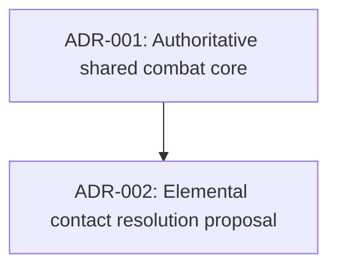

# Architecture Decision Records Index

> Last updated: 2026-10-15

## Dependency Order

The dependency expresses architecture compatibility; it does not change either record's approval status.

## ADR Registry

| # | Title | Status | Phase | Current Note |
|---|-------|--------|-------|-------------|
| [001](001-authoritative-combat-core.md) | Shared deterministic C# combat core with authoritative online services | **Proposed** | Shared-core foundation | Historical record remains `needs-human`; current implementation evidence lives in the relevant specs/code. |
| [002](002-elemental-reaction-resolution.md) | Shared-core elemental contact resolution with bounded child events | **Accepted direction** | Elemental feature | Owner approved the documented baseline on 2026-10-15; dependent E/K decisions and new detailed kit proposals remain explicit; runtime not implemented. |

## Phase Mapping

| GDD Phase | ADRs | Current Status |
|-----------|------|----------------|
| Shared combat authority | ADR-001 | Historical proposed direction; follow current source/spec evidence. |
| Elemental extension | ADR-002 | Approved baseline direction; see feature plan, supplied kits and E/K decisions before dependent coding. |

## How to Use

1. **Before making an architecture decision** → Check this index for existing decisions
2. **To create a new ADR** → Copy `_TEMPLATE.md` → Name it `{NNN}-{kebab-case-title}.md`
3. **After creating** → Add a row to the registry table above
4. **When superseding** → Update the old ADR's status to `Superseded by ADR-{NNN}`
