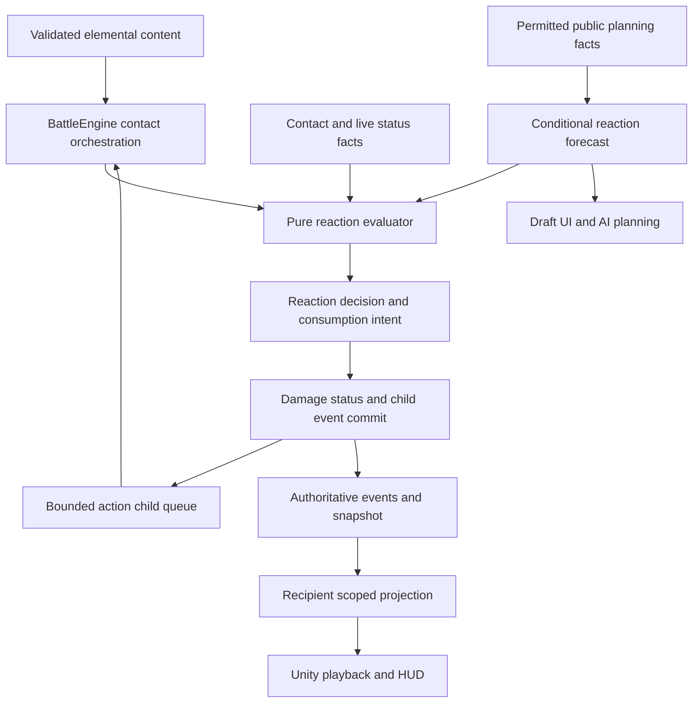

# Elemental system: implementation plan

Date: 2026-10-15. Status: owner approved the architecture and authorized A–H. A–F, G enemy planning and H automated Windows/editor integration are implemented; [G–H evidence](../../../../Artifacts/GenshinElementSystem/ImplementationGH.md) and [D–F evidence](../../../../Artifacts/GenshinElementSystem/ImplementationDF.md) supersede historical future-tense descriptions below. Android runtime acceptance is pending at the owner's request; human acceptance remains open. Generated stats and balance values remain starting values.

Design truth: [GDD `@tag:elemental-reactions`](../../1_Inputs_Templates/GDD_Fighting_Allstar.md#genshin-inspired-elemental-reactions). Related: [design spec](genshin-element-system-design-spec.md), [task card](genshin-element-system-task-card.md), [test plan](../TestPlans/genshin-element-system-test-plan.md), and [ADR-002 draft](../ADRs/002-elemental-reaction-resolution.md).

The owner requested and approved this plan. Latest authorization covers runtime D–F and the global 45% Shock/Poison, 70% Bleed correction. See the [D–F task](genshin-element-system-df-task-card.md). Earlier documentation-only/A–C-only scope is historical. Human feel/balance and Android acceptance are not claimed by automated checks.

## Outcome and constraints

Extend the existing pure shared C# combat authority with element identity, explicit application points, and deterministic reaction resolution. Preserve existing damage families, attributes, status snapshots, action costs, and actor/camera execution. Eligible teams consume all matching setup stacks except the confirmed source-preserving reactions. Overload damage is terminal.

Data-driven rules select reactions; character names never become branching conditions inside the resolver. Build a bounded child-event queue rather than callbacks that recursively call ordinary card execution. Every enabled rule must have validated fuel mapping, priority, damage policy, output recipe, limit policy, and public feedback data. The later confirmed Bunny/Waltz exceptions enter through typed authored triggered attacks, not a universal permission for reflected or periodic damage to react.

## Current state versus target

| Area | Observed current support | Required extension |
| --- | --- | --- |
| Content | Damage families, effects, traits, series, attributes, status recipes | Element IDs, eligible status registry, application point, reaction definitions, element resistance/modifiers, validation/export |
| Authority | Per-hit resolution, simultaneous root recipients, action events, snapshots, deferred defeats | Contact evaluation, atomic consumption, root/parent reaction lineage, child queue, action-local budgets |
| Statuses | Independent stacks, clocks, snapshots, removal, barriers, accumulation | Remove eligible instances by mapped element with exact event evidence; consumed incoming rider suppression; authored reaction outputs |
| Projection | Recipient-scoped views and events | Public fuel/status facts, enablement/reaction metadata, consumed instance IDs, element damage identity, public condition certainty |
| Planning | `PlanDraft` updates hand/order/gauge and targets | Symbolic combat/reaction forecasting through the queue; no authoritative RNG or hidden opponent state |
| AI | Candidate generation and heuristic damage scoring | Setup/conversion sequences, reaction value, consumed DOT value, role/control/shield evaluation |
| Presentation | Per-hit playback, status HUD, floating text, actor/camera/reaction barriers | Distinct elemental reaction handling, child impacts, inspector/forecast details, sound and VFX bindings |

These observations are file inspection, not a running-build verification. Existing local runtime/asset changes must be preserved and re-inspected when coding starts.

## Proposed architecture

`Rules` computes a decision without changing state, consuming RNG, or playing effects. Authority alone commits it. Forecast supplies permitted facts and reports uncertainty rather than borrowing private state. Application-capable origins are allowlisted: Swirl children and the later confirmed authored Bunny/Waltz attacks. Terminal reaction damage and ordinary DOT/reflect cannot reenter elemental application.

### Proposed contracts and ownership

Names below are proposed APIs/types, not existing declarations or new runtime files created by this task.

| Contract | Responsibility / owned data |
| --- | --- |
| `ElementId`, `ElementalReactionId` | Separate typed identifiers; never reuse attribute IDs or physical `HitReaction`. Append serialized enum values rather than renumbering existing families. |
| `ElementApplicationDefinition` | Element, application point, delivery via damage/status, optional recipe, and authored per-action opportunity policy. Default absent means no elemental behavior. |
| `ElementalReactionDefinition` | Directional partners, priority, consumption/preservation, output element/policy/recipe, propagation capability, and trigger/receipt limits. |
| `ElementalContactContext` | Root action, parent event, source, actual target, hit/application point, delivery acceptance, and immutable current-contact input view. |
| `ElementalReactionRules.Evaluate(context, facts, definition, budgetView)` | Pure result containing reaction ID, exact existing fuel instance IDs, consumed incoming delivery, source snapshot intent, and output/child intents. |
| `ElementalActionContext` | Authority-owned per-root-action application, reaction-occurrence, Swirl-emission and damage-receipt budgets; pending child intents; stable event sequence. Explicit triggered-attack IDs remain linked to their originating card/status. |
| `ElementalReactionSystem.Commit(decision, state, actionContext)` | Revalidate selected fuel, consume atomically, invoke explicit damage/status paths, suppress spent riders, emit events, and enqueue permitted children. |
| `ReactionForecast.Evaluate(publicView, draftActions)` | Conditional reaction path and consumption forecast; updates projected fuel state through earlier queued actions without mutating the match. |

Do not persist action-local queues as unexplained global statics. If execution can pause between contacts, include the required queue/budget cursor in its existing execution state; if submission resolves atomically, keep it transient and reconstruct only at transaction boundaries. Either path must pass replay/resume tests. Team eligibility is encounter state and must deep-clone/serialize.

### Contact transaction and hit batching

1. At the existing root hit boundary, capture the original recipient set, immutable formula inputs, and potential Swirl source instance IDs. Keep existing hit-major order.
2. Resolve targeting/evasion and any authored status-dependent application acceptance. Cache acceptance results for this delivery; never reroll during commit. A crit-conditioned rider uses the resolved crit fact and is not retroactively allowed to change its own crit roll.
3. Select the incoming element. Coalesce matching direct-element and status delivery from the same contact. Query the pure evaluator and reserve exact consumption/application budget intents.
4. Compute damage from the existing formula plus explicit proposed element/bridge/amplification stages. Avoid a second resolver pass on already resolved damage, duplicate defense, and intermediate rounding. Commit target-local root facts as a simultaneous batch.
5. Commit eligible status removals and output events, marking any incoming rider consumed. Reaction-generated damage/status outputs carry source and lineage. Add secondary lethal victims to the same action's pending-defeat set.
6. Emit captured Swirl sources in stable slot order, checking that the exact source fuel remains. Drain each permitted child's consequences in stable recipient-slot order before the next root hit. New setup cannot join the captured source list. Never rescan the entire field after every event.
7. Complete deferred riders not already consumed. Continue normal action completion, defeat/reserve, counters, reflect, and lifesteal with origin filters; clear budgets at the root action boundary.

Keep a clear distinction between reaction-occurrence budgets and overlapping damage-receipt budgets. Duplicate Overload damage can be suppressed while valid local fuel is still consumed. A fully exhausted application/occurrence opportunity produces no new reaction and no reaction consumption; ordinary authored status behavior still needs to follow its explicit rule.

Before coding E-04, specify whether an immune Frozen output consumes fuel. A rejected output must not create a partially committed transaction inconsistent with the public event stream. Consumption must remove exact eligible instances without treating Grey cleanse rules, Conductive, or unrelated DOTs as equivalent fuel.

### Damage-policy proposal

Retain the original `DamageFamily` semantics. Prefer an explicitly appended reaction family/policy for separate reaction packets, with `ElementId` orthogonal to all families; decide the exact serialized form in ADR-002 review. Avoid identifying a reaction solely by DOT family or colored text.

| Packet | Proposed source/modifier policy | Mitigation and callbacks |
| --- | --- | --- |
| Elemental card hit | Current Normal source/keyword modifiers plus the explicit DOT-dealt bridge if E-03 is adopted | Current crit/block/attribute/defense/pierce, then named element/amplification stages before final cap/shield/rounding; ordinary card callbacks remain once. |
| Separate instant reaction | Authored source stat/coefficient, reaction bonus category and element modifiers; no copied Normal card coefficient/keywords | Explicit policy for element resistance, cap and shields; no normal crit/block/lifesteal/reflect or normal-card retriggers by default. Generic/DEF bypass must be configured and tested, not inherited accidentally. |
| Swirl destination damage | Swirl source snapshot and element; destination amplification may modify this packet | Never recalculate as a new Normal skill; terminal after its destination reaction consequences. |
| Charged/Burning tick | Authored snapshot and periodic recipe with trigger ownership | Named clock, explicit DOT/reaction modifier category, no application/recursion. |
| Crystallize | E-08's chosen actual damage basis and authored coefficient | Separate barrier grant; enforce cap/lifecycle and avoid repeating the full action total per AOE victim. |

The final resistance, bridge, amplification, mitigation, cap and rounding stage order is a named E-03 deliverable. Do not silently alter non-elemental calculations while adding it. Keep precision until the existing final flooring point and test caps/overkill/shields at boundaries.

## Affected files and integration responsibilities

All source paths below are relative to the repository root. They are existing files unless marked proposed.

| Files / area | Planned change |
| --- | --- |
| `Shared/FightingAllstar.Core/Content/CombatContent.cs`, `EffectRecipes.cs` | Add optional element/application and modifier data, clone support, preserving legacy defaults. |
| `Shared/FightingAllstar.Core/Content/ElementalReactionDefinitions.cs` (proposed) | Typed registry/rules and validation; references to authored status recipes. |
| `Shared/FightingAllstar.Core/Combat/ElementalReactionRules.cs`, `ElementalReactionSystem.cs` (proposed) | Pure decisions and bounded authority commits; keep BattleEngine orchestration thin. |
| `Shared/FightingAllstar.Core/Combat/BattleEngine.cs`, `BattleModels.cs`, `TurnExecutionState.cs` | Contact hook, action context, team flag, event metadata, secondary pending defeats, execution boundaries. Inspect current execution ownership before adding persistent fields. |
| `Shared/FightingAllstar.Core/Combat/StatusSystem.cs`, `CardEffectSystem.cs` | Exact mapped-instance consumption, status delivery acceptance/result, consumed-rider suppression, output clock/snapshot use. |
| `Shared/FightingAllstar.Core/Combat/DamageResolver.cs`, `AttackEffectSystem.cs`, `CharacterPassiveRuntime.cs` | Explicit formula/modifier stages and origin filters; refresh derived contributions after consumption without applying normal keywords twice. |
| `Shared/FightingAllstar.Contracts/Projections/BattleView.cs`, `Shared/FightingAllstar.Core/Combat/BattleProjectionBuilder.cs` | Safe public fuel/element facts, enablement, reaction events, consumption details, reconnect parity. Keep physical reaction fields distinct. |
| `Shared/FightingAllstar.Core/Combat/ReactionForecast.cs` (proposed), `PlanDraft.cs` | Forecast symbolic setup transitions and conditional results in queue order; reset/undo/auto-commit integration. |
| `Shared/FightingAllstar.Core/Combat/AI/CandidateBuilder.cs`, `UtilityScorer.cs`, `PlanSimulator.cs` | Generate and score prepare/trigger orders and conversion cost using permitted facts. Existing plan validation alone is not combat simulation. |
| `Assets/Project/Runtime/Content/CharacterObject.cs`, `CharacterObjectCatalogBuilder.cs`, card SOs and editor drawers | Expose typed element/application/outputs; validate missing status aliases and incomplete kits. Preserve serialized assets/GUIDs and existing user edits. |
| `Assets/Project/Runtime/Content/StatusVisualData.cs`, status visual catalog | Element/reaction icons and output status bindings without classifying every DOT as elemental. |
| `Assets/Project/Runtime/Presentation/Combat/CoreBattleSceneController.Playback.cs`, `.Feedback.cs`, `BattleStagePresenter.Execution.cs`, `.MultiHit.cs`, `.Reactions.cs` | Play recorded root/child events with correct impact/readiness grouping. Do not conflate existing physical reactions with elemental reactions. |
| Combat HUD/inspector/detail/card text files | Show element, valid setup, consumed/preserved stacks, conditional forecast, and reaction names using shared metadata. |
| `Tests/CombatPresentation/ElementalReactionChecks.cs`, `ElementalReactionVisualChecks.cs` (proposed) | Deterministic fixtures and Unity playback checks, wired into the existing harness pattern. |

Server projects consume the shared model; inspect their serialization/revision validation before extending public contracts. Do not deploy or change services/dependencies/build configuration as a hidden part of this feature. Rebuild shared assemblies through the project's existing process during eventual integration; do not edit compiled binaries or duplicate Core source under Assets.

## Implementation sequence and exit criteria

**Completion update:** A's enabled-subset decisions/inventory, B's shared foundation, and C's deterministic core are implemented. The owner confirmed no extra provider, amplification-first priority, and the proposed damage starting policy. Default production fuel remains Ignite/Shock; missing status/kit outputs are excluded. Focused A–C checks pass (264 assertions); related regression/build/editor evidence and the separately reproduced pre-existing full-suite failure are linked above. This does not mark D–H, visual/game-feel checks, or complete character publication done.

| Slice | Work and dependency | Exit evidence |
| --- | --- | --- |
| A — rule/content inventory | Review E-01–E-08 with the owner as needed; resolve schema-level decisions first. Map actual recipes, aliases, trait IDs, output categories, source conflicts, and application points. | Decision answers recorded in GDD; precise formula/priority policy for enabled subset; unresolved reactions excluded from production catalog. No global Shock rebalance. |
| B — compatible foundation | After A's schema decisions: typed data, validator, clone/serialization, encounter eligibility, neutral defaults. | Existing non-elemental fixtures unchanged; both sides gate from starting roster; invalid rule catalogs fail clearly. |
| C — deterministic core slice | After B: direct amplification and Pyro/Electro conversion with contact acceptance, all-stack consumption, terminal damage, lineage and budgets. | Reversed order, aliases/multiple owners, shield/evasion, incoming-rider suppression, and AOE overlap fixtures pass. Equivalent visual hit counts cannot add opportunities. |
| D — Swirl and formation | After C: source-preserving Swirl, hit-start candidates/live recheck, adjacency and taunt, child queue and secondary defeat aggregation. | User's single-target/AOE examples match the GDD; consumed source cannot emit; root batch remains simultaneous; no Overload→Melt. |
| E — public forecast and feedback | Begin projection scaffolding after B; complete after C/D event semantics. Add conditional forecast, HUD/status updates, audio/VFX, playback barriers. | Forecast agrees on guaranteed symbolic outcomes, shows conditional branches before auto-commit, reset does not mutate live state/RNG, reconnect/skip preserves final HUD. |
| F — remaining outputs and kits | Implement each only after its dependent E decisions: Freeze, Superconduct, Charged/Burning, bounded Crystallize; finish Lisa/Lumine authored counters and modifiers. | Exact clocks, rejection/consumption, caps and snapshot fixtures pass; complete validated content only. Can proceed independently of AI polish once core/events are stable. |
| G — enemy planning | After C/D; extend after F. Generate setup/trigger combinations and value spent DOT/control alongside immediate damage. | Controlled equal-progression situations prefer explainable combos without private hand/RNG access or systematic always-trigger behavior. |
| H — integrated acceptance | After required C–G subset: headless regressions, Windows/Android playback, content export and shared assembly integration, player readability/abuse checks. | Test plan evidence recorded per platform; no recursion/stall exploit, privacy leak, unrelated combat regression, or incomplete enabled reaction. Owner reviews final feel. |

First playable milestone: validated fixture teams demonstrating setup→amplification, setup→Overload, and Lumine-style Swirl→Overload with consumption visible. It is not the full seven-element release and does not require unresolved Freeze/Crystallize tuning to prove the selected combat loop.

This milestone is **not yet complete**: A–C establish amplification/Overload authority and events, while Swirl/visible consumption/forecasts require D/E. Actual A–C types are `ElementalRuleSet`, `ElementalApplicationDefinition`, `ElementalReactionRules`, and the contact/batch commit integration in `BattleEngine.Elemental.cs`. Budgets are transient inside atomic plan resolution. Public projections now carry elemental schema/version, eligibility, reaction/element/origin, parent event and consumed-instance facts; no forecast or private state is added.

## Five-character content extension

Design truth: [GDD `@tag:genshin-roster`](../../1_Inputs_Templates/GDD_Fighting_Allstar.md#genshin-starter-roster); detailed input: [roster and generated stats](CharacterData/genshin-character-roster.md). The owner supplied five kits after approving this plan, confirmed R3/C0 and target icons, chose natural-expiry-only Bunny, permitted Bunny/Waltz reaction contacts, and defined Amber's Explosion scope and Barbara's Dissolve. These confirmations supersede any earlier implication that Swirl is the sole reaction-capable generated attack.

### Additional data and engine work

| Proposed extension | Implementation responsibility and exit evidence |
| --- | --- |
| Typed damage origin and capability policy | Distinguish card, periodic tick, delayed authored attack, authored retaliation, generic reflect, and reaction. Allowlist application and retaliation capabilities; inheritance/lineage cannot convert terminal packets back into attacks. |
| `StatusRemovalReason` and expiry commands | NaturalExpiry, Cleanse, Replacement, Defeat, Consumption, and EncounterCleanup are typed causes. Only natural Bunny expiry schedules its attack. Collect immutable expiry intents before removing status instances; never infer the cause from text or generate it twice on resume. |
| Delayed attack ownership/snapshot | Store source ID, source side, placement action ID, rank/output definition, snapshot policy, and expiry group. Proposed: markers from the same placement action expiring together share one generated root/group, preserving overlapping Overload receipt limits. Revisit only if K-01 chooses another explicit policy. Bunny detonation targets its marked enemy unless an authored scope says otherwise; Explosion metadata alone does not add splash. |
| Explosion damage category | Orthogonal eligibility tag for Bunny, Overload and explicitly authored explosions. Amber's team modifier applies once per packet, even if it matches several tags. Reaction modifier and explosion modifier stages remain separately inspectable. |
| Authored retaliation | Waltz owns its calculation, trigger limit, Cryo application, Frost Bite snapshot and healing. Do not implement it by increasing generic ReflectDamageBp. Apply anti-retaliation/reflect lineage flags to the attack and its reaction descendants. |
| Gauge rate and target-turn-end operations | Add a specific rate policy and serialized fractional carry if that policy is selected; define caps, rounding, gain sources and reset semantics. Dissolve schedules an actual gauge delta at target TurnEnd, not a DOT tick. Amount/duration/refresh remain K-04; do not invent them to unblock export. |
| Healing and lowest-ratio selection | Separate source damage basis, beneficiary, aggregation window, MaxHP snapshot/live policy, Recovery and recovery prevention. Ratio comparisons and ties must be deterministic. No HP-from-overkill, duplicate AOE heal, or revival from deferred zero HP. |
| Authoring/import | Add five separate draft IDs without altering the 29-character source JSON or inventing CSV/category IDs. Mark generated stats/ranks by provenance; preserve source percentages and normalize neutral Avoidance correctly. Complete traits/category/growth and all required fields before runtimeReady. |

These are required extensions to the plan, not assertions that their types currently exist. No extra package, Unity hierarchy, scene, or deployment change is assumed.

### Content delivery order

1. Import draft metadata/base-stat profiles and validate source/rank/attribute/element separation. Generate test-only full-Genshin formations; do not publish incomplete fighters in summon/enemy pools.
2. Author Lisa/Lumine's known direct contacts and support rules on core slices C–E. Resolve K-03/K-05 before claiming complete kits.
3. Add Barbara's healing, Melody, and Dissolve after their K-04 choices. Verify Hydro driver behavior without an unstated Wet rider.
4. Add Amber's typed expiry attack and Explosion category, testing safe cleanse and grouped multi-target expiry. Resolve K-01's burn/snapshot details before enabling her full source kit.
5. Add Kaeya's gauge-rate policy and Waltz after anti-retaliation, source attribution and heal policies exist. Complete C5 scope and K-02's intermediate progression before publishing all constellation levels.
6. Evaluate all five bench choices, generated-stat growth, C0/C5 tradeoffs, new origin/expiry forecast, AI sequencing, and platform playback. Keep Geo/Dendro fixtures because this roster has neither element.

This order supplies useful reaction fixtures before the most complex reactive kit. It does not change the source kits or silently remove missing effects to declare a fighter ready. New exit tests are [roster extension checks](../TestPlans/genshin-element-system-test-plan.md#roster-extension-checks).

No schedule or point estimate is asserted. Implementation should be reviewed by slice, with meaningful tests at each exit; repeat only checks affected by new changes/failures. Owner requests to implement a later slice can authorize that work without reopening already settled design choices.

## Validation, compatibility, and completion

Use the [test plan](../TestPlans/genshin-element-system-test-plan.md) as the acceptance matrix. Existing `Tests/CombatPresentation/Run.ps1` is the observed headless harness entry; focused runners cover multi-hit/physical reactions/status HUD. Proposed new fixture/runner names must be created and inspected before anyone claims they ran.

Version content, public event contracts, and snapshots as required by the actual serializer; preserve old numeric enum meanings and omitted-field defaults. Either migrate old resumable state explicitly or reject incompatible content with a clear version response. Never reconstruct live reaction state from visual effects. No package or CI change is required by this plan.

Feature completion means the enabled reaction subset is validated, publicly forecastable with honest uncertainty, deterministic/replayable, usable by both sides, and readable under the existing presentation flow. All recipe/tuning decisions for that subset are recorded; platform and owner playtests are evidence, not unchecked boxes. This documentation task does not claim any of those runtime checks have passed.
