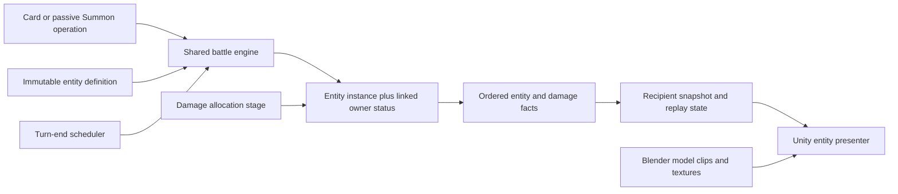

# Summon and Geo Construct architecture

Approved direction by the owner on 2026-10-21; backend implemented under ADR-003. Actual code uses inline `BattleEntityDefinition`, flat optional capacity fields, and a shared allocation seam inside `CombatPolicySystem`. Full backend evidence is in `Artifacts/Summons/Backend/Implementation.md`. The document below preserves the original proposal; its presentation stage remains future work.

Date: 2026-10-21. Proposed architecture, based on the working-tree source. This document implements no runtime classes. Read with the [design](summon-geo-construct-design-spec.md), [art plan](summon-geo-construct-art-plan.md), and [tests](../TestPlans/summon-geo-construct-test-plan.md).

## Existing foundations and gaps

Paths below are relative to the repository root. Current files live under `Assets/Project/`; older README/template references to other asset roots are stale.

| Verified source | What exists | Consequence |
| --- | --- | --- |
| `Shared/FightingAllstar.Core/Content/EffectRecipes.cs` | Grey status color, source-defeat break rule, duration clocks, triggered attack definitions | Reuse these foundations; do not make a parallel buff system |
| `Shared/FightingAllstar.Core/Combat/StatusSystem.cs` | Grey blocks generic dispel, but recipe-specific removal and layer consumption can still remove it | Structural marker removal needs an explicit lifecycle policy |
| `Shared/FightingAllstar.Core/Combat/CharacterPassiveRuntime.cs`, `NotifyFighterDefeated` | Removes source-defeat statuses before defeat reactions; both ordinary and DOT defeat paths call it | Extend shared defeat cleanup rather than attaching only a Unity death callback |
| `Shared/FightingAllstar.Core/Combat/BattleEngine.cs`, `EndTurn` | DOT/healing, outcome, team-end passives, duration advancement, expiry attacks | Insert summon scheduling before duration advancement and remove old duplicate attacks |
| `Assets/Project/Editor/BuildPreReleaseLaunchRoster.cs`, `SummonRecipe` and character passive cases | Guoba/Oz neutral markers and passive damage; Jade Screen self barrier | Migrate these approximations explicitly; they are not already field entities |
| `Shared/FightingAllstar.Core/Combat/DamageResolver.cs` | Formula and personal-shield/HP allocation are combined | Add an allocation seam for shared construct capacity |
| `Shared/FightingAllstar.Core/Combat/CombatPolicySystem.cs`, `PrepareIncomingDamage` | Recomputes HP-directed damage from calculated damage and target shield | Carry the new allocation receipt through caps/survival; subtraction in one caller is insufficient |
| `Shared/FightingAllstar.Core/Combat/BattlePlaybackState.cs`, `BattleProjectionBuilder.cs` | Event playback and recipient projections | Entity snapshots and immutable events must enter both |
| `Shared/FightingAllstar.Core/Combat/AI/AiPlanningObservation.cs` | Manually builds an observed `BattleState` | Copy entity state there as well as in deep clones |
| `Shared/FightingAllstar.Core/Content/CombatSupportDefinition.cs` | Passive stat/cadence/support capabilities | Keep battlefield objects in their own model, rather than expanding this unrelated type |
| `Assets/Project/Runtime/Presentation/Combat/BattlePlaybackDriver.cs` | Profiled actor sampling; disables AnimationEvents/root motion and strips clip events | Recorded facts and presentation markers must drive summon playback |

## Architectural decision proposal

Add a lightweight `BattleEntity` model owned by the shared combat core. `GeoConstruct` is a category; `AbsorptionDefinition` is an optional capability. Entities are not `FighterState`, do not enter formations/hand generation/initiative, and do not run Unity scripts as combat authority.

Use one linked grey structural status as the lifetime authority. Entity instances store identity, owner, marker link, capacity, and trigger bookkeeping. They do not maintain an independent remaining-turn counter. This preserves one answer for HUD, scheduler, save/load, and expiry.

Definitions are immutable versioned core data. Unity presentation profiles reference prefabs and clips by the definition's presentation key. A material, socket, animation event, collider, or missing prefab cannot determine whether an entity exists or protects an ally.



This follows the shared authority boundary described by ADR-001 and the bounded contact/child-event direction in ADR-002. Neither historical ADR status is changed. Draft a dedicated ADR when the entity/allocation approach is accepted; the current package is the reviewable proposal.

## Proposed data contracts

Names below are proposed, not declarations that already exist.

| Type | Responsibility and fields | Owned state |
| --- | --- | --- |
| `BattleEntityDefinition` | Stable ID, category (`Summon`/`GeoConstruct`), owner marker recipe, trigger/target policy, action payload, optional absorption, recast policy, presentation key | Immutable catalog content |
| `BattleEntityActionDefinition` | Owner-team-end trigger, target scope, hit policy, existing triggered-attack payload and explicit elemental application/origin permissions | Immutable action content |
| `AbsorptionDefinition` | Protected relation, allowed damage-family/origin filter, owner-stat capacity formula, deterministic priority | Immutable capability content |
| `BattleEntityInstance` | Instance ID, definition ID/version, owner fighter ID, marker status ID, side, spawn order, maximum/remaining capacity, eligible-from occurrence, last activation occurrence | Battle-local mutable state |
| `BattleEntitySystem` | Validate/create/replace/remove, reconcile marker links, gather jobs, revalidate availability | Uses `BattleState`; no scene state |
| `DamageAllocation` | Immutable pre-allocation `FormulaDamage`, construct absorptions, remaining damage, personal shield loss, HP-directed damage, final HP loss, prevention/overkill | Per-packet calculation/commit receipt |
| `BattleEntityView` | Public identity/owner/category, definition/presentation key, remaining duration from marker, capacity, next trigger | Recipient snapshot DTO |
| `BattleEntityPresentationProfile` | Prefab, model correction, sockets, placement mode, clips, reveal/contact/completion markers, audio/VFX bindings | Unity asset only |
| `BattleEntityPresenter` | Spawn/update/sample/remove views by stable instance ID; idle/action and effect cleanup | Session-scoped view registry |

Suggested narrow operations, expressed as contracts rather than implementation code:

```text
CreateOrReplace(state, ownerId, definitionId, rootActionId) -> entity facts
CollectTurnEndJobs(state, side, occurrenceId) -> stable job list
ResolveEntityAction(state, job, randomContext) -> existing damage/reaction facts
RemoveEntity(state, instanceId, typedCause) -> marker and entity removal facts
AllocateDamage(state, packetContext, formulaResult) -> allocation receipt
ApplyEntityFact(playbackState, fact) -> reconstructed public entity state
```

Append `Summon` to the existing `EffectKind` and `CardEffectOperationKind` schemas; add a typed definition reference/payload to their models and compiler/conversion paths. Passive `ExecuteCardEffect` should use the same operation. Append serialized enum members without renumbering old content. Do not reuse the existing economy protocol's `Summon` command or gacha presentation classes: they describe character acquisition.

The owner marker uses `Polarity=Buff`, `Color=Grey`, `BreakRule=OnSourceDefeated`, identity including owner/source, and an explicit structural entity link. Its self-target duration uses the existing owner-side end clock. A structural flag/query category excludes it from ordinary buff counting, stealing, transferring, cleansing, and elemental fuel consumption. Existing explicit summon-tag conditions remain available.

Extend validation to reject missing entity definitions, invalid category/capability combinations, nonpositive finite lifetimes, invalid/overflowing capacity formulas, unsupported triggers/targets, duplicate sockets/markers, and self-recursive payloads. Nullable absorption means no interception; category never supplies it implicitly.

Enforce a reciprocal one-to-one entity-to-marker link. In this slice, each entity definition owns a distinct marker recipe; reject different definitions reusing one structural recipe. Existing status identity supports Recipe or RecipeAndSource, so sharing a recipe on the same owner could otherwise merge the lifetimes of different entities. Validate both link directions and absence of orphan markers/entities during creation, replacement, cloning, and load.

## Lifecycle, timing, and action resolution

1. Validate the owner, summon definition, effect conditions, and reentrant limits at the authoritative Summon operation.
2. In one mutation, remove a previous same-owner/same-definition instance with `Replaced`, create the new marker and instance, initialize capacity, and emit creation facts. A rejected operation leaves no orphan marker or half-created instance.
3. For initial Guoba/Oz, read the owner's effective attacking stats once at action start and preserve existing hit snapshot semantics. Snapshot Jade capacity at creation; do not rescale it every time owner Max HP changes.
4. At turn end, preserve existing DOT/heal/defeat/outcome resolution. Capture eligible existing entity IDs before turn-end callbacks can create more. Merge jobs with existing turn-end rules using explicit stable scheduling keys, not callback registration order.
5. Recommended ordering key: phase, side/owner formation order, authored rule priority, instance creation order, stable instance ID. Serialize the required sequence/occurrence state and test repeated runs.
6. Mark a scheduled activation with its occurrence ID before resolving its payload. Recheck instance, marker, owner `IsAlive && Health > 0`, battle continuation, and living targets at execution; recheck before later contacts. Never reactivate the same instance in the same occurrence.
7. Resolve the action through the existing typed damage/elemental pipeline, with owner attribution and a distinct entity origin. Finish the bounded permitted reaction queue before the next action. No synthetic `CardPlayed` event, card consumption, normal PG grant, or fabricated hand card.
8. Advance the marker's owner-side duration after the final eligible action. Remove expired entities before further packets/jobs can use them. Entities created during this boundary become eligible at the next boundary and skip this boundary's duration decrement.
9. Preserve existing deferred defeat scopes: a pending-zero-HP owner cannot start new entity actions or supply interception; committed defeat removes the entity before defeat reactions proceed. Do not move fighter defeat finalization earlier merely to remove a model.

There is no new continuous aura loop. If an entity supplies a modifier, expose a core capability evaluated during existing passive/aura refresh while the instance and owner are eligible. Remove it atomically with the entity. Detailed Guoba attack buffs and other kit riders remain explicit content migrations.

Centralize lifecycle reconciliation for all marker mutation routes: expiry, source defeat, replacement, targeted removal, layer consumption, loaded snapshot validation, and battle teardown. Gameplay removal requests cannot remove structural markers; trusted lifecycle removal supplies a typed cause. Color alone is insufficient. Repeated removal is idempotent; stale jobs reference instance IDs and cannot act on a replacement.

## Damage allocation change

The difficult change is a shared post-formula allocation stage, not model spawning. Extract or expose the completed integer damage from `DamageResolver` without changing existing formulas, variance draws, hit-splitting, damage caps, or rounding. Then allocate in this order:

```text
Avoidance / immunity and existing contact decisions
  -> target-specific formula, mitigation, rounding, and hit amount
  -> eligible construct pools in explicit priority order
  -> personal shield allocation (honor BypassShield)
  -> existing HP-directed caps / prevention / survive-lethal rules
  -> atomic state commit and immutable receipts
```

`CombatPolicySystem.PrepareIncomingDamage` must receive the remainder/HP-directed portion from this receipt instead of recalculating from the original amount. Add an immutable `FormulaDamage` (after formula rounding/hit splitting, before resource allocation) and explicit absorption fields. Existing `CalculatedDamage` is not an immutable formula field: incoming-cap code can already reduce it. Document and regression-test its legacy/event `Amount` compatibility separately; do not assert it stays equal across pool/no-pool cases where HP cap activation differs. Never include absorbed amounts in `HealthLost`.

For each construct, consume `min(remaining capacity, unallocated damage)`; pass the remainder to later pools/personal allocation. Remove a depleted pool before the next packet. Full/partial interception must neither rerun the formula nor spend the same capacity twice. Use overflow-safe integer arithmetic.

All packet commit routes must use this seam: card damage, passive damage, DOT, reflection, triggered attacks, elemental reaction contacts, and reaction outputs. Relevant existing files are `BattleEngine.cs`, `BattleEngine.TriggeredElemental.cs`, `BattleEngine.Elemental.cs`, and `BattleEngine.ReactionOutputs.cs`. Reflection currently has a manual commit path and requires particular attention.

Existing `DamageProfileDefinition.BypassShield` / `DamagePolicy.BypassShield` continue to control personal shields. If an exception to constructs is needed, add a separate explicit `BypassConstruct` policy, default false. Do not infer it from True damage or personal-shield bypass. Health costs and direct HP assignment do not enter this damage seam.

For AoE/multi-hit, retain captured formula inputs and existing target/hit traversal, but spend capacity live in an explicit documented formation order. Make the existing ordering a contract with tests; do not depend on hash/list iteration accidents. A shared pool creates deliberate slot ordering effects, so show capacity and ordered receipts. Proportional simultaneous sharing is an alternative that would require grouped allocation and a separate design change.

Root/child reaction timing remains unchanged. A fully intercepted hit follows existing shield-absorbed-contact semantics for elemental application, counters, and damage-resolved notifications. Owner/stat attribution remains the attacker; absorption is separately attributed to the construct and protected target. HP-loss-based effects read actual committed HP loss.

## Events, snapshots, replay, and privacy

Append entity fact kinds such as `EntityCreated`, `EntityActionStarted`, `EntityActionEnded`, `EntityAbsorbedDamage`, and `EntityRemoved`. Use typed causes: `Expired`, `CapacityDepleted`, `OwnerDefeated`, `Replaced`, `BattleEnded`, and `ScriptedLifecycle` where explicitly supported. Do not send all removals through `Broken` and accidentally fire capacity-break rewards.

Each applicable fact carries event ID, root action/parent lineage, owner ID, entity instance/definition ID, triggering occurrence, and immutable after-state needed by playback. Damage allocation carries per-construct absorbed amount/capacity-after plus shield/HP after-state. Pair exact marker mutation facts with exact entity facts within the same revision. Group presentation facts by entity activation ID so repeated attacks from the same owner do not merge totals.

Snapshots expose both sides' visible entities and public lifetime/capacity. They do not expose private hands, RNG, hidden counters, or future jobs. Add public status fields sufficient for polarity, grey/locked presentation, structural classification, and entity linkage; current `PublicStatusView` does not contain these.

Update together: `BattleState.Clone`, `BattleEvent.Clone`, `BattlePlaybackState.Apply`, `BattleProjectionBuilder`, Contracts DTOs, local/remote session serialization, observed AI state construction, and any replay hashes. Copy definitions deeply or freeze content references according to existing catalog patterns. Persist entity sequence and turn-occurrence bookkeeping. On reconnect, build from the public snapshot and apply subsequent event IDs once; do not replay battle-start creation as a new passive.

Include `BattlePlaybackState.BeforeOpeningDeal` in reconstruction work. It currently clones already-opened state and resets opening hand/gauge/event data; new entity state and linked opening markers cannot simply survive that reset. Reconstruct the actual pre-opening entity/status state, then apply opening creation facts exactly once. Battle-start Jade Screen must neither appear before its creation fact nor duplicate during the opening replay.

Default old snapshots to an empty entity list under their recorded rules version. Do not infer new entities from legacy neutral marker names in historical battles. Newly compiled content opts into new definitions; unsupported schema/content versions fail visibly rather than silently falling back. AI and forecasts receive only permitted public entity facts; symbolic forecasts must not roll the live random stream.

## Unity presentation integration

Add an entity view registry under the battle presenter's owned scene root. Reuse the actor profile concepts for yaw correction, bounds, sockets, clip lookup, and authored contact markers, but do not make an entity a fighter or require a fake card to animate it.

Placement modes are data: owner cast socket to fixed ground anchor for Guoba, stable owner-formation hover anchor for Oz, and team-front ground anchor for Jade Screen. Resolve animation-dependent offsets at the reveal marker. Record/reconstruct semantic placement data where needed for replay; Unity world coordinates never affect damage/protection. Grounded views detach after placement so actor approach/recovery does not drag them.

Extend playback/timeline handling beyond the current `CardPlayed`-only action assumption. Live playback, Battle Lab sampling, replay scrubbing, and Skip should all consume entity activation facts. Marker times only synchronize those facts. Provide a visible fallback prefab/clip pose, finish/timeout fallback, and idempotent effect cleanup.

Logical removal takes effect immediately; a short break/despawn visual can finish as a noninteractive view. It cannot intercept damage or block touches/colliders. Disable gameplay colliders/root motion, preserve the current actor/camera matrix, and dispose all entity views, idle audio, instantiated materials, and transient VFX on battle exit.

## Affected files and proposed additions

| Area | Existing files / proposed addition | Change |
| --- | --- | --- |
| Core content | `Content/CombatContent.cs`, `EffectRecipes.cs`, `PassiveRules.cs`; new `BattleEntityDefinition.cs` | Typed operation, definitions, capability validation, clone/conversion support |
| Core execution | `Combat/BattleEngine.cs`, `CardEffectSystem.cs`, `CharacterPassiveRuntime.cs`; new `BattleEntitySystem.cs`, `BattleEngine.Entities.cs` | Create/remove, schedule actions, lifecycle hooks |
| Damage | `DamageResolver.cs`, `CombatPolicySystem.cs`, engine elemental/triggered/reaction-output partials | Common formula/allocation receipt across all origins |
| Status and keywords | `StatusSystem.cs`, `AttackEffectSystem.cs` | Protected structural marker lifecycle; ordinary-buff/fuel exclusion |
| State and views | `BattleModels.cs`, `BattlePlaybackState.cs`, `BattleProjectionBuilder.cs`, Contracts `Projections/BattleView.cs` | Entity state/events, clone, projection, playback |
| AI and forecasts | `Combat/AI/AiPlanningObservation.cs`, `ElementalForecast.cs`, simulation paths | Observed entity copy and permitted-fact prediction |
| Authoring | `Studio/` schema/compiler/validation/serialization, Unity content adapters | Authorable Summon operation and capability; reject unsupported content |
| Roster migration | `Assets/Project/Editor/BuildPreReleaseLaunchRoster.cs`, prerelease Xiangling/Fischl/Ningguang data | Replace old markers/attacks/self barrier without duplicate logic |
| Presentation | `BattleStagePresenter*`, `CoreBattleSceneController.Playback.cs`, `BattlePlaybackDriver.cs`; new entity presenter/profile | View registry, autonomous timelines, inspection/Skip/rebuild |
| Public HUD | `CoreFighterHud.cs`, `CombatDetailFormatter.cs`, `BattleCharacterInspector.cs`, status visuals | Grey structural icons, capacity, next trigger, ownership |

## Implementation slices and exit gates

| Slice | Deliverable | Exit evidence |
| --- | --- | --- |
| Foundation | Definitions, Summon operation, instance-marker invariants, death/expiry/recast, public snapshots | Core lifecycle and serialization tests pass; no Unity dependency |
| Autonomous actions | Deterministic turn-end scheduler, Guoba/Oz payloads, origin and lineage | Correct advertised action count; no duplicate old passive attack or PG |
| Absorption | Shared allocation seam and Jade Screen capability across every origin | Full/partial/exact exhaustion, shields/caps/survival, AoE and replay parity |
| Presentation proof | Placeholder views, marker-driven placement, idle/action, fallback, Skip/sampling | Live/preview/replay show the same entities and contacts |
| Art production | Proved rigged import, then final Guoba/Oz/Jade assets | Art plan's camera, animation, texture and material checks pass |
| Content integration | Versioned source migration, Studio support, descriptions and inspection | Authoring round trip and source-kit migration inventory reviewed |
| Verification | Regression and playtest package | Linked test plan executed, failures resolved, measured evidence recorded |

Do not regenerate the entire roster to update three kits. Inventory current authored overrides first, migrate only the affected content, and retain unrelated working-tree edits. Rebuild the existing Shared assemblies through the established project process after runtime implementation; no build, renderer, dependency, or hosting change is needed for this proposal.
