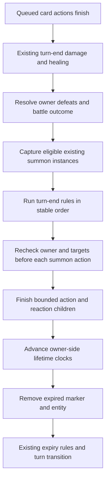

# Summon and Geo Construct game design

Approved by the owner on 2026-10-21. Backend implemented and source kits integrated; visual feel remains unverified until the next phase. Implementation evidence: `Artifacts/Summons/Backend/Implementation.md`; architecture decision: ADR-003. The planning wording below records the approved baseline and its explicit interpretations.

Date: 2026-10-21. Planning draft; gameplay is not implemented by this document. See the [task](summon-geo-construct-task-card.md), [architecture](summon-geo-construct-arch-plan.md), [art plan](summon-geo-construct-art-plan.md), and [tests](../TestPlans/summon-geo-construct-test-plan.md).

## Player goal and context

Summoning converts a card or passive into persistent battlefield value. The player invests now, keeps the owner alive, and anticipates a later attack or protection. Guoba should feel grounded and energetic; Oz should feel alert and electrical; Jade Screen should visibly stand between the team and incoming damage.

The actor receives a grey status showing the entity's portrait, name, and remaining owner-turn duration. Inspection states its next trigger and removal rule. The entity appears at the cast's presentation marker, loops its own idle animation, performs its own action, and disappears when its lifetime ends. It does not take an active fighter slot or add cards/actions.

## Requirements and proposed defaults

| Rule | Basis |
| --- | --- |
| Generic command/effect is `Summon`; Geo Construct is a category of the same entity system | User request |
| Owner receives a grey, non-dispellable status; owner death removes entity | User request |
| Entity owns a model, idle loop, and action animation; placement follows authored animation | User request |
| Guoba acts at the end of the owner's turn and respects duration | User request |
| Jade Screen spawns at battle start, absorbs incoming damage, and breaks at exhausted capacity | User request |
| Overflow reaches the protected ally | User confirmed in chat |
| Geo category does not automatically grant absorption | User request |
| Guoba, Oz, Jade Screen are the initial three entities | Proposed selection from supplied images |
| Jade Screen protects living active allies through a shared pool | Proposed interpretation, also supported by the current Ningguang source wording |
| Autonomous entities cannot be selected as ordinary attack targets | Proposed first-slice rule |

### Assumptions to review

**ASSUMPTION: an owner's turn means that owner's team turn, after the queued cards finish.** IMPACT: Guoba/Oz activate once per eligible team turn, whether the owner played several cards or none. IF WRONG: the player expects an activation after each owner card. VALIDATE: review a turn containing several Xiangling cards, a pass, and a controlled Xiangling before implementation.

**ASSUMPTION: idle summons operate while their owner is stunned/frozen, but require a living owner.** IMPACT: disabling card use does not also silence already-created entities. IF WRONG: control becomes weaker than intended against summon teams. VALIDATE: compare control-versus-summon playtests; add an explicit entity suppression rule if required.

**ASSUMPTION: owner-linked entities persist through reserve changes while the owner remains alive, and their clocks continue on that side's turns.** IMPACT: a future forced swap cannot hide or freeze a summon. IF WRONG: benching an owner should remove the entity. VALIDATE: inspect forced-swap fixtures; current reserve entry alone does not establish a full swap design. Jade Screen's opening spawn requires Ningguang to be active; reserve entry does not replay battle start.

**ASSUMPTION: "all incoming damage" covers positive hostile damage packets of every family, including DOT, reactions, reflection, and True damage.** IMPACT: the shared capacity is spent before the protected fighter's personal barriers; a personal-barrier bypass alone does not bypass a construct. IF WRONG: Jade Screen should only stop attack damage. VALIDATE: review combat-log examples with each family; author an explicit filter instead of hiding exceptions. Health costs, HP setting, and maximum-HP changes are not damage and do not spend capacity.

## Shared entity rules

- One live instance per owner and summon definition in this slice. Recasting replaces that instance atomically, resetting its lifetime and capacity. It never creates an extra attacker or a replacement-triggered explosion.
- Multiple different entity definitions may coexist. Opposing or different owners have independent instances and pools. Future stacking must be explicit content, not accidental duplicate markers.
- Lifetime is measured in eligible owner-side turn ends. The same status clock drives the HUD and entity; animation length and real time never consume turns.
- A card-created Guoba/Oz is eligible at the end of its creation turn. It acts, then its lifetime decreases. An entity created during turn-end processing waits for the next eligible boundary, preventing recursive same-boundary activations.
- Finite lifetime includes the final activation: a lifetime of N eligible boundaries produces at most N actions, followed by removal. Opponent turn ends do not consume these definitions' lifetime.
- Opening Jade Screen is active before the first actionable turn. Its lifetime decreases on Ningguang's side's turn ends, including that side's first turn; the UI must expose this convention.
- Only authoritative resolution creates an entity. An interrupted/fizzled card before its Summon operation produces neither model nor status. Missing art produces a visible fallback; it cannot cancel combat state.
- Costs are the source skill/card's existing costs. The entity consumes no further action slots, cards, or PG. Autonomous actions award no card-play/move/merge PG.
- Grey structural statuses resist generic and explicitly targeted dispel, cleanse, transfer, and reaction fuel consumption. Lifecycle removal remains allowed. They display with buffs but are excluded from ordinary buff-count/scaling/stealing rules unless content explicitly queries summons.
- Owner death makes all owned entities ineligible immediately and removes their markers and objects. Reviving the owner does not restore a previous entity or replay an opening spawn.
- Battle completion, encounter exit, and session reset clear all entities. They do not carry into another dungeon encounter.

## Initial entity definitions

| Entity | Creation | Action / function | Presentation |
| --- | --- | --- | --- |
| Guoba | Xiangling's existing summon skill operation | At owner-side turn end, attack all living enemies using an authored Pyro triggered attack | Ground placement near owner, seated idle, inhale/fire breath/recover, dissolve |
| Oz | Fischl's existing summon skill operation | At owner-side turn end, attack all living enemies using an authored Electro triggered attack | Hover/perch offset beside owner, wing idle, charge/bolt/recover, electrical dissolve |
| Jade Screen | Ningguang's battle-start passive, when active and alive | Optional interception capability enabled: shared team capacity; no autonomous attack | Grounded team-front placement, gentle panel shimmer, absorb pulse, break or fade |

Existing generator evidence uses two turns for all three, Guoba coefficient 30000 bp, Oz 25000 bp, and Jade capacity 2000 bp of owner Max HP. These are legacy migration references, not newly approved balance. The proposed first implementation preserves those values for comparison, with Jade capacity snapshotted from effective owner Max HP at creation and no subsequent refill from stat changes.

**Starting values for validation:** preserve those existing lifetime/coefficient/capacity values in the first fixture. Test repeated summon versus a direct attack across matched encounters. Pass if the advertised number of activations and absorption match the log and neither option dominates every tested situation. If summon damage dominates, reduce action coefficient first; if it never earns its investment despite surviving its advertised duration, increase coefficient. Tune capacity independently after protection timing is understood. Do not rebalance unrelated kit effects in the infrastructure change.

Fischl's separately granted Evasion remains a separate status. Pyronado remains a separate existing effect. Xiangling/Fischl/Ningguang riders, constellation behavior, and Jade break rewards require explicit migration inventory; the entity infrastructure must neither silently add nor drop them.

## Turn-end sequence

Summon jobs join a deterministic scheduler with existing turn-end rules; their order cannot depend on scene hierarchy or animation completion. If turn-end damage kills Xiangling before Guoba's job, Guoba does not fire. If an earlier summon action ends the battle, remaining jobs are cancelled. A trigger occurrence can activate each eligible instance only once.

## Jade Screen interception

Resolve avoidance/immunity and the target-specific damage formula first. Spend the shared construct pool against the resulting integer damage. Any remainder reaches the target's normal personal shields and then HP under existing policies. Absorption does not replace targets, change their defenses, or reroll crit/block/reaction decisions.

For each packet: absorbed = min(remaining capacity, incoming damage); spill = incoming damage - absorbed. Capacity reaching zero breaks the entity before the next packet. Equality breaks it too. Fully blocked hits spend no HP or personal shield; no positive incoming damage means no capacity loss.

Illustrative arithmetic, not tuning: with capacity 100 and incoming damage 140, show 100 absorbed and send 40 through normal personal-shield/HP allocation. With capacity 100 and damage 100, break the screen and send no spill.

- Multi-hit attacks spend capacity per committed hit. AoE uses the existing captured target order, with each hit/target packet spending the same live pool. The pool is never copied per ally. Display the shared capacity so the player can understand later targets taking spill.
- If multiple protective constructs are present, use explicit protection priority, then creation order, then stable entity ID. Each consumes only the remainder. This order is visible in inspection/logs.
- Constructs without an absorption capability never intercept. Ordinary shield bonuses do not modify construct capacity unless a rule explicitly targets that capability.
- Actual HP loss remains the basis for HP-loss triggers/lifesteal under existing rules. Absorption has its own event, attributed to the construct and protected ally. It must not masquerade as HP damage or inflate damage-based healing.
- An intercepted elemental contact follows the existing rules for a contact absorbed by a personal barrier. Do not create a second elemental hit or consume fuel twice. Full interception changes allocation, not element identity.
- Capacity break, expiry, owner death, replacement, and battle end are different removal reasons. Only a capacity break may trigger a specifically authored break reward, once. This infrastructure does not automatically add Ningguang's source break-reward rider.

## State and interruption contract

| State | Entry | Exit / cancellation | Chained behavior |
| --- | --- | --- | --- |
| Absent | No instance | Successful Summon operation | Create marker and instance atomically |
| Active | Valid marker, living owner | Trigger, expiry, break, replacement, owner death, battle end | Idle visual may continue while awaiting a job |
| Acting | Eligible recorded activation | Resolve all permitted contacts/children; revalidate before later contacts | Return Active if still present; otherwise remove |
| Removed | Terminal lifecycle cause | Only a new Summon operation can create a fresh instance | Cancel uncommitted jobs, clear marker, stop loop, release view |

Authoritative Active can precede the visual reveal during a cast. Visual substates are Appearing, Idle, Action, Absorb, Break, Despawn; they do not govern lifetime or capacity. Owner death may interrupt any visual phase. Completed authoritative damage is never undone by Skip, low frame rate, scene cleanup, or presentation cancellation.

Position is cosmetic in this first slice. It does not change range, targeting, protection, pathfinding, or collision. Spawn sockets and landing anchors are authored per animation; a ground entity detaches into the battlefield after placement, while Oz uses a stable formation-relative hover anchor. Camera movements do not move logical entities.

## Feedback and inspection

| Trigger | Visual | Audio | Timing contract |
| --- | --- | --- | --- |
| Creation | Cast reveal, entity model, grey icon and owner link | Short entity-specific entry cue | At the authored spawn marker for the recorded creation event |
| Autonomous attack | Entity anticipation, action, projectile/breath, target feedback | Charge/breath plus impact | Driven by recorded contacts; all-target damage remains readable |
| Absorption | Screen pulse at impact; capacity and absorbed number | Crystal impact | Same visual contact as the intercepted packet |
| Capacity break | Crack/fragment dissolve; icon and pool disappear | Distinct shatter | Before the next packet's protection presentation |
| Expiry / owner death | Soft fade / immediate link-loss dissolve | Quiet release / cut-off cue | Reflect the recorded removal reason |

Use a summon/construct symbol and lock glyph in addition to grey. Inspection explains "Cannot be dispelled. Removed when owner is defeated." Show next activation, remaining owner-turns, category, and absorption capacity when applicable. Mobile uses a tap on the status/inspection control; PC offers the equivalent click/hover information. Entities do not intercept ordinary enemy-selection taps.

Autonomous actions use a short entity-focused beat within the existing turn-end view. They do not replay the summoner's card animation or change the ranked-card camera matrix. Jade Screen remains translucent enough to read ally silhouettes and incoming attacks from both battle cameras. Stronger camera effects are deferred until readability is verified; existing Skip/fast playback must work immediately.

## Five-component evaluation and playtest priorities

| Component | Intended experience | Evidence needed |
| --- | --- | --- |
| Response | One committed summon; turn flow and Skip stay responsive | Duplicate-input, skip-during-spawn, and skip-during-attack tests |
| Clarity | Owner, duration, next action, protected team, and spill are predictable | New player predicts next activation and identifies why a screen broke |
| Satisfaction | Attacks and absorbed hits have animation/VFX plus distinct sound | Attack, absorb, break, and expiry are distinguishable without reading logs |
| Fit | Guoba feels weighty, Oz alert, Jade Screen architectural | Review at actual battle-camera distance with final textures |
| Motivation | Sustained value rewards keeping the owner alive | Matched encounters offer reasons to summon and reasons to choose another card |

Tuning order: fix owner/duration/protection readability, then queue responsiveness, then audiovisual contacts, then damage/capacity. See the linked test plan for new-player, stress, skill, abuse, and observer scenarios.
